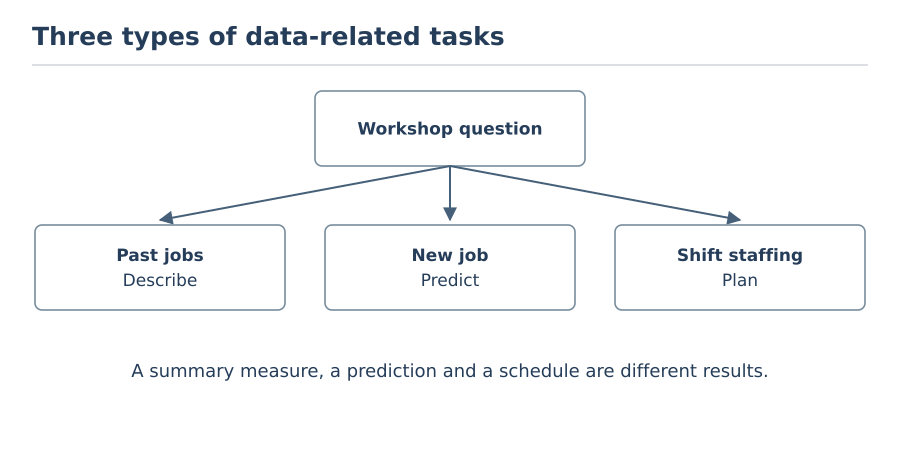

# M1-L1 – Data Science, AI and scientific questions {#L1}

**Course area:** M1 – Introduction to Data Science and AI

**Level:** Bachelor · Core/Fundamentals

**Prerequisites:** No prior course knowledge.

**Learning objective:** Distinguish statistics, data science, machine learning and AI by the tasks they address.

All workshop data are synthetic teaching examples.

## One workshop, several scientific questions {#S1}

A municipal bicycle repair workshop wants to reduce waiting times. It records the type of repair and the start and end times of the work. Several investigations can be developed from these data: How long do repairs take on average? How long is a new job likely to take? In what order should jobs be processed? The three questions require different methods. A correctly calculated mean is not yet a reliable prediction, and a prediction is not yet a work schedule.

## Four disciplinary perspectives {#S2}

*Figure: Three types of data-related tasks.*

Statistics develops methods for investigating data while accounting for how they were generated and for their uncertainty. Data science combines such methods with data acquisition, computer science and domain knowledge to develop sound insights or usable systems from data. Machine learning (ML) deals with methods whose behaviour is adapted through data or experience. AI investigates, among other things, how technical systems can perceive, reason, learn and select actions. These areas overlap; their boundaries are not defined uniformly everywhere.

| Task | Possible approach | Result |
|---|---|---|
| Summarise past durations | Descriptive statistics | Summary measure or distribution |
| Estimate the duration of a new job | Supervised learning | Prediction with error assessment |
| Determine the sequence of jobs | Search or optimisation | Feasible work schedule |

A learning method is not a prerequisite for every AI method: a search over possible work schedules can, for example, use fixed rules. Conversely, a statistical learning model need not act autonomously.

## From a question to a testable result {#S3}

An analysis is to determine the mean time spent actively working on the last four jobs. The invented values are 15, 25, 20 and 40 minutes. With $x_i$ denoting the duration of job $i$ and $n=4$, we obtain

$$\bar{x}=\frac{1}{n}\sum_{i=1}^{n}x_i=\frac{100}{4}=25\,\mathrm{min}.$$

The number describes only these four jobs. For a future repair, the type of damage would be relevant, for example. Even a model prediction of 25 minutes would first need to be tested on further cases. The scheduling decision additionally takes staffing and safety checks into account.

## Exercise and solution {#S4}

Classify three questions: (a) How many jobs involved brakes? (b) Is a duration of more than 30 minutes expected for a job that has not yet started? (c) Which combination of jobs fits into a shift? Name one criterion for assessing each result.

Solution: (a) is a descriptive question; the count must agree with the recorded jobs. (b) is a prediction; the error rate on previously unused cases is relevant. (c) is a scheduling question; a solution must in particular satisfy shift duration, work capacity and other constraints. No method automatically fulfils all three objectives.

## Limitations and next steps {#S5}

Data-driven methods are not automatically objective: selection, measurement, objectives and evaluation can influence the results. The next lesson therefore distinguishes data values, their meaning, models and decisions.

## Sources and further reading {#S6}

- [Poole/Mackworth, Artificial Intelligence: Foundations of Computational Agents, 3. ed. (2023), section 1.1 (HTML).](https://artint.info/3e/html/ArtInt3e.Ch1.S1.html) – **Verification:** pending; access date recorded only in source register (2026-11-20); substantive check not evidenced.
- [OpenIntro Statistics, 4. ed., ch. 1: Data basics, Data collection, Experiments (official contents and supplementary materials overview; no full-text review).](https://www.openintro.org/book/os/) – **Verification:** pending; access date recorded only in source register (2026-11-20); substantive check not evidenced.
