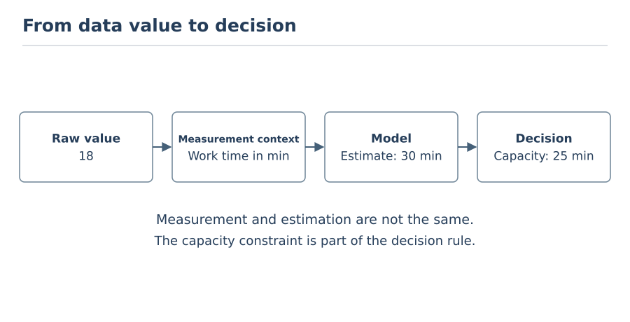

# M1-L2 – Data, information, models and decisions {#L2}

**Course area:** M1 – Introduction to Data Science and AI

**Level:** Bachelor · Core/Fundamentals

**Prerequisites:** [M1-L1](M1-L1.md).

**Learning objective:** Distinguish measurement context, model-based estimates and decision rules.

All workshop data are synthetic teaching examples.

## What does a number mean? {#S1}

The workshop stores the number 18 for a job. Without a unit and a measurement procedure, it is unclear whether it represents a duration, an identifier or something else. Even “18 minutes” is insufficient: the time since a bicycle was accepted may include waiting for spare parts; active repair time begins only when the work actually starts. If both quantities are mixed in the same column, a mean can be calculated, but its interpretation is no longer unambiguous.

A dataset requires a schema and a description of the variables collected. A data dictionary might specify, for example, that `arbeit_min` denotes the difference between the end and start of work in minutes and that interruptions are logged separately. A job identifier, in contrast, is used to retrieve a record and is not a measured quantity.

## A model is a purpose-specific simplification {#S2}

A model disregards certain properties of reality. A simple predictive model for the workshop might store the typical duration for each repair category. It therefore accounts for the category but not the condition of individual components. It must not be understood as a complete description of a job.

We use $x$ to denote features known in advance and $\hat y=f(x)$ for an estimated duration. The actually observed duration is denoted by $y$. The difference $y-\hat y$ is the signed prediction error: positive values here indicate an underestimate. For $y=36\,\mathrm{min}$ and $\hat y=30\,\mathrm{min}$, it is $6\,\mathrm{min}$. The hat denotes an estimate, not certainty.

## Estimation and action {#S3}

*Figure: From data value to decision.*

A workshop has 25 minutes left before a fixed handover deadline. The estimated duration of a job is 30 minutes. One possible rule is not to schedule the job within that period because $30>25$. This is a decision based on a prediction and a capacity constraint, not a new measurement. Depending on the uncertainty and the consequences of a delay, an additional safety margin may be appropriate.

## Exercise and solution {#S4}

Two jobs both have the stored value 18. For A, this is active working time in minutes; for B, it is waiting time in hours. Why must the values not be averaged? A third job was predicted to take 30 minutes but actually took 26 minutes. Calculate the error using the convention specified above.

Solution: A and B represent different variables; even conversion to the same unit does not make them the same measured quantity. For the third job, the error is $26-30=-4\,\mathrm{min}$. The model overestimated the duration by four minutes.

## Limitations and next steps {#S5}

Even an appropriate model does not decide which consequences are acceptable. These requirements belong to the domain-specific problem definition. To make results traceable, the definitions, model version and decision rule must be documented.

## Sources and further reading {#S6}

- [OpenIntro Statistics, 4. ed., ch. 1: Data basics, Data collection, Experiments (official contents and supplementary materials overview; no full-text review).](https://www.openintro.org/book/os/) – **Verification:** pending; access date recorded only in source register (2026-11-20); substantive check not evidenced.
- [Poole/Mackworth, Artificial Intelligence: Foundations of Computational Agents, 3. ed. (2023), section 1.1 (HTML).](https://artint.info/3e/html/ArtInt3e.Ch1.S1.html) – **Verification:** pending; access date recorded only in source register (2026-11-20); substantive check not evidenced.
