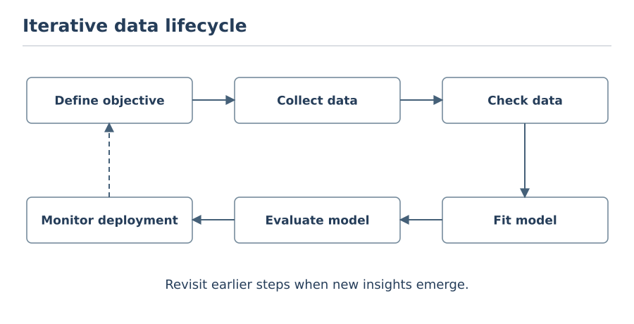

# M1-L3 – The data lifecycle and analytical workflows {#L3}

**Course area:** M1 – Introduction to Data Science and AI

**Level:** Bachelor · Core/Fundamentals

**Prerequisites:** [M1-L1](M1-L1.md) and [M1-L2](M1-L2.md).

**Learning objective:** Design an iterative data process and recognise data leakage.

All workshop data are synthetic teaching examples.

## Starting point: a usable prediction {#S1}

Before starting a repair, the workshop wants to estimate whether more than 30 minutes of work will be needed. Timing is crucial: features that become known only after completion are of no help in the intended use. The question therefore already determines which information is admissible as input and which results are useful.

## An iterative workflow {#S2}

*Figure: Iterative data lifecycle.*

First, the objective and measurement procedure are defined. Suitable data are then collected, their provenance documented and errors investigated. Next, a simple baseline model can be developed against which more complex methods can later be compared. Model evaluation uses data that were not used for fitting. Only when the results and risks are acceptable for the intended use can the model be deployed and monitored further.

A single pass is rarely sufficient: if information about spare-part availability is missing, for example, data acquisition must be improved. If predictions subsequently deteriorate, the causes may need to be investigated again. The workflow is therefore a loop with domain-specific feedback, not simply a sequence of software commands.

## Separating learning and evaluation {#S3}

A synthetic collection of 100 chronologically ordered jobs could be divided into 70 training cases, 15 validation cases and 15 test cases. Training fits the model; validation supports selection; testing provides the final independent performance estimate. When predicting future outcomes, a chronological split is often more informative than random mixing. The split is an example, not a universally applicable percentage requirement.

Data leakage occurs when information enters model development that will not be available during the intended use, or when information from evaluation data indirectly contributes to training. Here, the difference between the actual end and start times may be used as the target, but not as an input feature before the start. Likewise, a mean used to impute missing features must, for example, be learned from the training data alone.

## Exercise and solution {#S4}

An initial modelling attempt uses bicycle type, reported damage, actual completion time and the number of earlier repairs of that bicycle model. Which input is clearly inadmissible? What must be checked for the last variable?

Solution: Actual completion time is unknown before the repair. The number of earlier repairs is admissible only if it is actually available at prediction time; later jobs must not be included in the count. A new test should assess performance after the leakage has been removed.

## Limitations and next steps {#S5}

A test is only as informative as the data that represent its operating conditions. New repair types, changed workflows and rare cases may require further evaluation.

## Sources and further reading {#S6}

- [scikit-learn, Common pitfalls and recommended practices, section Data leakage (documentation).](https://scikit-learn.org/stable/common_pitfalls.html) – **Verification:** pending; access date recorded only in source register (2026-11-20); substantive check not evidenced.
- [Wickham/Çetinkaya-Rundel/Grolemund, R for Data Science, 2. ed., ch. 6, Scripts and projects.](https://r4ds.hadley.nz/workflow-scripts.html) – **Verification:** pending; access date recorded only in source register (2026-11-20); substantive check not evidenced.
