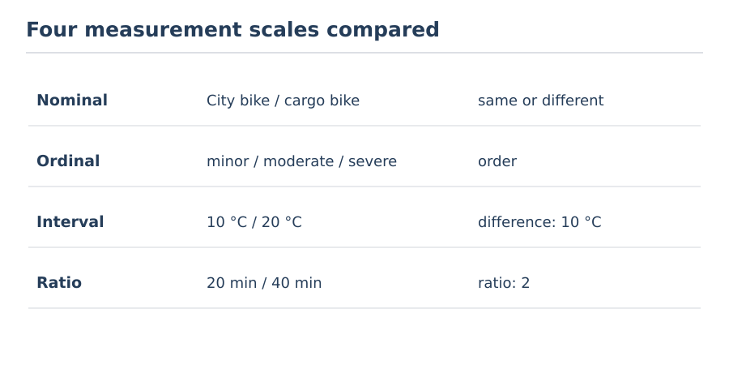

# M1-L4 – Data types, measurement scales and data representation {#L4}

**Course area:** M1 – Introduction to Data Science and AI

**Level:** Bachelor · Core/Fundamentals

**Prerequisites:** [M1-L2](M1-L2.md); basic arithmetic.

**Learning objective:** Distinguish data types and measurement scales and select meaningful operations.

All workshop data are synthetic teaching examples.

## Not every number is a quantity {#S1}

In the workshop, the identifier 102 represents a job. It is one greater than 101, but this makes the job neither larger nor more difficult. In contrast, 40 minutes of work really is twice the duration of 20 minutes. The numerical representation of a value alone therefore does not determine which mathematical statements are meaningful in the domain.

## Four measurement scales {#S2}

*Figure: Four measurement scales compared.*

| Scale | Workshop example | Meaningful statement |
|---|---|---|
| Nominal | Bicycle type: city bike, cargo bike | Same or different |
| Ordinal | Damage: minor, moderate, severe | Order, but not equal intervals |
| Interval | Outdoor temperature in °C | Difference, not ratio |
| Ratio | Working time in minutes | Difference and ratio with a positive denominator |

On an interval scale, equal intervals are comparable, but the zero point is conventional. There are ten degrees between 10 and 20 °C, just as there are between 20 and 30 °C. However, 20 °C is not twice the thermodynamic temperature of 10 °C. For working time, by contrast, zero minutes corresponds to a vanishing time interval. For 40 and 20 minutes, therefore, $40/20=2$.

## Storage and domain meaning {#S3}

A variable can be stored as text, an integer, a floating-point number, a Boolean value or a date, for example. The damage levels could be encoded as 1, 2 and 3. The encoding does not make them interval-scaled: it does not follow that the interval between minor and moderate is the same as that between moderate and severe.

Quantitative variables can be discrete or continuous. The number of jobs is discrete, whereas a time interval is continuous in the physical model used, even though a recording system may round it to whole minutes. The precision of the stored value and the modelled property must be distinguished.

For nominal variables, encoding individual categories with indicators can prevent an unintended ordering from being imposed on a learning method. Unknown values must be handled separately; they are not automatically an ordinary category.

## Exercise and solution {#S4}

Determine the scales for job identifier, priority (low/medium/high), outdoor temperature in Celsius and number of replaced spokes. Are 2 replaced spokes half as many as 4? May priority codes 1 and 3 be interpreted as meaning that the highest priority is three times the lowest?

Solution: Identifier: nominal; priority: ordinal; Celsius: interval scale; number of spokes: ratio scale and discrete. The comparison 2/4 is meaningful, but the ratio of the priority codes is not.

## Limitations and next steps {#S5}

The appropriate statistical method also depends on the research question, the distribution and the assumptions. The measurement scale alone does not prescribe a complete analytical procedure.

## Sources and further reading {#S6}

- [OpenIntro Statistics, 4. ed., ch. 1: Data basics, Data collection, Experiments (official contents and supplementary materials overview; no full-text review).](https://www.openintro.org/book/os/) – **Verification:** pending; access date recorded only in source register (2026-11-20); substantive check not evidenced.
- [OpenStax, Introductory Statistics, section 1.3: Levels of Measurement (search excerpt).](https://openstax.org/books/introductory-statistics/pages/1-3-frequency-frequency-tables-and-levels-of-measurement) – **Verification:** pending; access date recorded only in source register (2026-11-20); substantive check not evidenced.
