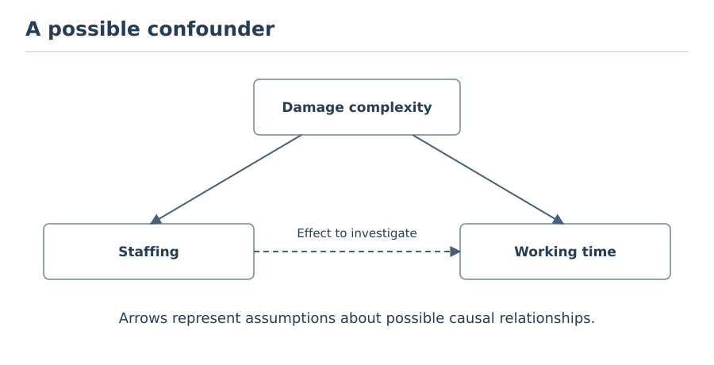

# M1-L5 – Gaining insights, prediction and causal questions {#L5}

**Course area:** M1 – Introduction to Data Science and AI

**Level:** Bachelor · Core/Fundamentals

**Prerequisites:** [M1-L1](M1-L1.md) to [M1-L4](M1-L4.md).

**Learning objective:** Distinguish description, prediction and causal effects using an example.

All workshop data are synthetic teaching examples.

## When an association points in the wrong direction {#S1}

The workshop observes that cases with two mechanics take longer on average than cases with one person. One might hastily conclude that additional staff slow down repairs. In fact, complex damage may be more frequently handled by two people. Staffing is then related to the damage, and the damage also influences the duration.

## Three different questions {#S2}

A descriptive question investigates which differences exist in the available data. A prediction question asks how well an unknown duration can be estimated from available features. A causal question, by contrast, investigates how the duration would change if staffing were deliberately altered. The intended intervention must be unambiguous: for example, a second qualified person working on the same repair from the outset.

## A synthetic example {#S3}

*Figure: A possible confounder.*

| Damage class | One person: cases × duration | Two people: cases × duration |
|---|---:|---:|
| Simple | 8 × 20 min | 2 × 15 min |
| Complex | 2 × 60 min | 8 × 50 min |

The mean duration with one person is $(8\cdot20+2\cdot60)/10=28$ minutes; with two people it is $(2\cdot15+8\cdot50)/10=43$ minutes. Within both damage classes, the second group is faster in these constructed data. Because complex cases predominate in the second group, the observed difference reverses when the data are aggregated. This illustrates an aggregation reversal, but does not prove an actual causal effect.

A directed causal graph can express the assumed structure: damage complexity influences staffing and duration; an additional arrow from staffing to duration indicates the causal pathway under investigation. Such a graph is a domain-specific assumption, not an automatic inference from the table. Unobserved influences remain possible.

## How can an effect be investigated? {#S4}

If organisationally feasible and safe, comparable repairs could be randomly assigned to one of two permissible staffing arrangements. Randomisation counteracts systematic differences between groups; chance imbalances may still occur in small samples. Analysing purely observational data requires additional assumptions and appropriate methods.

## Exercise and solution {#S5}

Name the possible confounder in the example. Explain why the unadjusted mean does not permit a causal conclusion and identify one other possible influence.

Solution: Damage complexity plausibly influences both staffing allocation and duration. Differences in its frequency distort a direct comparison between groups. Qualifications, spare-part availability or available tools may also be relevant. A good prediction alone does not answer the intervention question.

## Sources and further reading {#S6}

- [OpenIntro Statistics, 4. ed., ch. 1: Data basics, Data collection, Experiments (official contents and supplementary materials overview; no full-text review).](https://www.openintro.org/book/os/) – **Verification:** pending; access date recorded only in source register (2026-11-20); substantive check not evidenced.
- [Hernán/Robins, Causal Inference: What If, authors’ website (Parts I–III); further reading, no complete chapter comparison.](https://miguelhernan.org/whatifbook) – **Verification:** pending; access date recorded only in source register (2026-11-20); substantive check not evidenced.
