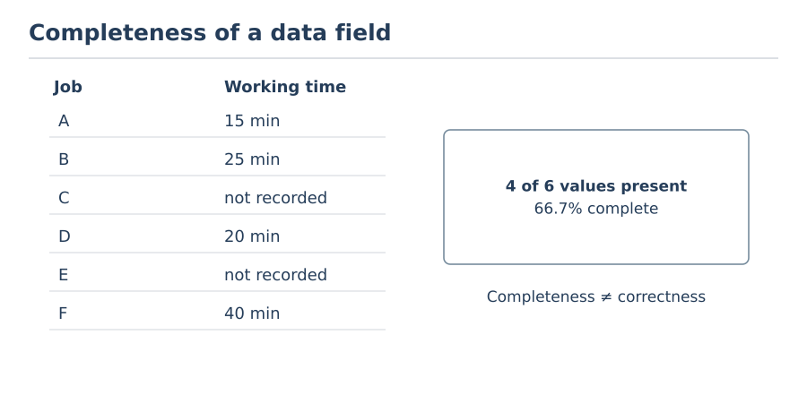

# M1-L6 – Data quality, documentation and reproducibility {#L6}

**Course area:** M1 – Introduction to Data Science and AI

**Level:** Bachelor · Core/Fundamentals

**Prerequisites:** [M1-L1](M1-L1.md) to [M1-L5](M1-L5.md).

**Learning objective:** Make data quality measurable and plan a repeatable analysis.

All workshop data are synthetic teaching examples.

## Data quality begins with collection {#S1}

Six fictitious repair jobs contain a column for working time. Four values are present; two entries are missing. A missing value must not be silently replaced with zero, because zero would be a measured duration. The cause of missingness is also important: if it is mainly very long jobs that have not yet been completed that are missing, a complete-case analysis may underestimate working time.

## Quality dimensions illustrated {#S2}

*Figure: Completeness of a data field.*

| Job | Working time (min) |
|---|---:|
| A | 15 |
| B | 25 |
| C | not recorded |
| D | 20 |
| E | not recorded |
| F | 40 |

Field-level completeness is the proportion of expected entries that are present. With $n=6$ expected and $m=4$ present entries, we obtain:

$$q=\frac{m}{n}=\frac{4}{6}\approx 0.667.$$

Thus, 66.7% of the expected duration values are present. This measure does not indicate whether the four values are correct. A validity check examines, for example, whether the duration is numeric and non-negative. Plausibility checks look for unusual but not necessarily incorrect values. Consistency checks compare related fields, such as the start and end of a job. Provenance documents the source, timing and processing of the data.

The mean of the four available values is $100/4=25$ minutes. This is the mean of the observed cases, not necessarily the mean of all six jobs. If both missing values were 70 minutes, the complete mean would be $240/6=40$ minutes. This hypothetical comparison shows why a missing number must not be filled in without assumptions.

## Repeatable analysis {#S3}

A traceable analysis requires an unambiguously identified input file, documented measurement definitions, processing steps, software versions and execution conditions. Raw data remain unchanged; cleaned data are derived from them. For randomised methods, settings including the random seeds used are documented to the extent necessary for repetition. A checksum can help detect whether an input file has changed.

Computational reproducibility here refers to the ability to obtain consistent results using the same data and the same documented processing steps. Replication investigates the same scientific question with newly collected data. The two objectives are different; a reproducible calculation error is still an error.

## Exercise and solution {#S4}

The missing entries are replaced with zero. What mean results? Why is the analysis problematic? Name three things another person would need to repeat the analysis.

Solution: The mean would be $100/6\approx16.7$ minutes. It relies on two invented zero measurements and is unjustified as a complete mean. The original data file, the documented calculation steps and the software environment used are needed, for example.

## Next steps {#S5}

This establishes the foundations for the subsequent modules. Next, data and models will be described mathematically; measurement context and quality continue to be essential.

## Sources and further reading {#S6}

- [Wickham/Çetinkaya-Rundel/Grolemund, R for Data Science, 2. ed., ch. 6, Scripts and projects.](https://r4ds.hadley.nz/workflow-scripts.html) – **Verification:** pending; access date recorded only in source register (2026-11-20); substantive check not evidenced.
- [National Academies, Reproducibility and Replicability in Science (2019), Summary.](https://www.nationalacademies.org/read/25303/chapter/3) – **Verification:** pending; access date recorded only in source register (2026-11-20); substantive check not evidenced.
