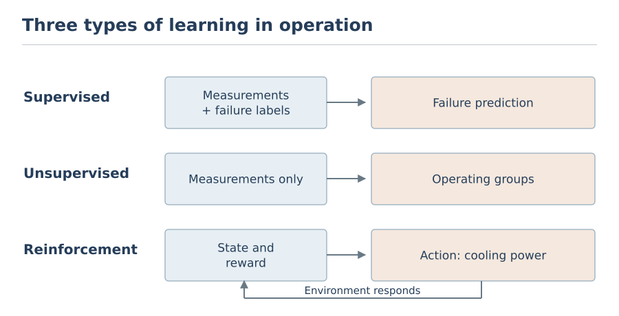

# M10-L1 – Supervised, unsupervised and reinforcement learning {#L1}

**Course area:** M10 – Foundations of machine learning

**Level:** Bachelor · Core/foundations

**Prerequisites:** [M1-L1](M1-L1.md), M4, [M8-L1](M8-L1.md).

**Learning objective:** Distinguish learning tasks by their feedback and objectives and formulate suitable applications.

## From a rule to a learnable task {#S1}

A company wants to detect the failure of a cooling unit early. A hard-coded rule triggers an alarm at temperatures above 80 °C. A learning model, by contrast, can infer relationships between load, temperature patterns and subsequent faults from historical measurements. The choice of model family, data and learning objective shapes the model. It is neither an independent authority on knowledge nor necessarily a neural network.

## Three forms of feedback {#S2}

*Figure: Three types of learning in operation.*

In supervised learning, examples $(x_i,y_i)$ consist of features and target values. Classification predicts a category, such as failure within 24 hours (yes/no). Regression estimates a numerical value, such as remaining operating hours. In classification, the model may first output a probability before a decision is made.

Unsupervised learning operates without the prescribed target variable. It searches for structures in the measurement vectors $x_i$, such as groups of similar operating states or a small number of informative coordinates. A cluster does not automatically correspond to a real fault type. The assignment requires specialist assessment.

In reinforcement learning, an agent interacts with an environment. It receives a state (or an observation), chooses an action and receives feedback in the form of a reward. The strategy, also called a policy, specifies how actions are selected. The objective may be the expected discounted return:

$$G_t=\sum_{k=0}^{T-t-1}\gamma^k r_{t+k+1},\qquad 0\le\gamma\le1.$$

For a finite episode with end time $T$ and rewards $r$, $\gamma$ weights later rewards. Unlike one-off classification, actions often change future observations. The diagram compares the different information flows using the cooling unit as an example.

## Hybrid forms and choice of learning task {#S3}

Self-supervised learning constructs targets from raw data, for example by predicting a masked sensor measurement from its surroundings. Semi-supervised learning combines a small number of labelled examples with many unlabelled ones. An unsupervised method can generate features for a subsequent supervised model. What matters, therefore, is the function of a learning step, not merely the label of the entire system.

Predicting a cooling failure is different from controlling the cooling system. Control also involves energy consumption, safety limits and delayed effects. A deployed policy must comply with permissible actions; merely maximising the reward does not guarantee a safe installation.

## Exercise and solution {#S4}

An agent receives 2, 0 and 4 reward points in sequence with $\gamma=0.5$. Calculate the return at the start. Solution: $2+0.5\cdot0+0.5^2\cdot4=3$. For $\gamma=1$, it is 6. A dataset of previously measured temperatures and fault classes, by contrast, would form the basis for supervised learning; a dataset containing only temperature patterns could be used for cluster analysis.

## Sources and further reading {#S5}

- [Google: What is Machine Learning?](https://developers.google.com/machine-learning/intro-to-ml/what-is-ml) – **Verification:** pending.
- [Sutton/Barto: Reinforcement Learning, 2nd edition (2018)](https://mitpress.mit.edu/9780262039246/reinforcement-learning/) – **Verification:** pending.
- [James et al.: An Introduction to Statistical Learning with Applications in Python (2023)](https://www.statlearning.com/) – **Verification:** pending.
