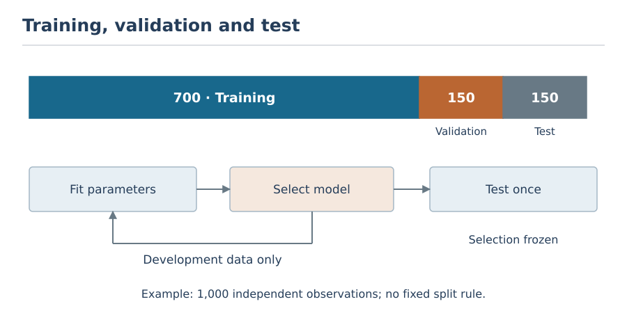

# M10-L2 – Training, validation and test data {#L2}

**Course area:** M10 – Foundations of machine learning

**Level:** Bachelor · Core/foundations

**Prerequisites:** M3, M5, M6, [M10-L1](M10-L1.md).

**Learning objective:** Split datasets appropriately for the deployment scenario and distinguish the three subsets by their functions.

## Why a good training score is insufficient {#S1}

A model is intended to predict the remaining operating time of devices from measurements. The observed examples are used to determine its parameters. How well this prediction rule works on other devices cannot be reliably assessed using the same observations. Even a method without a meaningful rule could memorise the known targets and achieve a training error of zero.

## Three distinct tasks {#S2}




*Figure: Training, validation and test.*

One possible split of 1,000 independent observations is 700 for training, 150 for validation and 150 for final testing. These sizes are a teaching example, not a general prescription. Training estimates model parameters. Validation supports decisions about the model family, features, regularisation and other settings. The test is used only after the selection has been finalised. If optimisation resumes after a poor test score, that test has effectively become a validation set.

The diagram shows the 70/15/15 per cent split and the permitted information flows. After selection, a model can be refitted on the training and validation data; the test remains unchanged. Before deployment, it is also necessary to check whether the sample adequately represents the intended application.

## The unit of splitting {#S3}

When there are several measurements per device, rows from the same device are often highly similar. If the aim is to assess a new device, its rows must be assigned together to exactly one subset. For prediction into the future, temporal boundaries are more suitable; all features must be available at prediction time. Overlapping time windows or targets collected later may require an additional gap around the split boundaries. For independent classification examples, stratified sampling helps keep class proportions approximately stable. It does not replace group-based or temporal splitting.

```python
import numpy as np
from sklearn.model_selection import GroupShuffleSplit
ids = np.repeat(np.arange(20), 5)
X = np.arange(100).reshape(-1, 1)
tr, rest = next(GroupShuffleSplit(n_splits=1, test_size=.3,
                                 random_state=12).split(X, groups=ids))
v, t = next(GroupShuffleSplit(n_splits=1, test_size=.5,
                              random_state=13).split(X[rest], groups=ids[rest]))
val, test = rest[v], rest[t]
sets = [set(ids[i]) for i in (tr, val, test)]
assert [len(i) for i in sets] == [14, 3, 3]
assert all(not a & b for j, a in enumerate(sets) for b in sets[j+1:])
```

The random seeds make the particular split reproducible. With few groups, however, the performance estimate remains uncertain; further group-based assessments may be useful.

## Exercise and solution {#S4}

A camera produces ten almost identical images per product. The aim is to recognise previously unseen products. Why is a random image-level split risky? Solution: images of the same product can end up on both sides; generalisation to new products is consequently overestimated. Group by product ID, not image number.

## Sources and further reading {#S5}

- [Google: Datasets – Dividing the original dataset](https://developers.google.com/machine-learning/crash-course/overfitting/dividing-datasets) – **Verification:** pending.
- [scikit-learn: Common pitfalls and recommended practices](https://scikit-learn.org/stable/common_pitfalls.html) – **Verification:** pending.
- [scikit-learn: Cross-validation](https://scikit-learn.org/stable/modules/cross_validation.html) – **Verification:** pending.
