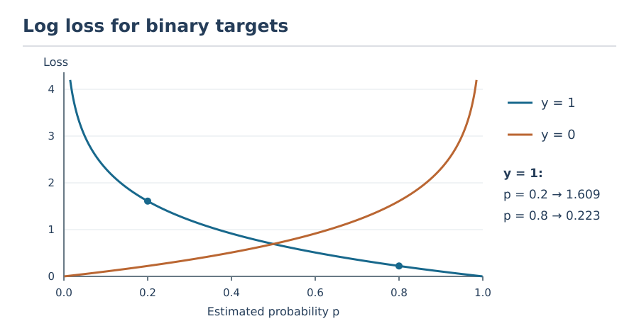

# M10-L3 – Loss functions and empirical risk {#L3}

**Course area:** M10 – Foundations of machine learning

**Level:** Bachelor · Core/foundations

**Prerequisites:** M4, [M8-L3](M8-L3.md), [M9-L2](M9-L2.md), [M10-L2](M10-L2.md).

**Learning objective:** Calculate losses, distinguish empirical from expected risk and explain the role of regularisation.

## Loss as a mathematical learning objective {#S1}




*Figure: Log loss for binary targets.*

A loss function $\ell(y,f_\theta(x))$ assigns a numerical assessment to a prediction $f_\theta(x)$. For remaining operating times in hours, absolute deviations are easy to interpret; squared deviations penalise larger errors more strongly. For a binary target variable $y\in\{0,1\}$ and an estimated probability $p\in(0,1)$, the logarithmic loss is

$$\ell(y,p)=-y\ln p-(1-y)\ln(1-p).$$

A wrong, highly confident prediction therefore costs considerably more than an uncertain one. For $y=1$ and $p=0.8$, the loss is about 0.223; for $p=0.2$, about 1.609. The diagram shows the two loss curves. In numerical code, stable calculations from logits are preferable; otherwise, the boundary cases zero and one can lead to undefined logarithms.

## Sample and target population {#S2}

The expected risk of a specified prediction rule is $R(\theta)=\mathbb E[\ell(Y,f_\theta(X))]$. Since the joint distribution of $X$ and $Y$ is usually unknown, the available sample is used:

$$\widehat R_n(\theta)=\frac1n\sum_{i=1}^n\ell(y_i,f_\theta(x_i)),\qquad \hat\theta\in\arg\min_{\theta\in\Theta}\widehat R_n(\theta).$$

The minimum depends on the model class $\Theta$ and the sample. For a rule specified in advance, the sample mean is an unbiased estimate of the risk for identically distributed observations with finite expectation. After selecting a minimiser on the same dataset, the training score is generally too optimistic. This is why the evaluation data from [M10-L2](M10-L2.md) are necessary.

## Choosing a practical objective {#S3}

Classification error with 0/1 loss is piecewise constant and poorly suited to many optimisation methods. A differentiable surrogate loss such as log loss, by contrast, provides continuous feedback. Regularisation supplements the objective function, for example with $\lambda\|\theta\|_2^2$ where $\lambda\ge0$ (see [M8-L7](M8-L7.md)). The value of $\lambda$ is selected using validation. The training objective and operational evaluation metric may differ, but must be appropriate for the same task.

```python
import numpy as np
y = np.array([1, 0, 1]); p = np.array([.8, .3, .6])
loss = -(y*np.log(p) + (1-y)*np.log1p(-p))
assert np.isclose(loss.mean(), -np.log(.8*.7*.6)/3)
```

## Exercise and solution {#S4}

Two models have errors in hours of $(0,0,6)$ and $(2,2,2)$. Compare mean absolute error and mean squared error. Solution: the mean absolute error is 2 h for both, while the mean squared errors are 12 h² and 4 h². If extreme deviations are to be weighted more heavily, the second model is preferable here.

## Sources and further reading {#S5}

- [CMU: Empirical Risk Minimization (2021)](https://stat.cmu.edu/~cshalizi/sml/21/lectures/03/lecture-03.html) – **Verification:** pending.
- [scikit-learn: Metrics and scoring](https://scikit-learn.org/stable/modules/model_evaluation.html) – **Verification:** pending.
- [James et al.: An Introduction to Statistical Learning with Applications in Python (2023)](https://www.statlearning.com/) – **Verification:** pending.
