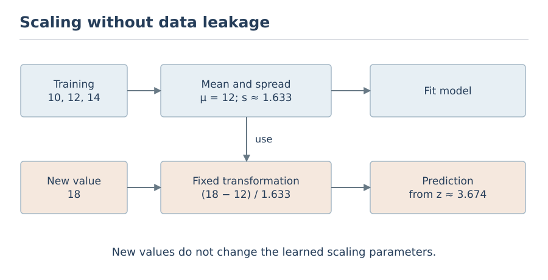

# M10-L4 – Feature engineering, scaling and data leakage {#L4}

**Course area:** M10 – Foundations of machine learning

**Level:** Bachelor · Core/foundations

**Prerequisites:** M3, M5, [M10-L2](M10-L2.md).

**Learning objective:** Construct features from available raw data and create a leakage-free processing pipeline.

## Representing a situation {#S1}

A cooling unit reports temperature and power consumption every minute. Instead of a long sequence of individual values, the mean, maximum and slope over the last hour can serve as features. This choice changes what a model can detect. If future measurements are used in a symmetric time window, the feature is inadmissible for real-time prediction. The feature definition must therefore specify its relationship to the query time.

## Scaling and learned transformations {#S2}

For a numerical feature, let $\mu_{\mathrm{train}}$ be the mean and $s_{\mathrm{train}}$ the standard deviation of the training values. Standardisation is given by

$$z=\frac{x-\mu_{\mathrm{train}}}{s_{\mathrm{train}}}.$$

Here we use the empirical variance with divisor $n$. For the training values 10, 12 and 14, $\mu=12$ and $s=\sqrt{8/3}\approx1.633$. A later value of 18 becomes $z\approx3.674$. It need not lie within the earlier range. For a constant column, $s=0$; a defined special treatment is necessary. Models based on distances or regularisation are often sensitive to scaling; tree-based methods usually do not require it. The units and interpretability of the raw features are retained in the data contract.

## Data leakage and pipelines {#S3}




*Figure: Scaling without data leakage.*

Leakage occurs, for example, when a workshop diagnosis made after failure is used as an input to predict that failure. Imputation, feature selection based on targets, dimensionality reduction and scaling must likewise not be fitted using validation or test data. The diagram shows the split taking place before the transformation is fitted. In cross-validation ([M10-L6](M10-L6.md)), the entire pipeline is refitted in each round.

```python
import numpy as np
from sklearn.preprocessing import StandardScaler
from sklearn.pipeline import make_pipeline
from sklearn.linear_model import Ridge
X = np.array([[10.], [12.], [14.]])
y = np.array([5., 4., 3.])
pipe = make_pipeline(StandardScaler(), Ridge(alpha=1.))
pipe.fit(X, y)
z = pipe[0].transform([[18.]])[0, 0]
assert np.isclose(z, 6/np.sqrt(8/3))
assert np.isclose(pipe[0].mean_[0], 12.)
```

Categorical data can be encoded as indicator columns; previously unseen categories require a defined treatment. Missing values can themselves carry information about measurement failures. The chosen rule must be consistent between training and deployment. A pipeline does not automatically detect a feature that is inadmissible for domain-specific reasons.

## Exercise and solution {#S4}

A table contains service age, temperature and repair costs recorded only after a failure. Which values are suitable for prediction before failure? Solution: age and temperature measured up to that point are in principle suitable; later repair costs are not. Highly correlated features can be suspicious for precisely this reason.

## Sources and further reading {#S5}

- [scikit-learn: Common pitfalls and recommended practices](https://scikit-learn.org/stable/common_pitfalls.html) – **Verification:** pending.
- [scikit-learn: Cross-validation](https://scikit-learn.org/stable/modules/cross_validation.html) – **Verification:** pending.
