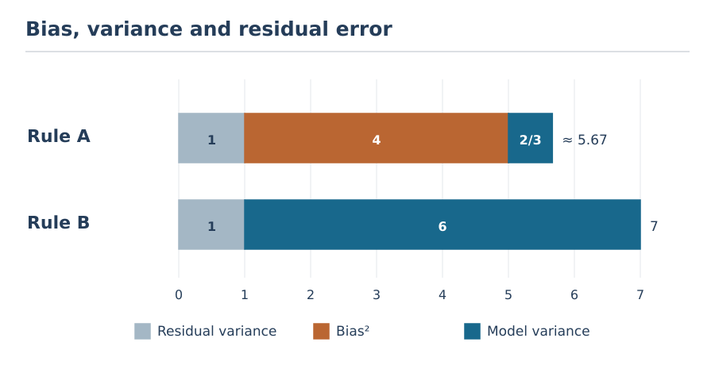

# M10-L5 – The bias–variance trade-off and generalisation {#L5}

**Course area:** M10 – Foundations of machine learning

**Level:** Bachelor · Core/foundations

**Prerequisites:** [M4-L2](M4-L2.md), M6, M8, [M10-L3](M10-L3.md).

**Learning objective:** Derive the squared-error decomposition and assess the influence of bias and variance using an example.

## Two distinct causes of poor predictions {#S1}

An overly simple model of the relationship between outside temperature and cooling performance may consistently produce similar but systematically incorrect values. A highly flexible model, by contrast, may change considerably when data collection is repeated. Systematic deviation and sensitivity to the choice of sample are distinct properties of a learning method.

## Decomposing expected squared error {#S2}

For a fixed input $x$, let $m(x)=\mathbb E[Y\mid X=x]$ and $\sigma^2(x)=\operatorname{Var}(Y\mid X=x)$. Denote the rule learned from random training data $D$ by $f_D$. Let a new target value be independent of $D$ for fixed $x$. With $\bar f(x)=\mathbb E_D[f_D(x)]$, the following holds for finite second moments:

$$\mathbb E_{D,Y\mid x}[(Y-f_D(x))^2]=\sigma^2(x)+(m(x)-\bar f(x))^2+\operatorname{Var}_D(f_D(x)).$$

To derive this, decompose $Y-f_D=(Y-m)+(m-\bar f)+(\bar f-f_D)$. When squaring, the mixed expectations vanish: the first and third terms in brackets have expectation zero and are independent given $x$. The three remaining terms are the conditional residual variance, squared systematic deviation (bias²) and model variance. Further averaging over the inputs yields an overall statement. This particular identity does not apply unchanged to other losses.

## Comparing two learning rules {#S3}

*Figure: Bias, variance and residual error.*

With $m(x)=10$ and $\sigma^2(x)=1$, rule A produces 7, 8 and 9 in three equally likely training situations. Its mean is 8, its bias² is 4 and its variance is $2/3$. Rule B produces 7, 10 and 13. Its mean is 10, bias² is zero and variance is 6. The expected squared errors are therefore $17/3\approx5.67$ and 7. The diagram compares the same synthetic situations.

Flexibility can decrease bias and increase variance, but a U-shaped error curve is not a universal law. Data volume, regularisation and the learning algorithm affect both components. Empirically, large differences between training and validation errors often indicate generalisation problems; however, data shift or poor data quality can produce similar patterns. Without knowledge of the true data distribution, the three terms cannot be measured directly and exactly.

## Exercise and solution {#S4}

A third rule always produces 11 regardless of the sample. Calculate the expected error at the same input. Solution: $1+(10-11)^2+0=2$. At this single point it is better than the other rules. Whether this holds over the entire input space remains open.

## Sources and further reading {#S5}

- [University of Toronto CSC311: Bias-Variance Decomposition](https://www.teach.cs.toronto.edu/~csc311notes/bias_variance_decomposition/bv.html) – **Verification:** pending.
- [James et al.: An Introduction to Statistical Learning with Applications in Python (2023)](https://www.statlearning.com/) – **Verification:** pending.
