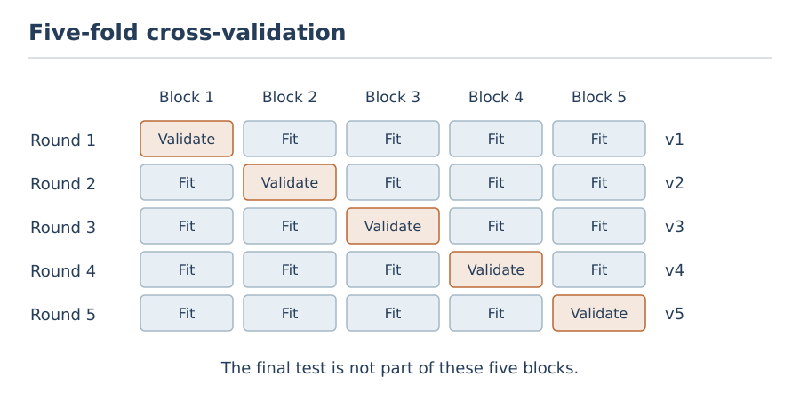

# M10-L6 – Cross-validation and hyperparameter search {#L6}

**Course area:** M10 – Foundations of machine learning

**Level:** Bachelor · Core/foundations

**Prerequisites:** [M10-L2](M10-L2.md) to [M10-L5](M10-L5.md).

**Learning objective:** Perform k-fold cross-validation and select hyperparameters without using the final test.

## Repeated evaluation with limited data {#S1}

A single validation sample may happen to contain particularly easy cases. In k-fold cross-validation, the development data are divided into $k$ disjoint blocks. On each run, one block is held out for validation and the model is trained anew on the remaining blocks. Each block is used for validation exactly once. A separate test is used only at the end.

## Folds and comparison measures {#S2}




*Figure: Five-fold cross-validation.*

With five equally sized folds, each model yields five validation scores $v_1,\ldots,v_5$. Their arithmetic mean is $\bar v=k^{-1}\sum_j v_j$. For unequal block sizes, aggregation must suit the objective: for an average loss per observation, weights can reflect the number of cases; for equal weighting of sites, a group mean is conceivable instead. Non-linear measures such as F1 calculated on pooled predictions can differ from the mean of individual F1 scores. The diagram shows five equally sized folds with their changing roles.

## Hyperparameters and selection bias {#S3}

Parameters arise during fitting; hyperparameters specify how fitting takes place, such as the strength of ridge regularisation or tree depth. A grid search checks all combinations specified in advance. A random search draws combinations from a search space and may be more economical in many dimensions. Each variant must be evaluated on the same splits. All learned preprocessing steps belong in the pipeline.

```python
import numpy as np
from sklearn.model_selection import KFold, GridSearchCV
from sklearn.pipeline import make_pipeline
from sklearn.preprocessing import StandardScaler
from sklearn.linear_model import Ridge
x = np.linspace(-2, 2, 40).reshape(-1, 1)
y = 3*x[:, 0] + .2*np.sin(9*x[:, 0])
pipe = make_pipeline(StandardScaler(), Ridge())
cv = KFold(5, shuffle=True, random_state=20)
search = GridSearchCV(pipe, {'ridge__alpha': [.01, .1, 1., 10.]},
                      cv=cv, scoring='neg_mean_squared_error')
search.fit(x, y)
assert len(search.cv_results_['mean_test_score']) == 4
assert search.best_params_['ridge__alpha'] in [.01, .1, 1., 10.]
```

The negative MSE follows the API convention that higher scores are better. The four candidates require 20 fold fits and, with the default refit, one additional fit. The best internal score is not an independent final assessment. Without a separate test, nested cross-validation can evaluate the entire selection procedure in outer folds. For temporal and grouped data, the inner split must also account for these dependencies. The fold scores are dependent because of overlapping training sets; their standard deviation is not a directly valid estimate of the standard error.

## Exercise and solution {#S4}

Three candidates each have four validation errors: A=(3,4,2,3), B=(2,3,3,2), C=(1,6,1,6). Which has the smallest mean? Solution: A=3, B=2.5, C=3.5. B wins according to the specified criterion; independent evaluation is still missing.

## Sources and further reading {#S5}

- [scikit-learn: Cross-validation](https://scikit-learn.org/stable/modules/cross_validation.html) – **Verification:** pending.
- [scikit-learn: Tuning the hyper-parameters](https://scikit-learn.org/stable/modules/grid_search.html) – **Verification:** pending.
- [scikit-learn: Common pitfalls and recommended practices](https://scikit-learn.org/stable/common_pitfalls.html) – **Verification:** pending.
