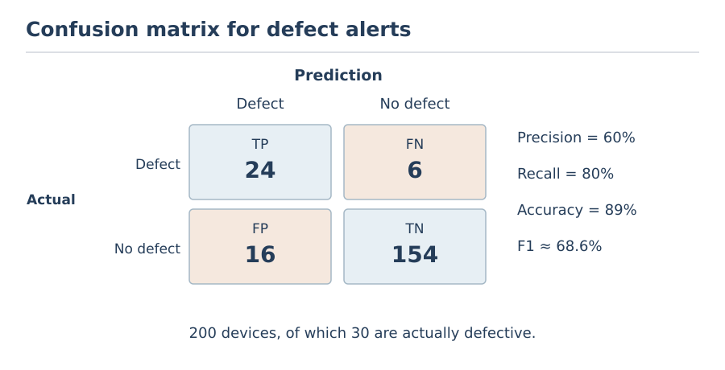

# M10-L7 – Classification metrics and decision thresholds {#L7}

**Course area:** M10 – Foundations of machine learning

**Level:** Bachelor · Core/foundations

**Prerequisites:** M4, M6, [M10-L3](M10-L3.md), [M10-L6](M10-L6.md).

**Learning objective:** Calculate confusion matrices and classification metrics and relate decision thresholds to error costs.

## Four possible outcomes {#S1}

A model flags potentially defective devices before maintenance. Positive here means actually defective. A correct warning is TP, a false warning FP, a missed defect FN and a device correctly not flagged TN. The confusion matrix arranges these categories by actual and predicted state. Changing the positive class changes several metrics; the class must therefore always be specified.

## Comparing metrics {#S2}




*Figure: Confusion matrix for defect alerts.*

For 200 devices, suppose there are 24 TP, 16 FP, 6 FN and 154 TN (see diagram). Overall accuracy is $(24+154)/200=0.89$. Other metrics are

$$\text{Precision}=\frac{TP}{TP+FP}=0.60,\qquad \text{Recall}=\frac{TP}{TP+FN}=0.80,$$

$$\text{Specificity}=\frac{TN}{TN+FP}=\frac{154}{170}\approx0.906,\qquad F_1=\frac{2TP}{2TP+FP+FN}=\frac{48}{70}\approx0.686.$$

Balanced accuracy is the mean of recall and specificity, approximately 0.853 here. A model making exclusively negative predictions already achieves 85% ordinary accuracy, but no positive recall. If the denominator is zero, the corresponding rate is undefined; software output conventions must be documented explicitly.

## Thresholds and decisions {#S3}

For a predicted defect probability $p$, a threshold $\tau$ determines when a warning is issued. With correctly calibrated probabilities, constant costs $C_{FP}$ and $C_{FN}$ and zero cost for correct decisions, the warning is cheaper if $(1-p)C_{FP}\le pC_{FN}$. It follows that $\tau=C_{FP}/(C_{FP}+C_{FN})$. With a cost of 20 euros for a false alarm and 180 euros for a missed defect, the threshold is 0.1. Capacity constraints and additional costs may require a different decision rule.

An ROC curve plots recall against the false positive rate $FP/(FP+TN)$ for different thresholds. A precision–recall curve shows the quality of positive assignments; its baseline depends strongly on class prevalence. ROC AUC measures ranking, not probability calibration. The threshold is set using development data, not on the basis of subsequent test results.

```python
import numpy as np
from sklearn.metrics import confusion_matrix, f1_score, balanced_accuracy_score
y = [1]*30 + [0]*170
pred = [1]*24 + [0]*6 + [1]*16 + [0]*154
assert confusion_matrix(y, pred, labels=[0,1]).tolist() == [[154,16],[6,24]]
assert np.isclose(f1_score(y,pred),48/70)
assert np.isclose(balanced_accuracy_score(y,pred),(.8+154/170)/2)
```

## Exercise and solution {#S4}

With a lower threshold, warnings are additionally issued for four previously missed defects and twelve previously correctly unflagged devices. Solution: TP=28, FN=2, FP=28, TN=142; recall=28/30, precision=28/56=0.5. At the costs above, total error costs decrease from 1,400 to 920 euros.

## Sources and further reading {#S5}

- [scikit-learn: Metrics and scoring](https://scikit-learn.org/stable/modules/model_evaluation.html) – **Verification:** pending.
- [CMU: Empirical Risk Minimization (2021)](https://stat.cmu.edu/~cshalizi/sml/21/lectures/03/lecture-03.html) – **Verification:** pending.
