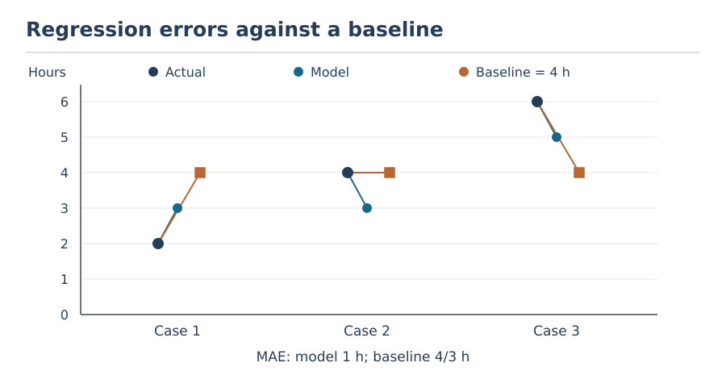

# M10-L8 – Regression metrics and baselines {#L8}

**Course area:** M10 – Foundations of machine learning

**Level:** Bachelor · Core/foundations

**Prerequisites:** M5, M8, [M10-L3](M10-L3.md), [M10-L6](M10-L6.md).

**Learning objective:** Interpret regression metrics with their units and assess a model against an admissible baseline.

## Which errors matter in practice? {#S1}

A service predicts repair duration $\hat y_i$ in hours. For $n$ observed values $y_i$ and residuals $e_i=y_i-\hat y_i$, commonly used metrics are:

$$\mathrm{MAE}=\frac1n\sum_i|e_i|,\quad \mathrm{MSE}=\frac1n\sum_i e_i^2,\quad \mathrm{RMSE}=\sqrt{\mathrm{MSE}}.$$

MAE and RMSE have the unit of the target value, whereas MSE has the squared unit. RMSE is more sensitive to individual large errors. The mean of signed residuals indicates possible systematic underestimation or overestimation; positive and negative errors can cancel each other out. Analysis by device group and load range supplements the overall score.

## Comparing the same cases {#S2}




*Figure: Regression errors against a baseline.*

Three repairs actually take 2, 4 and 6 hours. A model predicts 3, 3 and 5 hours. A comparison model always predicts 4 hours; assume that this value is already known from the training data. The diagram shows all deviations. For the model, MAE=1 h and RMSE=1 h. For the constant baseline, MAE=4/3 h and RMSE=$\sqrt{8/3}\approx1.633$ h.

A dimensionless measure is

$$R^2=1-\frac{\sum_i(y_i-\hat y_i)^2}{\sum_i(y_i-\bar y)^2}.$$

Here $\bar y$ is the mean of the actual evaluation values. In the example, numerator and denominator are 3 and 8, so $R^2=0.625$. The measure can become negative on new data if the sum of squared errors exceeds that of the constant evaluation-set mean. For constant targets, the denominator is zero. The evaluation-set mean in the mathematical reference measure must not be confused with a prediction admissible in operation.

## Baselines before complex models {#S3}

For squared loss, the training mean is the optimal constant estimate on the training data; for absolute loss, it is the median. For time-ordered data, the last available observation or the value from the previous season may be more appropriate. Every baseline must use the same information cutoff and evaluation cases. A percentage error such as MAPE is undefined when the target value is zero and often of little significance when magnitudes are very small. MAE is frequently easier to interpret in these cases.

```python
import numpy as np
from sklearn.metrics import mean_absolute_error, mean_squared_error, r2_score
y = np.array([2.,4.,6.]); pred = np.array([3.,3.,5.])
base = np.full(3,4.)  # aus Entwicklungsdaten festgelegt
assert np.isclose(mean_absolute_error(y,pred),1.)
assert np.isclose(mean_squared_error(y,base),8/3)
assert np.isclose(r2_score(y,pred),.625)
```

An improvement in a small sample may be due to chance. A comparison should consider errors on identical cases and uncertainty in the differences, for example by paired bootstrap for independent cases.

## Exercise and solution {#S4}

Another model predicts $(0,4,8)$ hours. Solution: the residuals are $(2,0,-2)$, MAE=4/3 h, MSE=8/3 h² and $R^2=0$. The mean signed error is zero, although two predictions are wrong by two hours. The first model variant is better here according to both error measures.

## Sources and further reading {#S5}

- [scikit-learn: Metrics and scoring](https://scikit-learn.org/stable/modules/model_evaluation.html) – **Verification:** pending.
- [James et al.: An Introduction to Statistical Learning with Applications in Python (2023)](https://www.statlearning.com/) – **Verification:** pending.
