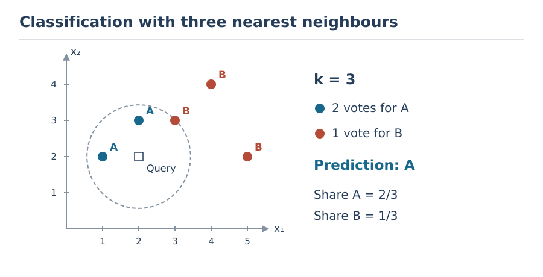

# M11-L1 – Nearest neighbours and distance-based classification {#L1}

**Course area:** M11 – Classical learning algorithms

**Level:** Bachelor · Core/elective

**Prerequisites:** M2, [M10-L4](M10-L4.md), [M10-L6](M10-L6.md).

**Learning objective:** Calculate distance-based predictions, explain the effect of scaling and choose k appropriately.

## Cases rather than parameter estimation {#S1}

A test bench records two dimensionless measurement features for each component. For an unknown component, a class is to be inferred from specimens already tested. The k-nearest neighbours method (k-NN) finds the k most similar training cases and uses their target values. Unlike a linear model, it does not estimate a fixed global decision line. The training set remains essential for prediction; consequently, memory requirements and search time can become substantial.

## Distances and majority decision {#S2}




*Figure: Classification with three nearest neighbours.*

For $d$ numerical features, the Euclidean distance is

$$D(x,z)=\sqrt{\sum_{j=1}^d(x_j-z_j)^2}.$$

With uniform weighting, class $c$ receives the proportion $\hat p_c(x)=\frac1k\sum_{i\in N_k(x)}\mathbf1(y_i=c)$. Here, $N_k(x)$ is the set of the k selected indices; the indicator equals one if the classes match. The highest frequency determines the prediction. A fixed rule must apply in the event of a tie. These proportions are not automatically calibrated probabilities. For regression, the target values can be averaged instead.

| Training profile | Class | Distance to (2,2) |
|---|---|---:|
| (1,2) | A | 1 |
| (2,3) | A | 1 |
| (3,3) | B | $\sqrt2$ |
| (5,2) | B | 3 |
| (4,4) | B | $\sqrt8$ |

The illustration marks the three nearest neighbours. With k=3, A is predicted with a proportion of 2/3; with k=5, B is predicted with 3/5 instead.

## Hyperparameters and computational cost {#S3}

k=1 can be highly sensitive to outliers; larger neighbourhoods smooth local differences but may overlook small groups. A feature measured in millimetres and another in micrometres would dominate the distance to different degrees depending on the numerical scale used. Suitable transformations, such as standardisation, are therefore fitted exclusively to training data. Categorical data require a meaningful encoding or distance measure. In high dimensions, proximity often becomes less informative. An exhaustive search requires approximately $O(nd)$ computational operations per query for n training points; search indices are particularly helpful with suitable geometry.

```python
from sklearn.neighbors import KNeighborsClassifier
X = [[1,2],[2,3],[3,3],[5,2],[4,4]]
y = ['A','A','B','B','B']
assert KNeighborsClassifier(3).fit(X,y).predict([[2,2]])[0] == 'A'
assert KNeighborsClassifier(5).fit(X,y).predict([[2,2]])[0] == 'B'
```

The small sample illustrates the rule, not generalisation performance. The validation methods from M10 are used for that purpose.

## Exercise and solution {#S4}

For k=3, determine the proportion for A when votes are weighted by $1/D$. Solution: A receives 2, while B receives $1/\sqrt2$. The normalised proportion for A is $2/(2+1/\sqrt2)\approx0.739$. A distance of zero requires a separate rule instead of division by zero.

## Sources and further reading {#S5}

- [scikit-learn: Nearest Neighbors](https://scikit-learn.org/stable/modules/neighbors.html) – **Verification:** pending.
- [James et al.: An Introduction to Statistical Learning with Applications in Python (2023)](https://www.statlearning.com/) – **Verification:** pending.
