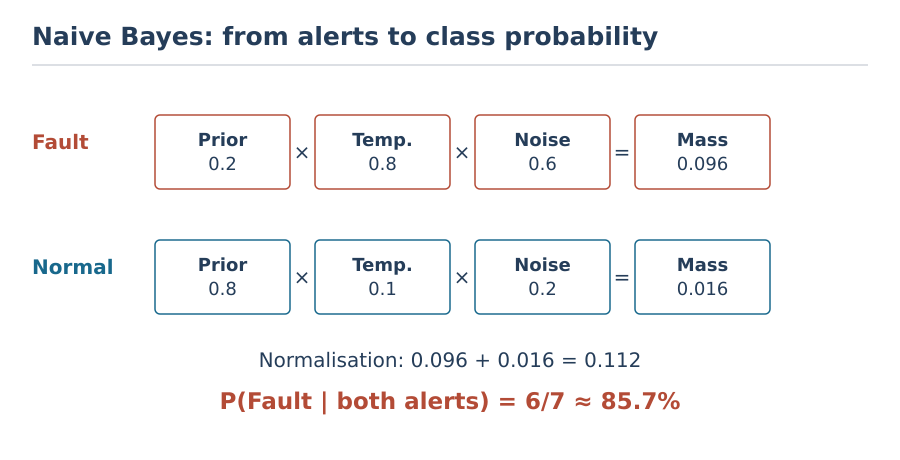

# M11-L2 – Naive Bayes and probabilistic classification {#L2}

**Course area:** M11 – Classical learning algorithms

**Level:** Bachelor · Core/elective

**Prerequisites:** [M4-L2](M4-L2.md), [M10-L3](M10-L3.md).

**Learning objective:** Calculate class probabilities from prior and likelihood and assess the independence assumption.

## Evidence from several observations {#S1}

A maintenance service assigns reports either to the fault class S or the normal operation class N. Two binary features indicate whether a temperature alert T and a noise alert G are present. The prior class frequency is combined with the probability of the observations under each class. Bayes' theorem from M4 gives, for a feature vector x,

$$P(c\mid x)=\frac{P(c)P(x\mid c)}{\sum_{a}P(a)P(x\mid a)}.$$

## Conditional independence as a modelling assumption {#S2}




*Figure: Naive Bayes: from alerts to class probability.*

Naive Bayes replaces the joint feature distribution with a product of the individual conditional distributions:

$$P(x\mid c)=\prod_{j=1}^dP(x_j\mid c).$$

This simplification assumes independence given the class, not necessarily in the population as a whole. In practice, measurement features may be strongly associated; the model can still yield useful decisions, but its probabilities may be overconfident.

For the teaching example, let $P(S)=0.2$, $P(N)=0.8$, $P(T=1\mid S)=0.8$, $P(G=1\mid S)=0.6$, $P(T=1\mid N)=0.1$ and $P(G=1\mid N)=0.2$. With both alerts present, the unnormalised mass for S is $0.2\cdot0.8\cdot0.6=0.096$, while that for N is 0.016. Normalising gives $P(S\mid T=1,G=1)=0.096/0.112=6/7$. The illustration shows the calculation steps for both classes.

## Estimation, smoothing and numerical stability {#S3}

Bernoulli Naive Bayes uses the presence and absence of a binary feature; multinomial Naive Bayes is suitable for non-negative count features such as word frequencies. Gaussian Naive Bayes models continuous features using class-specific normal distributions. For a binary feature with m ones in n cases of a class, additive smoothing gives $(m+\alpha)/(n+2\alpha)$ when $\alpha>0$. Thus an event not observed so far does not immediately reduce the entire likelihood to zero. The decision can be computed in log space: $s_c=\log P(c)+\sum_j\log P(x_j\mid c)$. Normalisation using log-sum-exp avoids numerical underflow when there are many features.

```python
import numpy as np
log_score = np.log([.2,.8]) + np.log([[.8,.6],[.1,.2]]).sum(axis=1)
w = np.exp(log_score - log_score.max())
posterior = w / w.sum()
assert np.allclose(posterior,[6/7,1/7])
```

In applications, the prior and feature parameters must be estimated from admissible training data. A change in the base rate during operation may also require reassessment.

## Exercise and solution {#S4}

Calculate P(S) after a temperature alert with no noise alert. Solution: the masses are $0.2\cdot0.8\cdot0.4=0.064$ and $0.8\cdot0.1\cdot0.8=0.064$. Both classes receive 0.5. With smoothing using $\alpha=1$ and zero occurrences in eight cases, the estimated feature probability is 1/10.

## Sources and further reading {#S5}

- [scikit-learn: Naive Bayes](https://scikit-learn.org/stable/modules/naive_bayes.html) – **Verification:** pending.
- [James et al.: An Introduction to Statistical Learning with Applications in Python (2023)](https://www.statlearning.com/) – **Verification:** pending.
