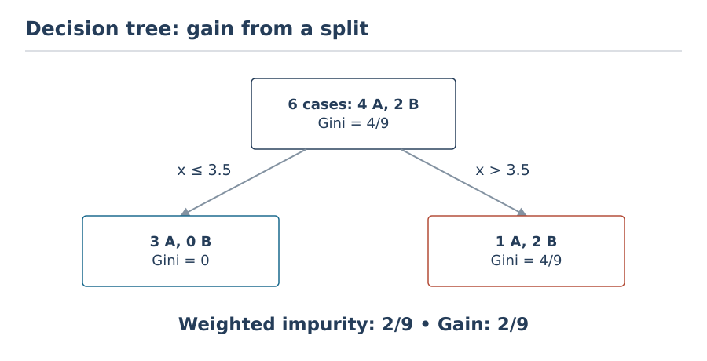

# M11-L3 – Decision trees and splitting criteria {#L3}

**Course area:** M11 – Classical learning algorithms

**Level:** Bachelor · Core/elective

**Prerequisites:** M4, [M10-L3](M10-L3.md), [M10-L6](M10-L6.md).

**Learning objective:** Calculate node impurity and split gain and justify tree depth and pruning.

## Decisions as a sequence of questions {#S1}

A sorting model distinguishes quality classes A and B. A decision tree partitions the feature space by asking questions at internal nodes, for example whether a measurement is at most 3.5. Each path to a leaf describes a subregion. The class prediction is based, for instance, on the most frequent class in the leaf; for regression, the leaf mean can be used. Trees can represent nonlinear boundaries and interactions without having to construct product features beforehand.

## Gini impurity and gain {#S2}




*Figure: Decision tree: gain from a split.*

For the class proportions $p_c$ at a node, the Gini impurity is

$$I_G=1-\sum_c p_c^2.$$

Alternatively, entropy $I_H=-\sum_c p_c\log_2 p_c$ measures the degree of mixing (with $0\log_2 0=0$). For a binary split with n cases and child sizes $n_l,n_r$, a greedy procedure maximises the local gain

$$\Delta I=I_{\mathrm{parent}}-\frac{n_l}{n}I_l-\frac{n_r}{n}I_r.$$

The six training values 1 to 6 have the classes A,A,A,B,A,B. The parent node contains four A and two B, giving $I_G=4/9$. With the split $x\le3.5$, the left side has A=3 and B=0, and the right has A=1 and B=2. The impurities are 0 and 4/9, and the gain is $4/9-2/9=2/9$. The illustration visualises this split. For $x\le4.5$, the children are (3,1) and (1,1); the gain is $4/9-(4/6)(3/8)-(2/6)(1/2)=1/36$. The first of these two splits is better. A complete search step must also examine the other admissible thresholds.

## Tree growth and control {#S3}

A single tree usually searches for locally optimal splits in succession; this does not guarantee a globally optimal tree. Too many small leaves can memorise random patterns. Maximum depth, minimum leaf size and pruning constrain growth. Cost-complexity pruning uses a criterion of the form $R(T)+\alpha|\mathcal L(T)|$: R is an empirical tree risk (depending on the implementation, for example, the weighted leaf impurity), and $|\mathcal L(T)|$ is the number of leaves. Larger $\alpha$ penalises complex trees more heavily. Thresholds must be selected using development data. Standardisation is not required for ordinary trees with numerical thresholds; missing or categorical values require a defined treatment.

```python
from sklearn.tree import DecisionTreeClassifier
X = [[1],[2],[3],[4],[5],[6]]
y = ['A','A','A','B','A','B']
model = DecisionTreeClassifier(max_depth=1, random_state=2).fit(X,y)
assert model.tree_.threshold[0] == 3.5
```

## Exercise and solution {#S4}

Also compare the threshold 5.5. The left side contains four A and one B, the right side one B. The gain is therefore $4/9-(5/6)(8/25)=8/45\approx0.178$, less than 2/9. The tree of depth one selects 3.5. Why is a pure leaf containing only one case not yet proof of a reliable prediction? Because its empirical purity is based on very few observations.

## Sources and further reading {#S5}

- [scikit-learn: Decision Trees](https://scikit-learn.org/stable/modules/tree.html) – **Verification:** pending.
- [James et al.: An Introduction to Statistical Learning with Applications in Python (2023)](https://www.statlearning.com/) – **Verification:** pending.
