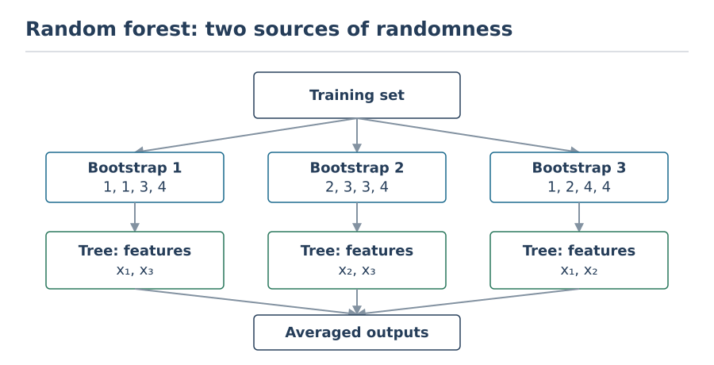

# M11-L4 – Random forests and bagging {#L4}

**Course area:** M11 – Classical learning algorithms

**Level:** Bachelor · Core/elective

**Prerequisites:** [M6-L7](M6-L7.md), [M10-L5](M10-L5.md), [M11-L3](M11-L3.md).

**Learning objective:** Explain bootstrap aggregation, feature randomisation and the importance of correlated model errors.

## Many trees instead of a single split {#S1}

Small changes in measurement data can alter an early branch of a decision tree. This may change entire subtrees. Bagging (bootstrap aggregating) trains several models on random samples drawn with replacement from the training set and combines their outputs. The training runs can be executed independently; their data and subsequent errors are not necessarily independent.

## Variance and samples {#S2}

If n cases are drawn uniformly n times with replacement, a particular case is omitted with probability $(1-1/n)^n$, approximately $e^{-1}\approx0.368$ for large n. Each base model therefore has training cases outside its bootstrap sample (out-of-bag, OOB). Predictions can be collected from the models that have not seen the case under consideration. Such an internal estimate does not replace an independent final evaluation, particularly with group dependencies or temporal change.

For B identically distributed numerical model predictions with variance $\sigma^2$ and equal pairwise correlation $\rho$,

$$\operatorname{Var}\left(\frac1B\sum_{b=1}^B Z_b\right)=\sigma^2\left(\rho+\frac{1-\rho}{B}\right).$$

The formula follows by adding the B variances and $B(B-1)$ covariances and dividing by $B^2$. With $\sigma^2=4$, $B=10$ and $\rho=0.25$, the result is 1.3. More models reduce the uncorrelated component; the remaining correlation limits the gain.

## Additional randomness in the forest {#S3}




*Figure: Random forest: two sources of randomness.*

A random forest typically restricts the features considered at each node to a random subset. This encourages the trees to use different structures. The illustration shows the separate randomisation of data and features. For regression, tree values are averaged; for classification, majority voting or averaging class probabilities is common, depending on the implementation. Scikit-learn uses averaged tree probabilities in its RandomForestClassifier. The number of trees stabilises the estimate, while depth, leaf size and feature selection control the individual trees.

```python
from sklearn.datasets import make_classification
from sklearn.ensemble import RandomForestClassifier
X,y = make_classification(n_samples=300,n_features=6,
                          n_informative=4,random_state=12)
f = RandomForestClassifier(n_estimators=100,max_features='sqrt',
                           oob_score=True,random_state=12).fit(X,y)
assert len(f.estimators_) == 100
assert 0 <= f.oob_score_ <= 1
print(round(f.oob_score_,3))
```

The example tests internal OOB evaluation on synthetic data, not suitability for a real plant. Impurity-based feature importances can favour features with many splitting possibilities; permutation importance on independent data helps but also has limitations with correlated features.

## Exercise and solution {#S4}

What is the variance with B=100 and unchanged $\rho$? Solution: $4(0.25+0.75/100)=1.03$. The limit as B tends to infinity is 1. Without correlation, the variance would be 0.04.

## Sources and further reading {#S5}

- [scikit-learn: Ensembles](https://scikit-learn.org/stable/modules/ensemble.html) – **Verification:** pending.
- [James et al.: An Introduction to Statistical Learning with Applications in Python (2023)](https://www.statlearning.com/) – **Verification:** pending.
