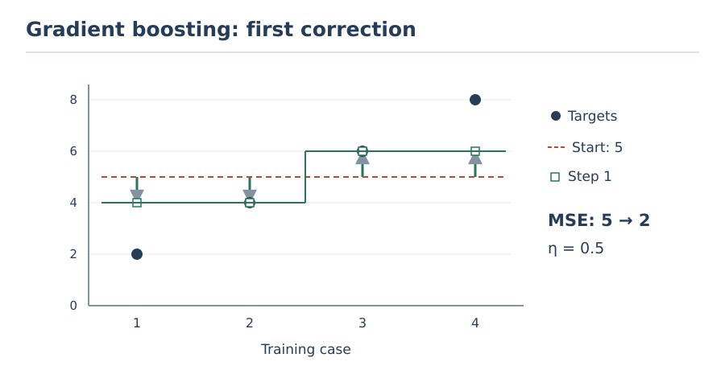

# M11-L5 – Boosting and additive models {#L5}

**Course area:** M11 – Classical learning algorithms

**Level:** Bachelor · Core/elective

**Prerequisites:** [M9-L2](M9-L2.md), [M10-L3](M10-L3.md), [M11-L3](M11-L3.md).

**Learning objective:** Derive additive learning steps and explain the roles of learning rate, loss and weak base models.

## A model is improved step by step {#S1}

While bagging trains many models separately, boosting builds a sequence of coordinated models. A new base model is intended to reduce the errors or loss of the existing combination. The combination often takes an additive form. For regression, a tree can provide small corrections for different feature regions. This differs from independently averaging many complete predictions.

## Gradient boosting with squared loss {#S2}




*Figure: Gradient boosting: first correction.*

For $L(y,F)=\tfrac12(y-F)^2$ and the current prediction $F_{m-1}$, the negative gradient with respect to the prediction is $r_i=y_i-F_{m-1}(x_i)$. Here it corresponds to the residual. A model $h_m$ is fitted to these residuals. With step size $\eta$, this simple variant gives

$$F_m(x)=F_{m-1}(x)+\eta h_m(x),\qquad 0<\eta\le1.$$

For four cases with $y=(2,4,6,8)$, the constant initial prediction is the mean of 5. The residuals are (-3,-1,1,3). A decision stump groups the first two and last two cases; its leaf means are -2 and 2. With $\eta=0.5$, we obtain $F_1=(4,4,6,6)$. The mean squared error falls from 5 to 2. The illustration tracks this correction. In the second step the residuals are (-2,0,0,2). An optimal stump isolates an endpoint case; the two symmetrical splits are equivalent. If it isolates the first case, the correction values are -2 and 2/3; after a half step the new MSE is 1. Isolating the last case yields the same MSE.

## Other losses and regularisation {#S3}

With a different differentiable loss, the negative gradients are generally not simple residuals. Some methods subsequently optimise additional step sizes or leaf values. For binary classification, a logistic loss function can be used with an additive raw score; the logistic transformation maps it to probabilities. AdaBoost is another boosting variant in which misclassified cases receive greater weight in subsequent training steps. Both methods are sequential but not identical. Small learning rates often require more steps; tree depth, sampling fraction and early stopping can constrain fitting. Outliers and incorrect labels deserve particular attention.

```python
import numpy as np
from sklearn.ensemble import GradientBoostingRegressor
X = np.arange(4).reshape(-1,1)
y = np.array([2.,4.,6.,8.])
m = GradientBoostingRegressor(n_estimators=2, max_depth=1,
                              learning_rate=.5,random_state=1).fit(X,y)
p = list(m.staged_predict(X))
assert np.allclose(p[0],[4,4,6,6])
assert np.isclose(np.mean((y-p[1])**2),1.)
```

The example shows training steps; a number of trees selected using development data is subsequently evaluated on independent data.

## Exercise and solution {#S4}

What would the first step look like with $\eta=1$? Solution: (3,3,7,7), MSE=1. The large step is faster in this example but need not generalise better on more complex data.

## Sources and further reading {#S5}

- [scikit-learn: Ensembles](https://scikit-learn.org/stable/modules/ensemble.html) – **Verification:** pending.
- [James et al.: An Introduction to Statistical Learning with Applications in Python (2023)](https://www.statlearning.com/) – **Verification:** pending.
