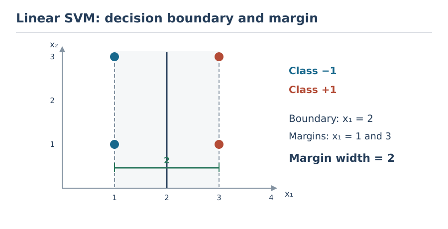

# M11-L6 – Support vector machines and the kernel principle {#L6}

**Course area:** M11 – Classical learning algorithms

**Level:** Bachelor · Core/elective

**Prerequisites:** M2, [M9-L4](M9-L4.md), [M10-L3](M10-L3.md).

**Learning objective:** Explain the margin, hinge loss and kernels as inner products in a feature space.

## Separation with a safety margin {#S1}

With two classes and numerical features, a hyperplane $w^\top x+b=0$ can serve as a decision boundary. Let the binary labels be -1 and +1. Rather than merely seeking any separating line, the linear support vector machine (SVM) favours a boundary that, for separable data, leaves a wide gap between the nearest training cases of the two classes.

## Geometry and the soft margin {#S2}




*Figure: Linear SVM: decision boundary and margin.*

The normalisation $y_i(w^\top x_i+b)\ge1$ for all cases defines the margin planes $w^\top x+b=\pm1$. The distance between them is $2/\|w\|_2$. For the negative-class points (1,1),(1,3) and positive-class points (3,1),(3,3), $w=(1,0)$ and $b=-2$ give an optimal linear separation. The boundary is at $x_1=2$, the margin planes at 1 and 3; all four cases lie on the margins. The illustration shows the geometry.

For non-separable data, a soft-margin SVM allows margin violations. A common objective function is

$$\min_{w,b}\;\tfrac12\|w\|_2^2+C\sum_i\max(0,1-y_i(w^\top x_i+b)).$$

The second term contains the hinge loss. Larger C gives more weight to violations; smaller C tends to favour stronger regularisation. A point on the correct side can still incur loss if it lies within the margin. Support vectors determine the decision function in the dual formulation; other cases with a dual coefficient of zero make no direct contribution.

## Nonlinear boundaries through kernels {#S3}

A kernel $K(x,z)=\langle\phi(x),\phi(z)\rangle$ computes an inner product in a feature space without always having to generate its coordinates explicitly. One example is the Gaussian RBF kernel $K(x,z)=\exp(-\gamma\|x-z\|_2^2)$ with $\gamma>0$. Large $\gamma$ confines similarity more strongly to the immediate neighbourhood. Not every similarity function is a valid kernel; positive semidefiniteness of the Gram matrix is a central condition. Scaling, C and kernel parameters must be chosen appropriately; for very large datasets, a kernel SVM can require substantial time and memory. Raw scores are not calibrated probabilities.

```python
import numpy as np
from sklearn.svm import SVC
X = [[1,1],[1,3],[3,1],[3,3]]
y = [-1,-1,1,1]
m = SVC(kernel='linear', C=10).fit(X,y)
assert np.allclose(m.coef_,[[1,0]])
assert np.allclose(m.intercept_,[-2])
assert m.predict([[2.5,2]])[0] == 1
```

## Exercise and solution {#S4}

For w and b as above, let a positive point be at $(2.4;2)$, so $x_1=2.4$. Its score is 0.4 and its hinge loss is 0.6. It is correctly classified but lies within the margin. For two points with squared distance 4 and $\gamma=0.5$, the RBF kernel value is $e^{-2}\approx0.1353$.

## Sources and further reading {#S5}

- [scikit-learn: Support Vector Machines](https://scikit-learn.org/stable/modules/svm.html) – **Verification:** pending.
- [James et al.: An Introduction to Statistical Learning with Applications in Python (2023)](https://www.statlearning.com/) – **Verification:** pending.
