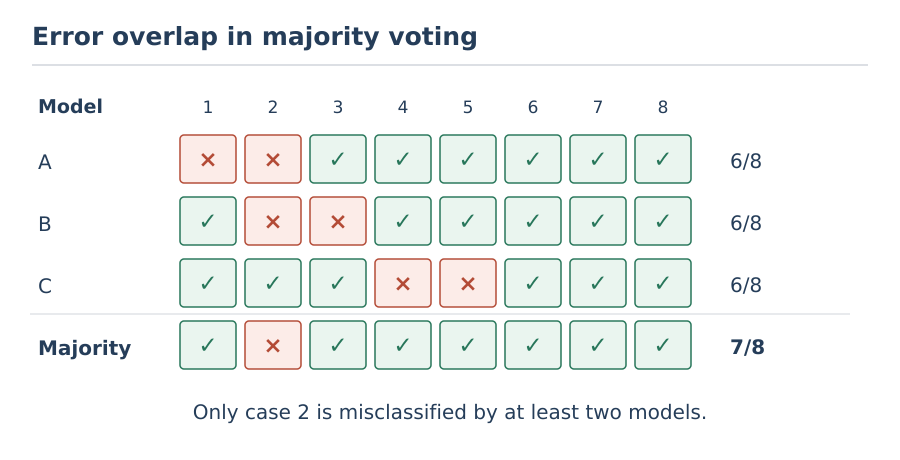

# M11-L7 – Comparison, ensembles and error analysis {#L7}

**Course area:** M11 – Classical learning algorithms

**Level:** Bachelor · Core/elective

**Prerequisites:** [M10-L6](M10-L6.md), [M10-L7](M10-L7.md), [M11-L1](M11-L1.md)–[M11-L6](M11-L6.md).

**Learning objective:** Compare learning methods on common development data, justify ensembles and investigate groups of errors.

## The appropriate model family depends on the task {#S1}

When inspecting workpieces, we have several model families to choose from. k-NN uses local similarity, Naive Bayes simplified probability models, trees rule-like splits, forests averaged tree predictions, boosting successive corrections and SVMs regularised separating surfaces. No method invariably wins regardless of data volume, features, error costs, computational budget and data distribution. For comparison, we use the same data split, the same target definition and a predefined metric; preprocessing and hyperparameter selection remain within the development phase.

## Why different errors can be useful {#S2}

In hard voting, the majority of class labels decides; in soft voting, the largest averaged class probability decides. For M models and normalised weights $a_m\ge0$, $\sum_m a_m=1$, the soft output is

$$\hat p(c\mid x)=\sum_{m=1}^M a_m\hat p_m(c\mid x).$$

The probabilities should be comparably calibrated. Three models output values of 0.9, 0.4 and 0.4 for class B. Hard voting with a threshold of 0.5 yields A; equally weighted soft voting gives 1.7/3 and therefore B. In stacking, a further model is trained on predictions instead of using a fixed combination. Its training features must come from predictions for cases not used to train the respective base model (out-of-fold), so that it does not learn from overly optimistic training scores.

## Diagnosis using specific errors {#S3}




*Figure: Error overlap in majority voting.*

On a synthetic validation set of eight cases, models A, B and C have errors at the following positions: A at 1 and 2, B at 2 and 3, C at 4 and 5. All three achieve 6/8 correct predictions. In binary classification, a majority decision is incorrect exactly when at least two models are incorrect; here this occurs only in case 2. The illustration shows the overlap. The ensemble achieves 7/8. However, an improvement on these eight cases alone is not proof of general superiority.

```python
import numpy as np
y = np.array([0,1,0,1,0,1,0,1])
p = np.tile(y,(3,1))
for j, cases in enumerate([[0,1],[1,2],[3,4]]):
    p[j,cases] = 1 - p[j,cases]
assert np.all((p == y).mean(axis=1) == .75)
majority = (p.sum(axis=0) >= 2).astype(int)
assert (majority == y).mean() == .875
```

Errors are investigated by class, measurement range, device type and time of collection. For small subgroups, absolute case counts and uncertainty are important. High errors in one group can arise from poor measurement, new data distributions, label problems or model limitations; attributing them to a cause requires further evidence. Model selection, thresholds and ensemble weights are determined on development data. The held-out test set remains untouched until the final evaluation.

## Exercise and solution {#S4}

If all three models happened to be incorrect on cases 1 and 2, what added value would hard voting offer on these data? Solution: None; the same two cases remain incorrect. In addition to individual quality, differences between errors are crucial. In the soft-voting exercise above, weights (0.2; 0.4; 0.4) give a B proportion of 0.5; a predefined rule is needed to handle ties.

## Sources and further reading {#S5}

- [scikit-learn: Ensembles](https://scikit-learn.org/stable/modules/ensemble.html) – **Verification:** pending.
- [James et al.: An Introduction to Statistical Learning with Applications in Python (2023)](https://www.statlearning.com/) – **Verification:** pending.
