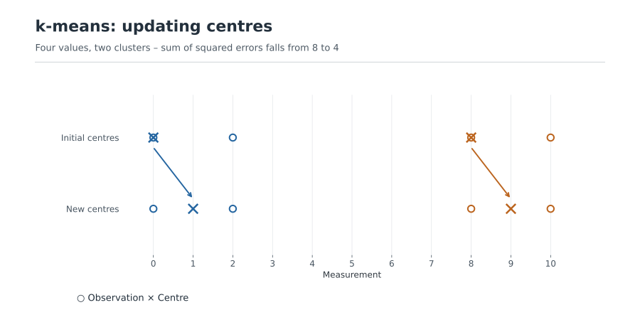

# M12-L1 – Clustering with k-means and hierarchies {#L1}

**Course area:** M12 – Unsupervised learning and data mining

**Level:** Bachelor · Core/elective

**Prerequisites:** [M2-L1](M2-L1.md)–[M2-L7](M2-L7.md), M10.

**Learning objective:** Form clusters using distances, calculate the k-means objective and distinguish hierarchical methods.

## Groups without a known target variable {#S1}

A spare parts warehouse wants to group items by consumption and delivery time. There are no predefined categories. Clustering derives a structure from the features; a cluster is therefore initially a computational group, not a proven natural class. Delivery time in hours must not overshadow consumption in units simply because of a larger numerical scale. Scaling, distance measures and consistent observational units are therefore part of the model. Euclidean distance weights differences in each coordinate quadratically; for sparse text vectors, angular similarity may be more appropriate.

## k-means as alternating optimisation {#S2}




*Figure: k-Means: Zentren aktualisieren.*

Given $n$ vectors $x_i$, we seek $k$ centres $\mu_j$ and group assignments $c_i\in\{1,\ldots,k\}$. The criterion is

$$J=\sum_{i=1}^n\|x_i-\mu_{c_i}\|_2^2.$$

When the centres are fixed, each point is assigned to its nearest centre. When assignments are fixed, the mean of each group minimises the sum of squared distances. Neither step increases $J$. However, they do not guarantee a globally optimal solution. Empty groups require appropriate handling; multiple initialisations reduce dependence on the starting point.

In the one-dimensional teaching example, measurements are at 0, 2, 8 and 10. Initial centres 0 and 8 produce groups {0,2} and {8,10}; the new centres are 1 and 9. The sum of squared errors falls from 8 to 4. The illustration shows the movement of both centres. With $k=4$, the error would be zero, although each value would stand alone. A smaller objective value is therefore insufficient for choosing $k$.

## Hierarchical alternatives {#S3}

Agglomerative methods start with individual points and repeatedly merge two groups. Single linkage uses the smallest pairwise distance, complete linkage the largest, and average linkage the mean. For Euclidean data, Ward's method chooses the merge with the smallest increase in the within-group sum of squared errors. In the example, the close pairs 0/2 and 8/10 are merged first; the final single-linkage merge occurs at distance 6. A dendrogram shows the merges and their heights. Single linkage can connect seemingly separate groups through a chain of intermediate points. In contrast, k-means produces a direct partition and works particularly well for compact groups of comparable dispersion.

```python
import numpy as np
from sklearn.cluster import KMeans
from scipy.cluster.hierarchy import linkage
x = np.array([[0.], [2.], [8.], [10.]])
m = KMeans(n_clusters=2, init=np.array([[0.], [8.]]), n_init=1).fit(x)
assert np.allclose(np.sort(m.cluster_centers_.ravel()), [1,9])
assert np.isclose(m.inertia_,4)
assert np.allclose(linkage(x, method='single')[:,2],[2,2,6])
```

For new data, the same scaling method should be applied without alteration. Also check whether the clusters persist when initial values, samples or measurement conditions change.

## Exercise and solution {#S4}

Calculate the sum of squared errors for just one centre. Solution: The mean is 5; the squares 25, 9, 9 and 25 sum to 68. What practical information is lost with four singleton groups? The grouping of similar cases. Choosing the number of groups therefore requires a combination of evaluation measures ([M12-L7](M12-L7.md)) and the intended use.

## Sources and further reading {#S5}

- [scikit-learn: Clustering](https://scikit-learn.org/stable/modules/clustering.html) – **Verification:** pending.
