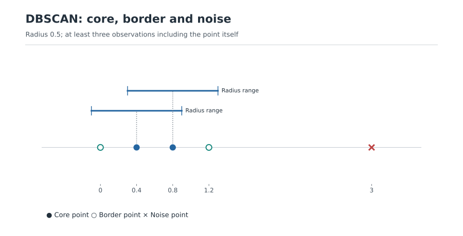

# M12-L2 – Density-based clusters and anomalies {#L2}

**Course area:** M12 – Unsupervised learning and data mining

**Level:** Bachelor · Core/elective

**Prerequisites:** [M12-L1](M12-L1.md), M4.

**Learning objective:** Trace DBSCAN using neighbourhoods and distinguish noise points from confirmed anomalies.

## Density rather than centres {#S1}

Measurements along a curved conveyor path may form two elongated groups. A single centre characterises each group poorly. DBSCAN seeks connected regions with sufficiently many neighbours. For a point $x$ and a radius $\varepsilon>0$, let

$$N_\varepsilon(x)=\{y:d(x,y)\leq\varepsilon\}.$$

A core point has at least $m$ points in this neighbourhood, including itself. A non-core point in the neighbourhood of a core point may belong to its cluster as a border point. Points without such a connection remain noise. Connected core points form the backbone of the clusters. A border point reachable from several clusters may be assigned according to the processing order.

## A teaching example on the number line {#S2}




*Figure: DBSCAN: Kern, Rand und Rauschen.*

The measurements 0, 0.4, 0.8, 1.2 and 3 are analysed with $\varepsilon=0.5$ and $m=3$. At 0.4, the values 0, 0.4 and 0.8 are within reach; at 0.8, these are 0.4, 0.8 and 1.2. Both are core points and are within reach of one another. The values 0 and 1.2 have only two neighbours including themselves, but are border points. At 3, only the point itself remains. The illustration shows the overlapping neighbourhoods and the isolated value.

```python
import numpy as np
from sklearn.cluster import DBSCAN
x = np.array([0,.4,.8,1.2,3.]).reshape(-1,1)
m = DBSCAN(eps=.5,min_samples=3).fit(x)
assert set(m.core_sample_indices_) == {1,2}
assert np.array_equal(m.labels_, [0,0,0,0,-1])
```

The cluster number is merely an identifier. In this implementation, `-1` denotes unassigned noise.

## Parameters and limitations {#S3}

Too small a radius splits even related regions; too large a radius may connect distinct groups. Sorted distances to the $m$-th neighbour, including the point itself, can help guide the choice. An elbow is only a heuristic. Different local densities are often difficult to capture using a single radius. OPTICS investigates neighbourhood structures across a range of radii; HDBSCAN derives groups from a density hierarchy. Both are alternatives, not guarantees of unambiguous groups.

Noise points may be measurement errors, but they may also be rare valid operating states. Automatic shutdown would require separate validation with established error costs. In many dimensions, distances also lose discriminatory power. A different feature representation or a domain-appropriate distance measure may be more important than the choice of algorithm.

## Exercise and solution {#S4}

What happens in the teaching example with a radius of 0.3 and unchanged $m$? Solution: No point has another point within the radius; there are no core points and all five values become noise. With radius 0.5 and $m=2$, all four nearby values are core points; 3 remains noise. The example shows why a single setting must not be presented as objective truth.

## Sources and further reading {#S5}

- [scikit-learn: Clustering](https://scikit-learn.org/stable/modules/clustering.html) – **Verification:** pending.
