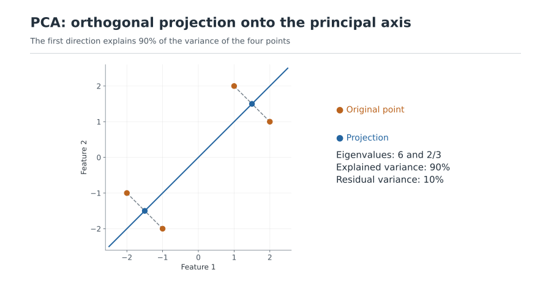

# M12-L3 – Principal component analysis and dimensionality reduction {#L3}

**Course area:** M12 – Unsupervised learning and data mining

**Level:** Bachelor · Core/elective

**Prerequisites:** M2, M5.

**Learning objective:** Derive PCA from the covariance matrix, determine explained variance and reconstruct observations from projections.

## Redundant measurements {#S1}

Two sensors record different signals that fluctuate strongly together. A linear combination may describe much of the variation in both quantities. Principal component analysis (PCA) seeks orthogonal directions along which centred data have as much variance as possible. The method requires no target variable. However, high variance does not automatically mean high domain relevance.

## From covariance to projection {#S2}

For a data matrix $X$ with $n>1$ rows and $p$ features, let $X_c$ be the column-centred matrix. The sample covariance is

$$S=\frac{X_c^\top X_c}{n-1}.$$

A unit vector $v$ produces the projection $X_cv$ with variance $v^\top Sv$. Subject to the condition $v^\top v=1$, this reaches its maximum at an eigenvector corresponding to the largest eigenvalue. The remaining directions are chosen orthogonally. For the matrix $V_q$ of the first $q$ eigenvectors,

$$Z=X_cV_q,\qquad \widehat X=ZV_q^\top+\mathbf 1\bar x^\top.$$

The proportion of explained variance is $\sum_{j=1}^q\lambda_j/\sum_{j=1}^p\lambda_j$, provided the total variance is positive. An SVD of $X_c$ yields the same directions (up to sign and possible choice of basis for equal eigenvalues); $\lambda_j=\sigma_j^2/(n-1)$.

## A projection by hand and in Python {#S3}




*Figure: PCA: senkrechte Projektion auf die Hauptachse.*

The four synthetic points (-2,-1), (-1,-2), (1,2), (2,1) have mean zero and covariance matrix

$$S=\frac13\begin{pmatrix}10&8\\8&10\end{pmatrix}.$$

The eigenvalues are 6 and 2/3. The first axis runs along $(1,1)/\sqrt2$; it explains 90% of the variance. The point (2,1) receives coordinate $3/\sqrt2$ and is reconstructed as (1.5; 1.5). Its squared reconstruction error is 0.5. The illustration shows the perpendicular projection of all four points.

```python
import numpy as np
from sklearn.decomposition import PCA
X = np.array([[-2,-1],[-1,-2],[1,2],[2,1]],float)
p = PCA(n_components=1).fit(X)
assert np.allclose(p.explained_variance_ratio_, [.9])
assert np.allclose(p.inverse_transform(p.transform(X))[-1],[1.5,1.5])
assert np.isclose(np.linalg.eigvalsh(np.cov(X,rowvar=False))[-1],6)
```

When features are scaled differently, standardisation changes the PCA. For later prediction, means, scaling and PCA must be estimated exclusively on training data. The number of components can be chosen according to reconstruction quality or validation performance; a fixed variance target alone is not always sufficient.

## Exercise and solution {#S4}

How much variance is left unaccounted for after projection? Solution: 10%, or 2/3 in absolute units of sample variance. The sum of squared reconstruction errors for the four points is $(n-1)\cdot2/3=2$. If a small fluctuation happens to indicate a defect, the second component may be crucial to quality inspection despite its low variance.

## Sources and further reading {#S5}

- [scikit-learn: Decomposing signals in components](https://scikit-learn.org/stable/modules/decomposition.html) – **Verification:** pending.
