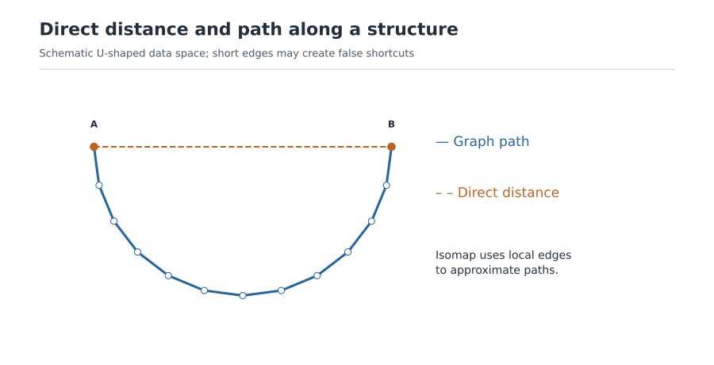

# M12-L4 – Non-linear embeddings and their limitations {#L4}

**Course area:** M12 – Unsupervised learning and data mining

**Level:** Bachelor · Core/elective

**Prerequisites:** [M12-L3](M12-L3.md), M4.

**Learning objective:** Distinguish local from global geometry and evaluate a non-linear embedding using neighbourhood measures.

## A curved data structure {#S1}




*Figure: Direkter Abstand und Weg entlang einer Struktur.*

Imagine measurement points on a folded ribbon. Nearby points along the ribbon are often similar, even though a straight projection into two dimensions may superimpose different sections. Non-linear embeddings attempt to condense such relationships differently from linear PCA. Isomap constructs a neighbourhood graph and approximates path lengths along the structure using shortest graph paths. The illustration presents a U-shaped ribbon with a path along the ribbon and a short direct connection. If the graph is too sparse, it may become disconnected; if it is too dense, shortcuts arise.

## t-SNE and local similarity {#S2}

t-SNE describes similarities in the original space using probabilities $p_{ij}$ and in the embedding using $q_{ij}$. For distinct points $i\ne j$, the symmetrised $p_{ij}$ are formed from local Gaussian neighbourhoods and normalised over all ordered pairs. A heavy-tailed distribution is used in the target space:

$$q_{ij}=\frac{(1+\|z_i-z_j\|^2)^{-1}}{\sum_{a\ne b}(1+\|z_a-z_b\|^2)^{-1}},\qquad C=\sum_{i\ne j}p_{ij}\log\frac{p_{ij}}{q_{ij}}.$$

The minimisation particularly penalises highly similar original points having too little similarity in the target space. Perplexity controls the effective size of local neighbourhoods. Random initialisation, optimisation and parameters influence point positions. The sizes, distances or orientations of visible islands must therefore not be interpreted directly as feature differences without further investigation. The classical t-SNE mapping also provides no directly defined transformation for new observations.

## Checking neighbourhood preservation in practice {#S3}

For a U-shaped two-dimensional dataset, we use an additional zero coordinate. The underlying curve is approximately one-dimensional. We evaluate Isomap with a small neighbourhood graph and compare local rank preservation with an arbitrary ordering. Trustworthiness assesses whether new neighbours in the embedding are actually nearby in the original space; a high value does not guarantee global distance preservation.

```python
import numpy as np
from sklearn.manifold import Isomap, trustworthiness
u = np.linspace(np.pi,2*np.pi,40)
X = np.column_stack([np.cos(u),np.sin(u),np.zeros_like(u)])
z = Isomap(n_neighbors=4,n_components=1).fit_transform(X)
t = trustworthiness(X,z,n_neighbors=3)
assert t > .95
assert t > trustworthiness(X,np.random.default_rng(4).permutation(z),n_neighbors=3)
```

For empirical data, compare several neighbourhood sizes and seeds, inspect the original features and document deviations. If the representation produces apparent groups, these should be investigated in the original space or using independent data. A projection is an aid to developing hypotheses, not a justification for automatically assigning a class.

## Exercise and solution {#S4}

Two points are shown far apart by t-SNE. Does this mean their original distance is greater than that of other pairs of points? Solution: No. The criterion prioritises local similarities; global distances are not guaranteed to be preserved monotonically. Check the original distance under the same preprocessing and the neighbourhood ranks.

## Sources and further reading {#S5}

- [scikit-learn: Manifold learning](https://scikit-learn.org/stable/modules/manifold.html) – **Verification:** pending.
