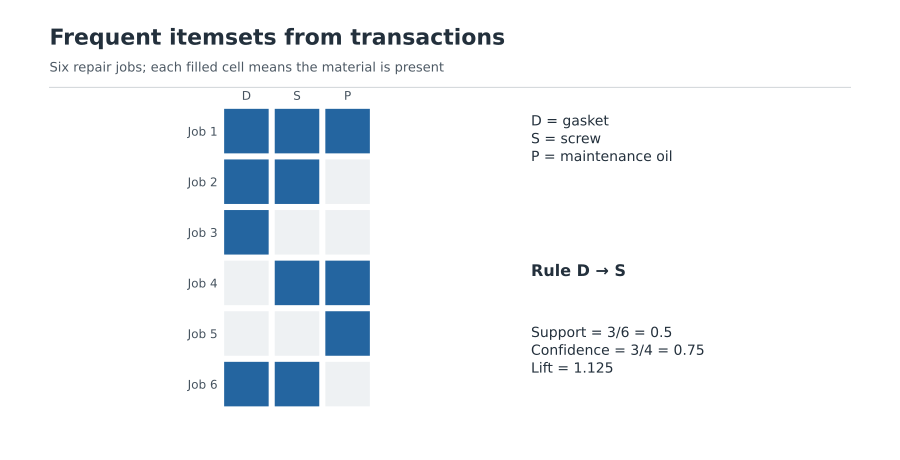

# M12-L5 – Association rules and frequent patterns {#L5}

**Course area:** M12 – Unsupervised learning and data mining

**Level:** Bachelor · Core/elective

**Prerequisites:** M4, M7.

**Learning objective:** Calculate support, confidence and lift, justify Apriori pruning and avoid causal interpretations of associations.

## Transactions rather than feature vectors {#S1}

A repair service records the types of material needed for each job. A transaction here is a set, such as {gasket, screw}, without order or quantity. Frequent itemsets show recurring combinations. From two disjoint, non-empty sets $A$ and $B$, a rule $A\Rightarrow B$ can be formed. It describes co-occurrence in the observed collection and is not a logical implication.

## Three measures for a rule {#S2}




*Figure: Häufige Mengen aus Transaktionen.*

For $N>0$ transactions and an itemset $I$, $s(I)$ is the proportion of transactions containing every item in $I$. For positive denominators,

$$\operatorname{conf}(A\Rightarrow B)=\frac{s(A\cup B)}{s(A)},\qquad \operatorname{lift}(A\Rightarrow B)=\frac{s(A\cup B)}{s(A)s(B)}.$$

Six jobs contain the following combinations: DSP, DS, D, SP, P, DS (D = gasket, S = screw, P = maintenance oil; the original item codes are retained). D and S each occur four times; DS occurs three times. The support of rule D→S is 3/6 = 0.5, confidence 3/4 = 0.75, lift $0.75/(4/6)=1.125$. The illustration shows the six jobs as a matrix. A confidence of 0.75 is only slightly above the base rate of S. A lift of 1 corresponds to the product of the empirical individual frequencies; values above 1 indicate positive association, not causation.

## Finding frequent itemsets efficiently {#S3}

If an itemset $I$ has insufficient support, no superset can be more frequent, because any transaction containing the superset also contains $I$. Apriori constructs candidates of size $k+1$ from frequent sets of size $k$ and discards those whose subsets fail to reach the minimum frequency. At a minimum support of 1/2, the singleton sets D, S and P and the pair DS remain frequent in the teaching example. DP occurs once and SP twice. The triple therefore no longer needs to be checked at this threshold.

```python
from itertools import combinations
T = list(map(set,['DSP','DS','D','SP','P','DS']))
def support(items):
    return sum(set(items) <= t for t in T)/len(T)
frequent = [''.join(c) for k in range(1,4)
            for c in combinations('DSP',k) if support(c)>=.5]
assert frequent == ['D','S','P','DS']
assert support('DS')/support('D') == .75
assert abs(support('DS')/(support('D')*support('S'))-1.125)<1e-12
```

The script counts all small candidates as a reference; it does not yet implement Apriori pruning. Eclat, by contrast, uses lists or sets of transaction identifiers and forms intersections. With large datasets, the number of possible rules may nevertheless become very large. Minimum case counts, independent confirmation and domain-informed selection reduce chance discoveries.

## Exercise and solution {#S4}

Calculate the reverse rule S→D and the rule P→S. Solution: By coincidence, S→D also has confidence 3/4 and the same lift here. P→S has support 2/6, confidence 2/3 and lift 1; the observed joint frequency corresponds to the product of the individual frequencies. With other data, the confidence of the reverse rule may differ substantially, while lift remains symmetric.

## Sources and further reading {#S5}

- [Christian Borgelt: Eclat Documentation](https://borgelt.net/doc/eclat/eclat.html) – **Verification:** pending.
