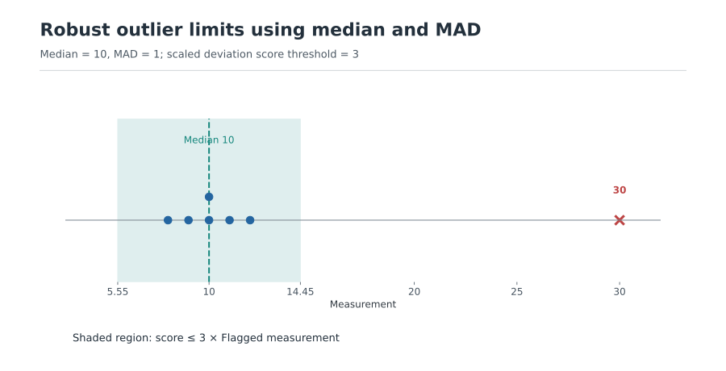

# M12-L6 – Outlier detection and rare events {#L6}

**Course area:** M12 – Unsupervised learning and data mining

**Level:** Bachelor · Core/elective

**Prerequisites:** M4, [M10-L6](M10-L6.md), [M12-L2](M12-L2.md).

**Learning objective:** Explain robust deviation scores and Isolation Forest, and assess thresholds in terms of false alarm costs.

## Rarity does not imply a fault {#S1}

A machine usually operates at a temperature in a familiar range. A rare measurement may indicate a new load condition, a defective sensor or damage. Outlier detection seeks unusual cases in a dataset that may already be contaminated. Novelty detection learns from a reference containing, as far as possible, normal conditions and evaluates new cases. Both tasks require a clear context: a temperature of 70 degrees may be normal for another machine model.

## Robust deviation and model scores {#S2}




*Figure: Robuste Ausreißergrenzen mit Median und MAD.*

A simple score uses the median $m$ and the median absolute deviation $\mathrm{MAD}=\operatorname{median}(|x_i-m|)$. For positive MAD, the normalised magnitude is

$$a(x)=\frac{|x-m|}{1.4826\,\mathrm{MAD}}.$$

The factor makes scaled MAD asymptotically comparable to the standard deviation for normally distributed data. However, it does not guarantee normally distributed scores. For measurements 8, 9, 10, 10, 11, 12, 30, the median is 10 and MAD is 1. The value 30 reaches about 13.49, and 12 about 1.35. At a threshold of 3, only 30 is flagged. The illustration shows the symmetric limits at approximately 5.55 and 14.45. When MAD is zero, another justified scale (such as measurement resolution or a suitable quantile) must be used instead of dividing by zero.

Isolation Forest generates random splits in selected features. An isolated point is often separated after only a few splits. Comparable deviation scores are obtained across many trees. With several operating states, a local approach such as Local Outlier Factor, which compares neighbourhood densities, may be more suitable.

## A threshold in operation {#S3}

Among 10,000 cases with 20 actual faults, a method detects 16 and generates 100 false alarms. Recall is 16/20 = 0.8, precision 16/116 ≈ 0.138. Despite a high detection rate among the faults, most alarms are false. In operation, absolute alarm counts, inspection costs, consequences of missed faults and shifts in data over time must therefore be considered. The threshold must be set using development data and later evaluated under realistic conditions.

```python
import numpy as np
from sklearn.ensemble import IsolationForest
x = np.array([8,9,10,10,11,12,30.])
m = np.median(x); mad = np.median(abs(x-m))
assert (m,mad)==(10,1)
assert np.array_equal(x[abs(x-m)/(1.4826*mad)>3],[30])
ref = np.linspace(8,12,101).reshape(-1,1)
f = IsolationForest(random_state=8,n_estimators=200).fit(ref)
# sklearn: kleinere score_samples bedeuten ungewöhnlichere Fälle
assert f.score_samples([[30]])[0] < f.score_samples([[10]])[0]
```

An algorithm parameter such as `contamination` is not a measured frequency of actual damage. Manual inspection, the availability of independent labels and a strategy for dealing with new normal conditions remain necessary.

## Exercise and solution {#S4}

If only twelve of the twenty faults are detected but only ten false alarms are generated, how do recall and precision change? Solution: Recall falls to 0.6; precision rises to 12/22 ≈ 0.545. Which operating point is preferable depends on the consequences. In safety-critical decisions, a deviation score alone is insufficient.

## Sources and further reading {#S5}

- [scikit-learn: Novelty and Outlier Detection](https://scikit-learn.org/stable/modules/outlier_detection.html) – **Verification:** pending.
