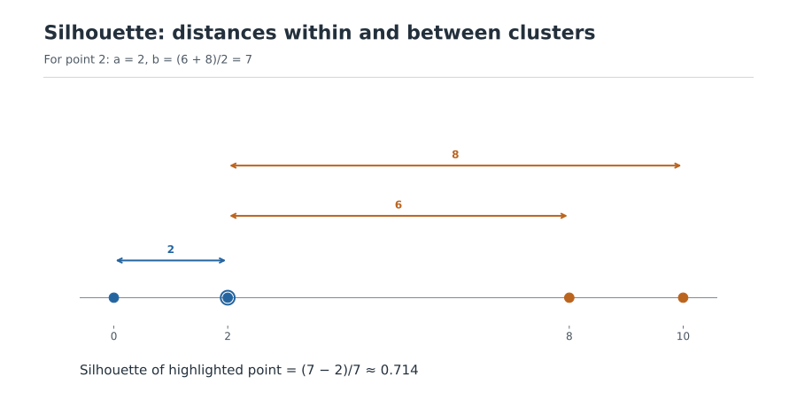

# M12-L7 – Internal and external evaluation of unsupervised methods {#L7}

**Course area:** M12 – Unsupervised learning and data mining

**Level:** Bachelor · Core/elective

**Prerequisites:** [M10-L6](M10-L6.md), [M12-L1](M12-L1.md)–[M12-L6](M12-L6.md).

**Learning objective:** Distinguish silhouette scores from the adjusted Rand index and plan a robust evaluation protocol.

## What can be evaluated without class labels? {#S1}

When customer groups are unknown, segmentation cannot simply be assessed using classification accuracy. Internal measures use data, distances and the resulting grouping. External measures compare against independently known reference groups. Stability analyses check whether similar groupings arise under different samples or initialisations. Each perspective answers a different question; suitability for a practical purpose must be established separately.

## Silhouette from two distances {#S2}




*Figure: Silhouette: Abstand zur eigenen und zur fremden Gruppe.*

For a point $i$, let $a(i)$ be the average distance to the other points in its cluster and $b(i)$ the smallest average distance to another cluster. With a positive denominator,

$$s(i)=\frac{b(i)-a(i)}{\max\{a(i),b(i)\}}.$$

The range is between -1 and 1. For singleton clusters, the score is conventionally set to zero; for a valid average silhouette, there must be at least two clusters and fewer clusters than data points. In the teaching example from [M12-L1](M12-L1.md), for point 2 the internal distance to 0 is 2, while the average distance to 8 and 10 is 7. Thus $s(2)=5/7\approx0.714$. The illustration shows precisely these three distances. The mean across all four points is approximately 0.746. The measure rewards compact, separated groups and may disadvantage elongated or density-based shapes.

## External pair comparison and stability {#S3}

The Rand index compares whether pairs of observations are grouped together or separated in both the reference and the model. The adjusted Rand index (ARI) corrects this agreement for chance expectation at fixed group sizes. Identical partitions receive 1 regardless of cluster labels. Values near zero approximately correspond to the modelled chance expectation; negative values are possible. With reference (0,0,1,1) and model (0,1,0,1), neither model group shares a pair with a reference group. At these group sizes, $2\cdot2/6=2/3$ shared pairs are expected. The ARI is $(0-2/3)/(2-2/3)=-0.5$.

```python
import numpy as np
from sklearn.metrics import silhouette_samples, adjusted_rand_score
X = np.array([0,2,8,10]).reshape(-1,1)
y = [0,0,1,1]
s = silhouette_samples(X,y)
assert np.allclose(s,[7/9,5/7,5/7,7/9])
assert np.isclose(s.mean(),47/63)
assert adjusted_rand_score(y,[1,1,0,0])==1
assert np.isclose(adjusted_rand_score(y,[0,1,0,1]),-.5)
```

For repeated samples, the ARI can compare stability on observations present in both samples. Document the sampling procedure, scaling, parameters, proportion of unassigned points and treatment of noise. Reference groups may themselves be incomplete or unsuitable for the new objective. If they are used for model selection, the final external evaluation requires an independent reference.

## Exercise and solution {#S4}

Two methods have mean silhouette scores of 0.6 and 0.5, but the second repeatedly identifies a domain-plausible elongated group. Must the first be chosen? Solution: No. Distance assumptions, stability, proportion of noise and intended use must also be assessed. In a synthetic test with a known grouping, an external measure can additionally show which structure the method actually recovers.

## Sources and further reading {#S5}

- [scikit-learn: Clustering](https://scikit-learn.org/stable/modules/clustering.html) – **Verification:** pending.
