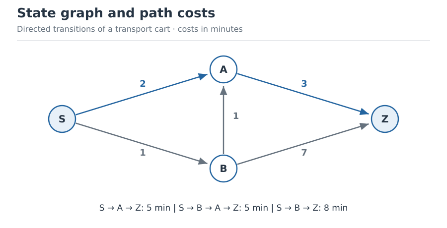

# M13-L1 – State spaces, problem formulation and search graphs {#L1}

**Course area:** M13 – Symbolic AI and intelligent search

**Level:** Bachelor · Core/elective

**Prerequisites:** M2, M3.

**Learning objective:** Model a discrete problem as a state space and determine admissible paths and their costs.

## From the task to the state model {#S1}

A mobile transport cart must travel from a storage room to a packing station. A task is not yet a search problem: first we must decide which information determines the possible actions. If all passages are open and the cart always carries the same load, its location is sufficient. If a key must be collected on the way, both location and possession of the key are necessary. Two situations with the same position but different keys must not be treated as identical. A state model is useful when the available actions, their consequences and the goal test can all be determined from the modelled state alone.

Formally, let $S$ be the set of states, $s_0\in S$ the initial state, $A(s)$ the set of admissible actions, $T(s,a)$ the successor state and $G\subseteq S$ the goal set. In this module we initially consider known, deterministic transitions. The cost function $c(s,a)$ assigns each action a non-negative value; costs might be minutes or units of energy. Different units must not be added without defined weighting.

## Graph, path and search tree {#S2}




*Figure: Zustandsgraph und Wegkosten.*

An original teaching graph consists of locations S, A, B and Z. It has directed connections S→A (2), S→B (1), A→Z (3), B→A (1) and B→Z (7). The numbers denote minutes. The illustration shows that several paths can lead to the same state. In contrast, a search tree contains paths as nodes and may list A several times. A return edge would even allow arbitrarily long repetitions in the search tree. Graph search therefore stores information about states already reached; cost-based search may need to take account of a newly discovered cheaper path.

For a path $p=(s_0,a_0,s_1,\ldots,a_{k-1},s_k)$ the cost is

$$C(p)=\sum_{i=0}^{k-1}c(s_i,a_i).$$

S→A→Z costs 5 minutes, S→B→A→Z also costs 5, and S→B→Z costs 8. Reaching a goal is not the same as finding a least-cost goal. If several solutions are equally good, a search algorithm may return any of them unless a secondary condition is specified.

## Checking the model in practice {#S3}

The following small enumeration serves only to check this acyclic teaching graph. Without cycle protection it would not be a general graph search.

```python
graph = {'S':[('A',2),('B',1)], 'A':[('Z',3)],
         'B':[('A',1),('Z',7)], 'Z':[]}
def paths(s):
    if s == 'Z':
        return [(('Z',),0)]
    return [((s,)+p,c+d) for t,c in graph[s] for p,d in paths(t)]
assert sorted(c for p,c in paths('S')) == [5,5,8]
```

In real problems the graph is often not stored in advance: a successor generator constructs only the necessary parts. With $d$ independent binary state features, up to $2^d$ different combinations are possible. The modelling therefore directly determines the size of the search. Unnecessary features enlarge the space, whereas missing features make results unreliable. Tests of permitted, forbidden and boundary-case actions check whether the abstraction actually represents the task.

## Exercise and solution {#S4}

An additional door from A to B costs 1 minute. Why is the recursive function above no longer sufficient? Solution: it can follow A→B→A indefinitely. With strictly positive costs, a shortest path can be chosen without such cycles. What information must be added if B is accessible only to an empty cart? The load status must be included in the state description. [M13-L2](M13-L2.md) discusses methods that do not need to enumerate every path.

## Sources and further reading {#S5}

- [Poole/Mackworth (2023): Searching for Solutions](https://www.cs.ubc.ca/~poole/aibook/3e/html/ArtInt3e.Ch3.html) – chapter overview, state space; selective cross-check. **Verification:** pending.
