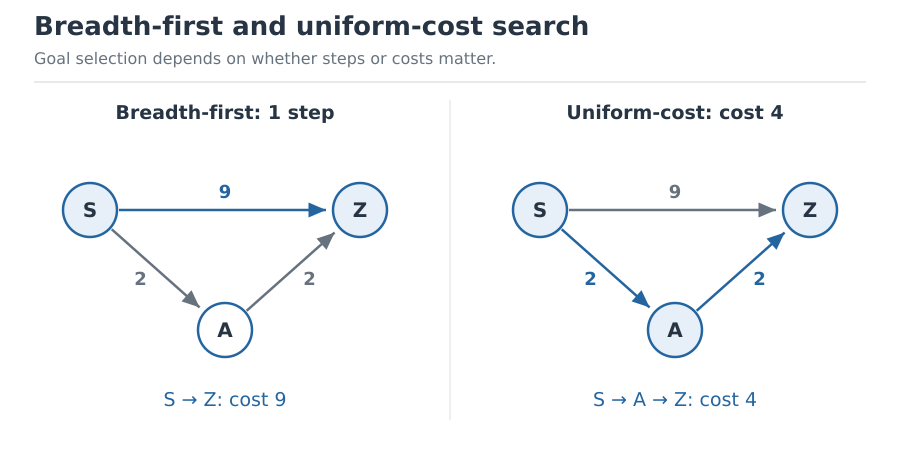

# M13-L2 – Uninformed search, costs and heuristics {#L2}

**Course area:** M13 – Symbolic AI and intelligent search

**Level:** Bachelor · Core/elective

**Prerequisites:** M2, M3, [M13-L1](M13-L1.md).

**Learning objective:** Select breadth-first, depth-first and uniform-cost search according to the goal and costs.

## Ordering the open paths {#S1}

A search routine maintains a set of possibilities still to be examined, the frontier. Many methods differ in the criterion used to select the next entry. Uninformed here means that no estimate of the remaining distance to the goal is used. The method nevertheless knows the transitions, the goal criterion and, where relevant, the costs incurred so far.

Breadth-first search (BFS) uses a queue: entries added first are examined first. Depth-first search (DFS) behaves like a stack and follows the most recently added branch. In a finite graph with visited-state marking, both can find reachable goals. In an infinite search space, however, DFS may become stuck in an endless branch. BFS is complete with a finite branching factor and a goal at finite depth, but orders paths only by their number of steps, not by differing costs. Without additional conditions, DFS is optimal neither in cost nor in depth. Iterative deepening repeats the search with increasing depth limits and combines low tree-search memory requirements with completeness at a finite branching factor.

## Few steps do not always mean low cost {#S2}




*Figure: Breitensuche und Kostensuche.*

A test device can connect S directly to Z (9 cost units), or via A (2) and then Z (2). BFS prefers the direct route; uniform-cost search (UCS) finds the cost of 4. UCS removes the path with the lowest cost incurred so far, $g(s)$. With non-negative edge costs in finite graphs, a state may be closed when its best entry is removed. For infinite graphs, a general completeness guarantee requires additional conditions, such as a finite branching factor and a strictly positive lower bound on costs. The illustration compares the priorities.

```python
from heapq import heappop, heappush
graph = {'S':[('A',2),('Z',9)],'A':[('Z',2)],'Z':[]}
q = [(0,'S')]; best = {'S':0}; order = []
while q:
    g,s = heappop(q)
    if g != best[s]:
        continue
    order.append(s)
    if s == 'Z':
        break
    for t,c in graph[s]:
        if g+c < best.get(t,float('inf')):
            best[t] = g+c
            heappush(q,(g+c,t))
assert (g,order) == (4,['S','A','Z'])
```

The first goal path discovered during expansion might be the expensive one. UCS therefore tests for the goal when removing an entry. The old entry with cost 9 remains in the queue but is invalidated by the better value.

## Resource requirements and introductory heuristics {#S3}

For a regular search tree with branching factor $b>1$, a complete traversal down to depth $d$ generates $1+b+\ldots+b^d=(b^{d+1}-1)/(b-1)$ nodes; the actual frontier may depend on the order and early termination. Even with $b=3,d=5$, the entire tree contains 364 nodes. A heuristic $h(s)$ instead attempts to estimate the remaining cost from the state description. Greedy best-first search selects only the smallest $h$, without accounting for the distance already travelled. A seemingly nearby goal behind a barrier may thus require expensive detours. UCS and the A* search discussed in [M13-L3](M13-L3.md) account for the costs already incurred.

## Exercise and solution {#S4}

The direct route now costs 3, while the other two edges still cost 2 each. What do BFS and UCS return? Solution: both find the direct route costing 3. UCS first examines A at cost 2 but identifies that the route via A costs 4 in total. With a negative-cost edge, the closing steps of the algorithm would no longer be generally correct.

## Sources and further reading {#S5}

- [Poole/Mackworth (2023): Uninformed Search Strategies](https://www.cs.ubc.ca/~poole/aibook/3e/html/ArtInt3e.Ch3.S5.html) – breadth-first, depth-first and uniform-cost search; selective cross-check. **Verification:** pending.
- [Poole/Mackworth (2023): Informed (Heuristic) Search](https://www.cs.ubc.ca/~poole/aibook/3e/html/ArtInt3e.Ch3.S6.html) – heuristics and A*; selective cross-check. **Verification:** pending.
