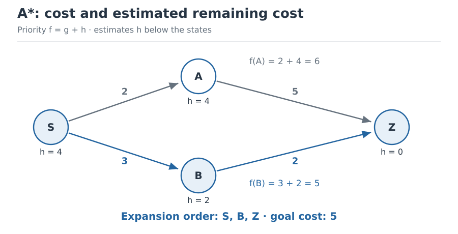

# M13-L3 – A*, admissibility and consistency {#L3}

**Course area:** M13 – Symbolic AI and intelligent search

**Level:** Bachelor · Core/elective

**Prerequisites:** M2, M3, [M13-L2](M13-L2.md).

**Learning objective:** Calculate A*, distinguish admissible from consistent heuristics and explain the role of re-expansion.

## Priority based on cost and prediction {#S1}




*Figure: A*: Aufwand und Restkostenschätzung.*

A* search combines the actual distance from the start $g(s)$ along the best known path so far with an estimated remaining distance $h(s)$. Selection is based on

$$f(s)=g(s)+h(s).$$

We use a small transport graph with edges S→A (2), S→B (3), A→Z (5), B→Z (2). Set $h(S)=4,h(A)=4,h(B)=2,h(Z)=0$. The estimates have the same unit as the edge costs. After S, A with $f=6$ and B with $f=5$ are available. B is expanded before A and yields Z with $g=f=5$. The illustration presents costs and estimates together. Search prioritised exclusively by $g$ would examine A before B.

## Admissibility, consistency and optimality {#S2}

Let $h^*(s)$ be the minimum remaining cost from $s$ to a goal. A non-negative heuristic is admissible if $h(s)\le h^*(s)$ holds for every reachable state. Consistency additionally requires, for each edge with cost $c(s,t)$,

$$h(s)\le c(s,t)+h(t),\qquad h(z)=0.$$

Summing these inequalities along any goal path gives $h(s)\le C(p)$ and therefore admissibility. The converse does not hold. In the example graph, $h$ is consistent: for example, $4\le 3+2$ and $2\le 2+0$. The true remaining costs for S, A, B and Z are 5, 5, 2 and 0 respectively. Under consistency, $f$ cannot decrease along a path. In a finite graph with non-negative costs, correct graph search removes a goal optimally; with a merely admissible, inconsistent heuristic, previously expanded states must be eligible for reopening when a better cost is found. General infinite spaces require further termination conditions.

## Implementation with a cost table {#S3}

```python
from heapq import heappop, heappush
graph = {'S':[('A',2),('B',3)],'A':[('Z',5)],
         'B':[('Z',2)], 'Z':[]}
h = dict(S=4,A=4,B=2,Z=0)
assert all(h[s] <= c+h[t] for s in graph for t,c in graph[s])
q = [(h['S'],0,'S')]; best = {'S':0}; order = []
while q:
    f,g,s = heappop(q)
    if g != best[s]:
        continue
    order.append(s)
    if s == 'Z':
        break
    for t,c in graph[s]:
        if g+c < best.get(t,float('inf')):
            best[t] = g+c
            heappush(q,(g+c+h[t],g+c,t))
assert (g,order) == (5,['S','B','Z'])
```

The table suppresses worse duplicates but does not prevent re-expansion when costs improve. Heuristics can be constructed from simplified problems: on a grid with horizontal and vertical unit steps and no shortcuts, Manhattan distance provides a lower bound if obstacles are ignored. If diagonal movement is permitted, it may be too large. A strong heuristic saves time only if calculating it does not consume the benefit.

## Exercise and solution {#S4}

Set $h(S)=5,h(B)=0$ and leave the other values unchanged. Is the new heuristic admissible and consistent? Solution: it nowhere exceeds the true remaining costs and is thus admissible. But for S→B, $5>3+0$, so it is inconsistent. An admissible heuristic is not automatically suitable for an implementation without reopening.

## Sources and further reading {#S5}

- [Poole/Mackworth (2023): Informed (Heuristic) Search](https://www.cs.ubc.ca/~poole/aibook/3e/html/ArtInt3e.Ch3.S6.html) – heuristics and A*; selective cross-check. **Verification:** pending.
