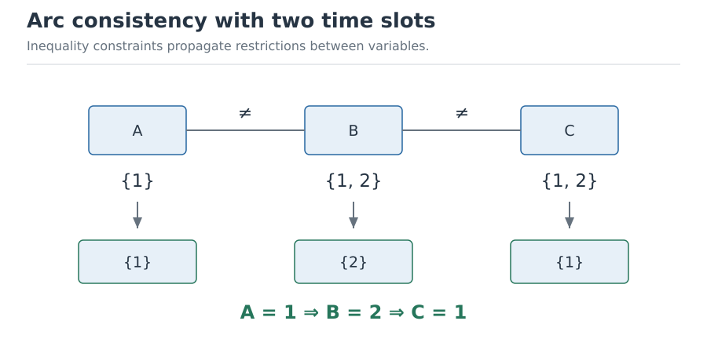

# M13-L4 – Constraints and constraint satisfaction {#L4}

**Course area:** M13 – Symbolic AI and intelligent search

**Level:** Bachelor · Core/elective

**Prerequisites:** M2, M3, [M13-L3](M13-L3.md).

**Learning objective:** Formulate variables, domains and constraints, apply arc consistency and check an assignment.

## Assignments rather than paths {#S1}

A university laboratory schedules three experiments A, B and C in two time slots, 1 and 2. A and B require the same measuring instrument, while B and C require the same supervisor. Neither pair may take place simultaneously. A constraint satisfaction problem (CSP) consists of variables $X$, their domains $D_i$ and a set of constraints $C$. The task is to assign values to all variables so that every hard constraint is satisfied. In the example, $A\ne B$ and $B\ne C$. Initially this is a feasibility question; a preferred time slot or minimised waiting time would be an additional optimisation problem.

## Propagation: removing impossible values {#S2}




*Figure: Kantenkonsistenz bei zwei Zeitfenstern.*

Assume A is available only in time slot 1. The constraint graph in the illustration has edges A–B and B–C. For each directed arc $X_i\to X_j$, a binary relation is arc-consistent when every remaining value $v\in D_i$ has at least one compatible value $w\in D_j$:

$$\forall v\in D_i\ \exists w\in D_j:\ (v,w)\in R_{ij}.$$

From $D_A=\{1\}$ it follows that B cannot be 1. From $D_B=\{2\}$ it follows that C cannot be 2. The domains become $\{1\},\{2\},\{1\}$. Methods such as AC-3 recheck affected arcs after changes until no further value can be removed or an empty domain indicates a contradiction. Arc consistency does not prove that a global solution exists in a general graph. For example, three pairwise distinct variables with domains $\{1,2\}$ remain arc-consistent but cannot be solved jointly.

## Search with backtracking {#S3}

Backtracking extends a partial assignment, checks all constraints that can already be evaluated and discards a branch as soon as a conflict arises. MRV (minimum remaining values) preferentially selects the variable with the smallest remaining domain. Bottlenecks are thus recognised early. When domains are equally small, the variable with particularly many unassigned neighbours may take priority.

```python
from itertools import product
def feasible(domains, edges):
    return [p for p in product(*domains)
            if all(p[i] != p[j] for i,j in edges)]
assert feasible([[1],[1,2],[1,2]],[(0,1),(1,2)]) == [(1,2,1)]
assert feasible([[1,2]]*3,[(0,1),(1,2),(0,2)]) == []
```

Enumeration tests at most $2^3=8$ complete assignments when all domains contain both values. Propagation can rule out many of these combinations without generating them in full. Independent subgraphs may be solved separately, whereas global constraints such as AllDifferent often benefit from specialised propagators. An empty solution space may also indicate incorrectly recorded availability; therefore document the origin of each hard constraint.

## Exercise and solution {#S4}

A and C must now also occupy different time slots. Can a third slot solve the problem? Solution: yes, for example A=1, B=2 and C=3, provided B and C are actually allowed to use the third slot. With two slots the triangular structure is unsatisfiable. An infeasible assignment must not silently be presented as an optimal solution.

## Sources and further reading {#S5}

- [Poole/Mackworth (2023): Consistency Algorithms](https://www.cs.ubc.ca/~poole/aibook/3e/html/ArtInt3e.Ch4.S3.html) – arc consistency; selective cross-check. **Verification:** pending.
