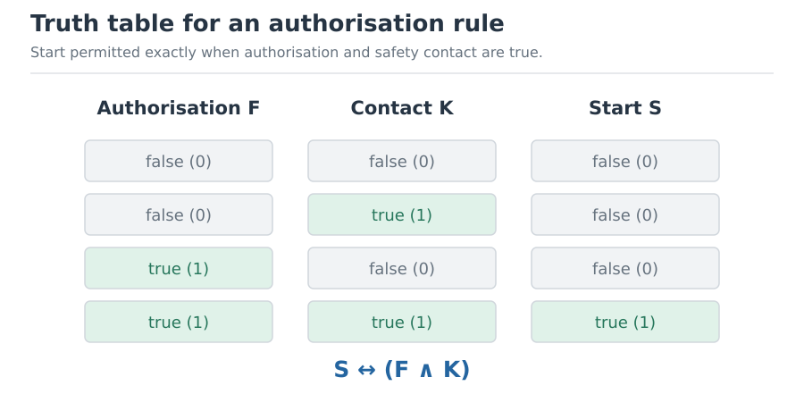

# M13-L5 – Propositional and predicate logic in AI systems {#L5}

**Course area:** M13 – Symbolic AI and intelligent search

**Level:** Bachelor · Core/elective

**Prerequisites:** M2, M3, [M13-L4](M13-L4.md).

**Learning objective:** Formalise propositions and predicates, distinguish models from logical entailment and interpret quantifiers.

## Truth and models {#S1}

A controller may start a machine if authorisation F is present and safety contact K is closed. In the model, F, K and S (start permitted) denote Boolean propositions. The rule might be $S\leftrightarrow(F\land K)$. This does not assert that the machine is actually running, but only specifies when permission is granted within the model. Propositional logic has truth values, not probabilities. Negation $\neg$, conjunction $\land$, disjunction $\lor$ and implication $\to$ are defined by their truth conditions. An implication $P\to Q$ is false precisely when P is true and Q is false. It asserts neither temporal order nor causality.

## Entailment rather than conjecture {#S2}




*Figure: Wahrheitstabelle einer Freigaberegel.*

In a knowledge base K (written here as $\mathcal K$ to distinguish it from the safety contact), $\varphi$ is logically entailed if every model of the base also satisfies $\varphi$:

$$\mathcal K\models\varphi.$$

In the teaching example, authorisation and a closed contact entail permission. Conversely, missing authorisation alone does not imply that the contact is open. The illustration shows the four input combinations and the resulting value of S. A formula is satisfiable if at least one assignment makes it true, valid if this holds for all assignments, and unsatisfiable if no satisfying assignment exists. An inconsistent knowledge base has no model; under classical entailment every formula follows from it. Consistency checks are therefore essential.

```python
from itertools import product
models = [(f,k,s) for f,k,s in product([False,True],repeat=3)
          if s == (f and k)]
assert len(models) == 4
assert all(s for f,k,s in models if f and k)
assert any(k for f,k,s in models if not f)
```

Checking by complete enumeration requires up to $2^n$ assignments for $n$ independent propositions. Rules of inference often allow direct derivations, for example deriving Q from P and $P\to Q$ by modus ponens.

## From propositions to individuals {#S3}

Predicate logic additionally describes objects and relations. Instead of inventing a separate proposition for each device, we can define a unary predicate $\mathrm{Calibrated}(x)$ and a binary predicate $\mathrm{Uses}(x,y)$, for example. A rule for all devices might be:

$$\forall x\ (\mathrm{Calibrated}(x)\to \mathrm{Checked}(x)).$$

Together with $\mathrm{Calibrated}(a)$ this entails $\mathrm{Checked}(a)$. By contrast, $\exists x\ \mathrm{Checked}(x)$ denotes the existence of at least one checked object without determining its identity. Negating a universal statement asserts the existence of a counterexample. Quantifier order is crucial: $\forall x\exists y\ R(x,y)$ allows different partners y, whereas $\exists y\forall x\ R(x,y)$ requires a common partner. Full first-order predicate logic is undecidable in general; specialised fragments are considered in [M13-L6](M13-L6.md) and [M13-L8](M13-L8.md).

## Exercise and solution {#S4}

We wish to infer P from $P\to Q$ and Q. Is this valid? Solution: no. The assignment P=false, Q=true satisfies both premises but not P. What is the negation of $\forall x\ \mathrm{Checked}(x)$? Solution: $\exists x\ \neg \mathrm{Checked}(x)$. At least one object has not been checked.

## Sources and further reading {#S5}

- [Poole/Mackworth (2023): Propositions and Inference](https://www.cs.ubc.ca/~poole/aibook/3e/html/ArtInt3e.Ch5.html) – chapter overview; propositional logic; selective cross-check. **Verification:** pending.
- [Poole/Mackworth (2023): Propositional Definite Clauses](https://www.cs.ubc.ca/~poole/aibook/3e/html/ArtInt3e.Ch5.S3.html) – rule-based inference; selective cross-check. **Verification:** pending.
- [Poole/Mackworth (2023): Predicate Calculus](https://www.cs.ubc.ca/~poole/aibook/3e/html/ArtInt3e.Ch15.S3.html) – quantifiers and semantics; selective cross-check. **Verification:** pending.
