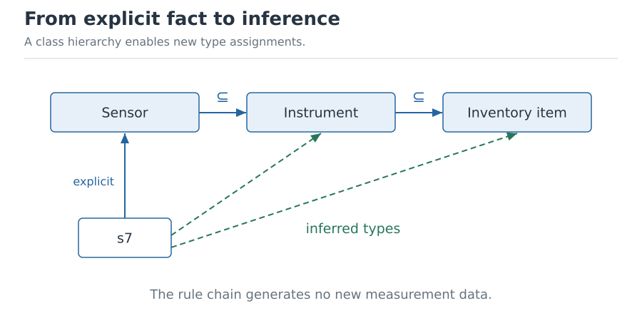

# M13-L6 – Knowledge representation, ontologies and inference {#L6}

**Course area:** M13 – Symbolic AI and intelligent search

**Level:** Bachelor · Core/elective

**Prerequisites:** M2, M3, [M13-L5](M13-L5.md).

**Learning objective:** Model knowledge as facts, rules and an ontology, and distinguish unknown from false propositions.

## Defining concepts and relationships {#S1}

A research database records measuring instruments, sensors and laboratory rooms. A knowledge graph can connect individual objects via typed edges: sensor s7 is located in room r2. An ontology additionally specifies the intended concepts and relations and their logical properties. For example, Sensor may be a subclass of MeasuringInstrument. Every object classified as a sensor then also belongs to the superclass. A graph alone does not guarantee this inference; it depends on the defined axioms and the semantics used.

In the Resource Description Framework (RDF), statements are organised as triples (subject, predicate, object). OWL 2 additionally allows formal class relationships and properties. A class describes a set of possible instances, while an individual is a specific object. Properties connect individuals or assign data values to them. When modelling, distinguish whether an expression denotes a category, a particular device or a measured value.

## Applying rules and recording derivations {#S2}




*Figure: Vom expliziten Fakt zur Folgerung.*

Our original teaching example uses the facts Sensor(s7), Ort(s7,r2) (location), and the rules $\mathrm{Sensor}(x)\to \mathrm{Messgeraet}(x)$ and $\mathrm{Messgeraet}(x)\to \mathrm{Inventarobjekt}(x)$, each implicitly universally quantified. Thus Inventarobjekt(s7) (inventory item) can be derived. The illustration distinguishes the explicit type assertion from the two inferred types. The identifiers Messgeraet (measuring instrument) and Inventarobjekt (inventory item) are retained in the rules and code.

Forward chaining starts with known facts and adds conclusions until nothing changes. Backward chaining starts with the query and looks for rules and facts that support it. For definite Horn rules over a finite set of ground atoms, forward chaining can proceed to a fixed point. The following example, restricted to a single individual, implements exactly this principle; it is not a general OWL reasoner.

```python
facts = {'Sensor(s7)','Ort(s7,r2)'}
rules = [('Messgeraet(s7)','Inventarobjekt(s7)'),
         ('Sensor(s7)','Messgeraet(s7)')]
while True:
    new = facts | {b for a,b in rules if a in facts}
    if new == facts:
        break
    facts = new
assert 'Inventarobjekt(s7)' in facts
assert len(facts) == 4
assert 'Sensor(r2)' not in facts
```

Here, the order of the rules affects only the number of iterations required to reach the fixed point. The derivation can be logged using rule and fact identifiers. This facilitates diagnosis of incorrect conclusions but does not replace checking the underlying facts.

## Open world and identity {#S3}

If information about whether s7 is calibrated is missing, this does not mean that s7 is uncalibrated under the OWL open-world assumption. This differs from a database query that returns only existing entries. Different names in OWL also do not automatically denote different individuals; equality or inequality may need to be expressed. An inventory check that treats missing calibration data as an error should therefore be modelled as a separate validation rule. Ontological reasoning and completeness checking pursue different goals. For large graphs, restricted language profiles, indexing and incremental updates can help; more expressive modelling may require more computation time.

## Exercise and solution {#S4}

The ontology declares Sensor and Room to be disjoint classes. s7 is assigned to both. What happens? Solution: under classical OWL semantics the knowledge base is inconsistent. The disjoint classes cannot have a common individual. If only the assertion Room(s7) (Raum(s7) in the original notation) is missing, however, without additional axioms its absence alone does not imply that it is false.

## Sources and further reading {#S5}

- [Poole/Mackworth (2023): Propositional Definite Clauses](https://www.cs.ubc.ca/~poole/aibook/3e/html/ArtInt3e.Ch5.S3.html) – rule-based inference; selective cross-check. **Verification:** pending.
- [W3C: OWL 2 Web Ontology Language Primer (Second Edition)](https://www.w3.org/TR/owl2-primer/) – classes, properties, open world; selective cross-check. **Verification:** pending.
