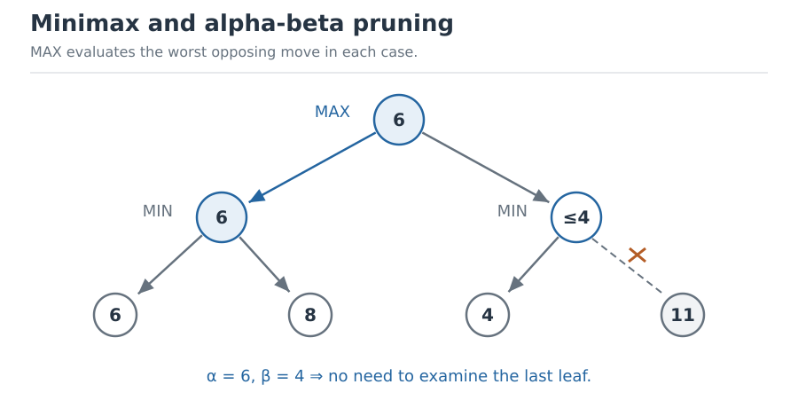

# M13-L7 – Automated planning and adversarial search {#L7}

**Course area:** M13 – Symbolic AI and intelligent search

**Level:** Bachelor · Core/elective

**Prerequisites:** M2, M3, [M13-L6](M13-L6.md).

**Learning objective:** Model deterministic action planning and minimax search and calculate their different objective quantities.

## Plans as sequences of executable actions {#S1}

An automated laboratory system must transport a sample from a storage magazine to an analyser. A state can be represented as a set of true atomic facts. In the simplified model, bereit (ready) means that the sample is accessible, geladen (loaded) that it is inside the device, and gemessen (measured) that measurement has taken place. The Load action requires bereit, adds geladen and removes bereit. Measure requires geladen and adds gemessen. An action is applicable only when its preconditions are satisfied.

For positive preconditions and sets of atoms to be added or removed, the simplified STRIPS transition rule is

$$s'=(s\setminus Del(a))\cup Add(a),\qquad Pre(a)\subseteq s.$$

The planning task is to find an action sequence that takes the initial state $s_0=\{bereit\}$ to a state containing gemessen. All unchanged facts are retained in this model. Forward search examines applicable actions; backward planning regresses goal conditions through suitable actions. Parallelism, durations, resource consumption and uncertain effects require more extensive models. Correct planning within the model does not yet guarantee physical executability.

```python
s = {'bereit'}
actions = [({'bereit'},{'geladen'},{'bereit'}),
           ({'geladen'},{'gemessen'},set())]
for pre,add,delete in actions:
    assert pre <= s
    s = (s-delete)|add
assert s == {'geladen','gemessen'}
```

## Opponents change the choice {#S2}

In a deterministic two-player zero-sum game with perfect information, the consequences of a choice also depend on the opponent's moves. MAX wants a high utility, MIN a low one. Instead of finding one favourable path, the agent must evaluate a decision against all admissible optimal responses. For terminal states, $V(s)=U(s)$; at MAX and MIN turns respectively,

$$V(s)=\max_{t\in Succ(s)}V(t)\quad\text{or}\quad V(s)=\min_{t\in Succ(s)}V(t).$$

In the illustrated teaching tree, MAX may choose left or right. On the left, MIN may choose between utilities of 6 and 8 points; on the right, between 4 and 11. The subtree values are 6 and 4, and the root receives 6. The attractive terminal value 11 is not guaranteed, because MIN can prefer 4. Utility points are model values, not probabilities.

## Alpha-beta and search limits {#S3}




*Figure: Minimax und Alpha-Beta-Schnitt.*

After evaluating the left subtree, MAX has the lower bound $\alpha=6$. In the right subtree the first leaf yields 4, so this MIN node already has an upper bound $\beta=4$. As soon as $\alpha\ge\beta$, the remaining right branch can be omitted without changing the optimal root value. Such a cut does not necessarily reveal the exact value of the pruned subtree. For large trees, a depth limit with estimated state values is often used as well; this forfeits the general guarantee of optimal moves.

```python
scores = [[6,8],[4,11]]
assert max(map(min,scores)) == 6
alpha = min(scores[0])
beta = scores[1][0]
assert alpha >= beta
```

## Exercise and solution {#S4}

The first right leaf value increases from 4 to 7. Can the second right leaf value still be skipped? Solution: no, 7 is greater than the current bound of 6. With the second value 11, the right subtree yields 7 and MAX chooses right. What confusion would be problematic with a random rather than deliberately minimising opponent? The minimum is then not the expected value of a probability distribution; another decision model would be needed.

## Sources and further reading {#S5}

- [Poole/Mackworth (2023): Representing States, Actions, and Goals](https://www.cs.ubc.ca/~poole/aibook/3e/html/ArtInt3e.Ch6.S1.html) – planning model; selective cross-check. **Verification:** pending.
- [UC Berkeley CS188: Minimax](https://inst.eecs.berkeley.edu/~cs188/textbook/games/minimax.html) – minimax and alpha-beta; selective cross-check. **Verification:** pending.
