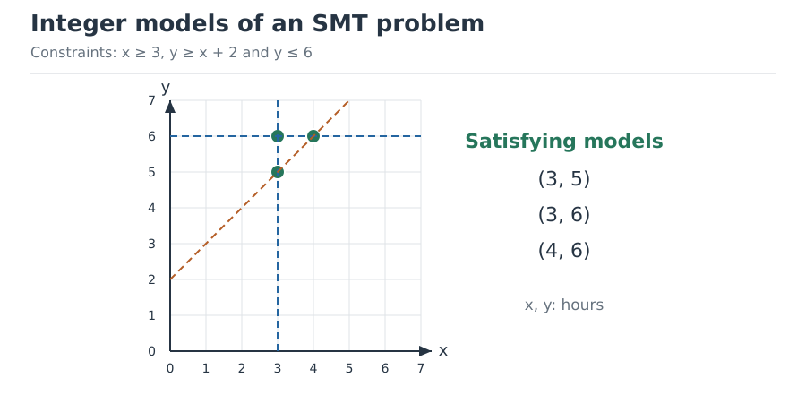

# M13-L8 – Automated reasoning: SAT, SMT and satisfiability checking {#L8}

**Course area:** M13 – Symbolic AI and intelligent search

**Level:** Bachelor · Advanced elective

**Prerequisites:** M2, M3, [M13-L7](M13-L7.md).

**Learning objective:** Understand SAT and SMT as feasibility checks and analyse CNF and a small arithmetic contradiction.

## Boolean satisfiability {#S1}

A computer is to operate with two redundant services A and B. At least one must be active; both must not run at the same time because they require exclusive access to a resource. The Boolean specification is

$$F=(A\lor B)\land(\neg A\lor\neg B).$$

A formula in conjunctive normal form (CNF) is a conjunction of clauses, each clause consisting of a disjunction of literals (variables or their negations). The teaching example has two satisfying models: A true, B false, and A false, B true. SAT asks whether such a model exists at all. SAT is NP-complete; this does not imply that every practical instance is difficult to solve.

## Propagation and conflicts {#S2}

If the unit clause A is added, the second clause forces $\neg B$. If B is also added, a conflict arises. In unit propagation, a clause with only one remaining possibly true literal determines its value. The DPLL algorithm combines this simplification with branching and backtracking. Modern CDCL solvers learn new implied clauses from conflicts to avoid similar fruitless search branches. This can provide substantial improvements over complete enumeration. A SAT result can be checked against the assignment found; for UNSAT, an appropriate proof certificate can allow independent verification.

```python
from itertools import product
models = [(a,b) for a,b in product([False,True],repeat=2)
          if (a or b) and not(a and b)]
assert models == [(False,True),(True,False)]
assert not any(a and b for a,b in models)
```

## SMT: constraints over numbers {#S3}




*Figure: Ganzzahlige Modelle eines SMT-Problems.*

Another teaching example describes two integer start times x and y in hours. A two-hour operation must begin and finish before the next one, and the second time slot must start no later than hour 6. The conditions are $x\ge3$, $y\ge x+2$, $y\le6$. They are jointly satisfiable, for example with x=3, y=5. The illustration shows precisely the three admissible integer points (3,5), (3,6), (4,6). The conditions must all hold in the same interpretation. With $y\le4$, no model would be possible, because $x\ge3$ and $y\ge x+2$ already force $y\ge5$.

SMT extends the satisfiability question to defined theories (for example linear integer arithmetic, bit vectors or arrays). In SMT-LIB the satisfiable case can be expressed as follows:

```smtlib
(set-logic QF_LIA)
(declare-const x Int)
(declare-const y Int)
(assert (>= x 3))
(assert (>= y (+ x 2)))
(assert (<= y 6))
(check-sat)
```

The expected result is `sat`. The logic QF_LIA allows quantifier-free linear integer arithmetic. The following Python lines independently check this specific small range of values; they do not replace an SMT solver and are not a general decision procedure.

```python
points = [(x,y) for x in range(3,5) for y in range(5,7)
          if y >= x+2]
assert points == [(3,5),(3,6),(4,6)]
assert not any(y >= x+2 for x in range(3,5) for y in range(0,5))
```

For each of the two bounds, the admissible range follows from the inequalities; the point is not to restrict an arbitrary SMT instance to small numbers. Depending on the fragment and implementation, solvers may also report `unknown`. This answer must not be treated as UNSAT.

## Exercise and solution {#S4}

Which models remain in the numerical example with the additional condition $y=6$? Solution: (3,6) and (4,6) remain. Does a satisfiable formula prove that the modelled workflow is safe in reality? No, it demonstrates only the existence of a model with respect to the specified conditions. Missing resource or safety rules must first be modelled.

## Sources and further reading {#S5}

- [cvc5: Satisfiability Modulo Theories – SMT Theories](https://cvc5.github.io/tutorials/beginners/theories.html) – Boolean and arithmetic theories; selective cross-check. **Verification:** pending.
