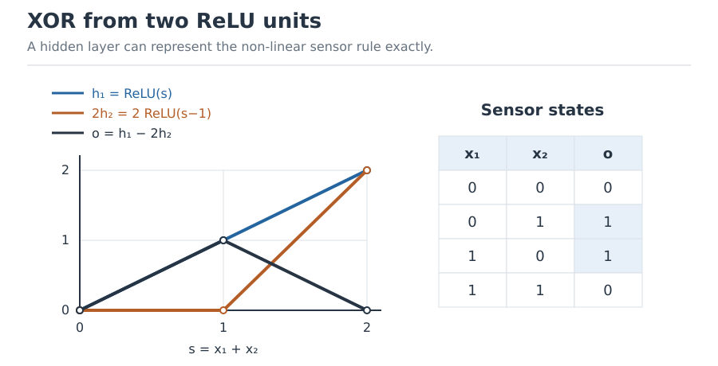

# M14-L1 – Perceptron and multilayer networks {#L1}

**Course area:** M14 – Neural networks and introduction to deep learning

**Level:** Bachelor · Core/elective

**Prerequisites:** M9, M10.

**Learning objective:** Explain linear decision boundaries, construct a non-linear network architecture and count parameters.

## A decision based on weighted features {#S1}

A conveyor system should send a workpiece for further inspection only if exactly one of two inspection sensors is triggered. The sensor states $x_1,x_2\in\{0,1\}$ are dimensionless. A single threshold unit first computes a score $z=\mathbf w^\top\mathbf x+b$ and reports $y=1$ if $z>0$, otherwise $y=0$. The classical perceptron is a model of this kind; its learning rule corrects an incorrect decision using $\mathbf w\leftarrow\mathbf w+\eta(y_{\mathrm{soll}}-y)\mathbf x$ and $b\leftarrow b+\eta(y_{\mathrm{soll}}-y)$, with learning rate $\eta>0$. The subscript 'soll' denotes the target value. For finite, linearly separable training data, the classical rule converges under the usual assumptions; there is no such guarantee for arbitrary data.

The system's requirement corresponds to XOR. For (0,0) and (1,1) the score must be non-positive; for (1,0) and (0,1) it must be positive. This implies $b\le0$, $w_1+b>0$, $w_2+b>0$ and $w_1+w_2+b\le0$. However, the two middle inequalities imply $w_1+w_2+b>-b\ge0$. A contradiction: a straight line cannot separate the four combinations as required.

## A hidden layer for feature construction {#S2}




*Figure: XOR aus zwei ReLU-Einheiten.*

Instead of a single unit, we use two ReLU units. ReLU denotes $r(z)=\max(0,z)$. Set $s=x_1+x_2$, $h_1=r(s)$ and $h_2=r(s-1)$. The output $o=h_1-2h_2$ yields exactly $0,1,0$ for $s=0,1,2$, respectively. Further inspection is triggered at an output threshold of 0.5 or above. The illustration shows this decomposition: the second unit reduces the previously increasing score when both sensors are active.

In general, a fully connected layer with $d$ inputs and $m$ outputs is described by a matrix $W\in\mathbb R^{m\times d}$ and a bias vector $b\in\mathbb R^m$. It has $m(d+1)$ trainable scalars. The network 2→2→1 therefore has $2(2+1)+1(2+1)=9$ parameters, even if individual values in the constructed example are identical. Without a non-linear intermediate operation, any composition of affine layers would again reduce to an affine map: $W_2(W_1x+b_1)+b_2=(W_2W_1)x+(W_2b_1+b_2)$.

## Checking our own construction {#S3}

```python
from itertools import product
for x1, x2 in product((0, 1), repeat=2):
    s = x1 + x2
    h1, h2 = max(0, s), max(0, s-1)
    assert int(h1-2*h2 >= 0.5) == (x1 ^ x2)
```

Here the weights were chosen algebraically, not trained. This is possible for small, known rules. In many applications, however, we have examples but no manageable decision formula. There the weights are adjusted through optimisation. An architecture provides a set of possible functions; its expressiveness alone tells us nothing about the effort of learning or generalisation. Real sensor data are also noisy, and a hard threshold can switch frequently in borderline cases.

## Exercise and solution {#S4}

How many parameters does a fully connected network 4→6→3→1 have, with biases in every computational layer? Solution: $6\cdot5+3\cdot7+1\cdot4=55$. If the two hidden layers use identity functions and the output is also affine, the entire network can be replaced by a single affine map from four values to one. Explain why more parameters alone cannot create a non-linear decision boundary: it is the non-linear transformation that changes the function class.

## Sources and further reading {#S5}

- [Zhang et al.: Dive into Deep Learning, §5.1](https://d2l.ai/chapter_multilayer-perceptrons/mlp.html) – affine and non-linear layers, selective comparison. **Verification:** pending.
- [Cornell University, CS4780: The Perceptron (Spring 2023)](https://courses.cis.cornell.edu/cs4780/2023sp/lectures/lecturenote03.html) – convergence theorem; ±1 convention. **Verification:** pending.
