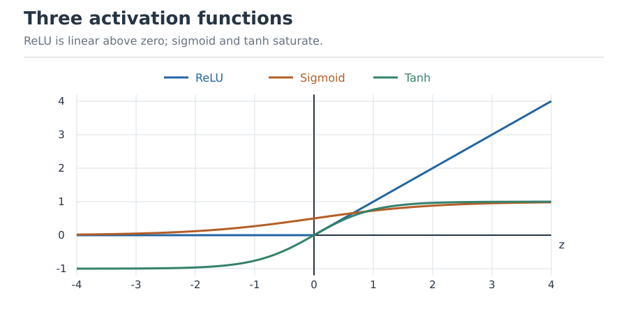

# M14-L2 – Activation functions and forward computation {#L2}

**Course area:** M14 – Neural networks and introduction to deep learning

**Level:** Bachelor · Core/elective

**Prerequisites:** M9, M10, [M14-L1](M14-L1.md).

**Learning objective:** Select activations, track tensor shapes and calculate a multiclass prediction numerically.

## From score to activation {#S1}




*Figure: Drei Aktivierungsfunktionen.*

A network for classifying the condition of a pump receives two already scaled measurements. An intermediate neuron first produces a weighted sum. An activation function transforms this into a new value. For real-valued scores $z$, three important possibilities are

$$r(z)=\max(0,z),\qquad \sigma(z)=\frac{1}{1+e^{-z}},\qquad \tanh(z)=\frac{e^z-e^{-z}}{e^z+e^{-z}}.$$

ReLU leaves positive values unchanged, sets negative values to zero and is not classically differentiable at zero. Backpropagation uses a convention there (often 0). Sigmoid yields values between 0 and 1, and tanh between −1 and 1. Their derivatives are $\sigma'(z)=\sigma(z)(1-\sigma(z))$ and $\tanh'(z)=1-\tanh^2(z)$. For large absolute values these become very small; the illustration shows the saturation. Sigmoid is common for a binary output with an appropriate loss, and ReLU for hidden layers; there is no universally optimal activation.

## Two layers by hand {#S2}

We use column vectors. With $x=(1,2)^\top$, $W_1=\begin{pmatrix}1&-1\\2&1\end{pmatrix}$ and $b_1=(0,-1)^\top$ we obtain $z_1=(-1,3)^\top$ and $h=r(z_1)=(0,3)^\top$. An output layer with three rows $W_2=\begin{pmatrix}1&0\\0&1\\-1&-1\end{pmatrix}$ and $b_2=(1,-1,2)^\top$ produces the logits $o=(1,2,-1)^\top$. The categories are mutually exclusive: normal, monitor, shut down. The softmax function couples the outputs:

$$p_i=\frac{\exp(o_i-m)}{\sum_j\exp(o_j-m)},\qquad m=\max_j o_j.$$

Subtracting the maximum leaves the ratio unchanged and avoids overflow for very large positive scores. Here the denominator is $e^{-1}+1+e^{-3}\approx1.4177$, giving $p\approx(0.2595,0.7054,0.0351)$. The model's decision by the maximum is to monitor. These values are normalised as probabilities within the model but are not automatically empirically calibrated.

## Shapes and batch computation {#S3}

In a matrix $X$ with $B$ example rows, the same layer computes $Z=XW^\top+b$ with output shape $(B,m)$. The bias is added to each row. Softmax must operate across categories for each example, not across examples. Multiple independent binary outputs for faults that may occur simultaneously would instead require separate sigmoid functions and a corresponding loss.

```python
import numpy as np
x = np.array([1., 2.])
w1 = np.array([[1., -1.], [2., 1.]])
w2 = np.array([[1., 0.], [0., 1.], [-1., -1.]])
h = np.maximum(w1 @ x + [0., -1.], 0.)
o = w2 @ h + [1., -1., 2.]
e = np.exp(o-o.max())
p = e/e.sum()
assert np.allclose(o, [1, 2, -1])
assert np.allclose(p, [0.259496, 0.705385, 0.035119], atol=1e-6)
assert np.isclose(p.sum(), 1.)
```

A forward computation does not yet change the weights. Learning information is calculated only from the target state, model value and loss. Before implementation, it is useful to write down the shape of every intermediate matrix; transposed weights or the wrong softmax axis can then be detected early.

## Exercise and solution {#S4}

What happens when 1000 is added to all three logits? Solution: softmax remains unchanged because the same factor cancels in the numerator and denominator. For $z=-2$, ReLU is 0, sigmoid is approximately 0.1192 and tanh is approximately −0.9640. Which function yields negative values while remaining bounded? Tanh.

## Sources and further reading {#S5}

- [Zhang et al.: Dive into Deep Learning, §5.1](https://d2l.ai/chapter_multilayer-perceptrons/mlp.html) – activations. **Verification:** pending.
- [Zhang et al.: Dive into Deep Learning, §5.3](https://d2l.ai/chapter_multilayer-perceptrons/backprop.html) – forward computation. **Verification:** pending.
- [Zhang et al.: Dive into Deep Learning, 4.1 Softmax Regression](https://d2l.ai/chapter_linear-classification/softmax-regression.html) – normalisation by softmax. **Verification:** pending.
