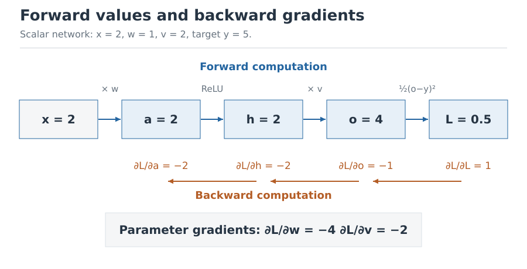

# M14-L3 – Chain rule and backpropagation {#L3}

**Course area:** M14 – Neural networks and introduction to deep learning

**Level:** Bachelor · Core/elective

**Prerequisites:** M9, M10, [M14-L2](M14-L2.md).

**Learning objective:** Derive gradients in a small computational graph and check them using finite differences.

## Composing local derivatives {#S1}




*Figure: Vorwärtswerte und Rückwärtsgradienten.*

When calibrating a measurement, the model output should equal 5. We use a scalar network with two weights $w,v$ and a fixed input $x=2$. The graph is $a=wx$, $h=r(a)$, $o=vh$ and $L=\tfrac12(o-y)^2$ with $y=5$. For $w=1$, $v=2$ we obtain $a=h=2$, $o=4$ and $L=0.5$. All numbers in this teaching example are scaled and dimensionless. The loss value has no direction; to make a correction we need derivatives with respect to the parameters.

The chain rule allows a longer dependency path to be evaluated as a product of local derivatives. The backward computation (backpropagation) uses the intermediate values stored during the forward computation. The starting point is $\partial L/\partial L=1$. The illustration associates each node with its forward value and the derivative propagated backwards.

## Derivatives by hand {#S2}

We have $\partial L/\partial o=o-y=-1$. It follows that

$$\frac{\partial L}{\partial v}=(o-y)h=-2,\qquad \frac{\partial L}{\partial h}=(o-y)v=-2.$$

Since $a>0$, we have $r'(a)=1$. Thus $\partial L/\partial a=-2$ and $\partial L/\partial w=(\partial L/\partial a)x=-4$. With learning rate 0.1 and a simultaneous update of both weights, we obtain $w'=1.4$ and $v'=2.2$. The new output is 6.16 and the loss is 0.6728. The step increased the loss despite correct derivatives! With learning rate 0.02, we instead obtain $w'=1.08$, $v'=2.04$, $o'=4.4064$ and $L'\approx0.17618$. A gradient provides local directional information, not a guarantee for an arbitrarily large step.

## Gradients of a dense layer {#S3}

For $z=Wh+b$, activation $a=\phi(z)$ and incoming gradient $g=\partial L/\partial a$ (as a column vector), let $\delta=g\odot\phi'(z)$. Then

$$\nabla_W L=\delta h^\top,\quad \nabla_b L=\delta,\quad \nabla_h L=W^\top\delta.$$

The outer product has the shape of the weight matrix. If an intermediate value has several successors, their gradient contributions are added. For a mean batch loss the individual contributions must be averaged accordingly. Automatic differentiation applies such rules to the operations actually performed; it is neither symbolic manipulation of the entire network formula nor a finite-difference approximation.

```python
def loss(w, v):
    return 0.5*(v*max(0., 2*w)-5)**2
w, v, eps = 1., 2., 1e-5
dw = (loss(w+eps, v)-loss(w-eps, v))/(2*eps)
dv = (loss(w, v+eps)-loss(w, v-eps))/(2*eps)
assert abs(dw+4) < 1e-7 and abs(dv+2) < 1e-7
assert abs(loss(1.4, 2.2)-0.6728) < 1e-10
assert loss(1.08, 2.04) < loss(w, v)
```

The central finite-difference quotient is used here to debug two parameters. It would be very expensive for millions of parameters and can differ from the implemented derivative convention at a ReLU kink. Gradient checks therefore use smooth points and several step sizes.

## Exercise and solution {#S4}

Set $w=-1$ while keeping $x,v,y$ unchanged. What are the two gradients? Solution: $a=-2$, $h=o=0$, $L=12.5$. The gradient with respect to $v$ contains the factor $h=0$; that with respect to $w$ contains the factor $r'(a)=0$. Both vanish despite a large loss. This example shows why initialisation and activation choice matter.

## Sources and further reading {#S5}

- [Zhang et al.: Dive into Deep Learning, §5.3](https://d2l.ai/chapter_multilayer-perceptrons/backprop.html) – computational graph and backpropagation. **Verification:** pending.
