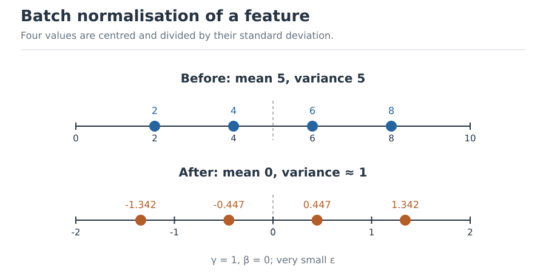

# M14-L4 – Initialisation, normalisation and optimisers {#L4}

**Course area:** M14 – Neural networks and introduction to deep learning

**Level:** Bachelor · Core/elective

**Prerequisites:** M9, M10, [M14-L3](M14-L3.md).

**Learning objective:** Explain symmetry breaking and variance scaling, apply batch normalisation and calculate an Adam step.

## Signals at the start of learning {#S1}

At the beginning of training, the weights have not yet been adapted to the task. If all units of a hidden layer are initialised identically and receive identical gradients, they remain identical under a deterministic update; additional units then provide no distinct features. Small independent random values can break this symmetry. The biases may nevertheless be zero.

For independent centred inputs with variance $q$ and independent centred weights with variance $s^2$, an affine neuron without bias has variance $d s^2 q$, where $d$ denotes the input width. If the factor $ds^2$ is substantially smaller or larger than one in many layers, signals may become weak or excessively large. The same difficulty can arise for gradients. A common Glorot initialisation sets $s^2=2/(d+m)$ for input width $d$ and output width $m$. For ReLU, He scaling $s^2=2/d$ is a common alternative: under a symmetric distribution, approximately half of the second moment is lost by setting negative values to zero. It is an approximation, not a stability guarantee. For $d=64,m=128$ the standard deviations are approximately 0.1021 and 0.1768, respectively.

## Normalisation within the network {#S2}




*Figure: Batch-Normalisierung eines Merkmals.*

For a feature, batch normalisation calculates the following quantities from the $B$ current training values $z_i$:

$$\mu_B=\frac1B\sum_i z_i,\qquad v_B=\frac1B\sum_i(z_i-\mu_B)^2,\qquad \tilde z_i=\gamma\frac{z_i-\mu_B}{\sqrt{v_B+\varepsilon}}+\beta.$$

$\varepsilon>0$ prevents division by zero; $\gamma,\beta$ are trainable scale and shift parameters. For the values 2, 4, 6, 8, the mean is 5 and the variance is 5. With $\gamma=1,\beta=0$ and very small $\varepsilon$, the results are approximately −1.342, −0.447, 0.447 and 1.342. The illustration shows the change of scale. The usual inference variant uses running estimates of training statistics, not the statistics of each incoming set of measurements to be predicted. Very small batches may provide unreliable estimates. In contrast, layer normalisation computes statistics within an example along specified feature dimensions. Both methods also differ from external scaling of raw data in M3.

## From gradient to update {#S3}

In a simple SGD step, $\theta$ changes by $-\eta g_t$. Momentum smooths the sequence of stochastic gradients. Adam additionally uses a running estimate of squared gradients. For initial values $m_0=v_0=0$ and $0\le\beta_1,\beta_2<1$, the following holds elementwise:

$$m_t=\beta_1m_{t-1}+(1-\beta_1)g_t,\quad v_t=\beta_2v_{t-1}+(1-\beta_2)g_t^2,$$
$$\hat m_t=\frac{m_t}{1-\beta_1^t},\quad\hat v_t=\frac{v_t}{1-\beta_2^t},\quad\theta_t=\theta_{t-1}-\eta\frac{\hat m_t}{\sqrt{\hat v_t}+\varepsilon}.$$

Here $v_t$ is a second raw moment, not a centred variance. With $g_1=4$, $\theta_0=2$, $\eta=0.01$, $\beta_1=0.9$ and $\beta_2=0.999$, we obtain $m_1=0.4$, $v_1=0.016$, with bias-corrected values 4 and 16. With very small $\varepsilon$ the update gives approximately 1.99. SGD with the same learning rate would give 1.96; the steps cannot be judged better or worse simply by their size.

```python
import numpy as np
z = np.array([2., 4., 6., 8.])
a = (z-z.mean())/np.sqrt(z.var()+1e-8)
assert np.isclose(a.mean(), 0) and np.isclose(a.var(), 1)
g, b1, b2 = 4., 0.9, 0.999
m, v = (1-b1)*g, (1-b2)*g*g
new = 2.-0.01*(m/(1-b1))/(np.sqrt(v/(1-b2))+1e-8)
assert np.isclose(new, 1.99)
assert np.isclose(np.sqrt(2/192), 0.10206207)
```

The optimiser, learning rate and batch size belong in the experiment protocol. Exploding gradients can be diagnosed and, if appropriate, clipped; clipping does not replace the search for faulty data or network operations.

## Exercise and solution {#S4}

A feature is a constant 7 throughout the batch. What does batch normalisation produce? Solution: $\mu_B=7$, $v_B=0$, each centred value is 0; the output is $\beta$ for all examples. A constant input gains no new differences through this operation. What happens when the input width doubles under He initialisation? The variance halves and the standard deviation decreases by a factor of $1/\sqrt2$.

## Sources and further reading {#S5}

- [Zhang et al.: Dive into Deep Learning, §5.4](https://d2l.ai/chapter_multilayer-perceptrons/numerical-stability-and-init.html) – initialisation. **Verification:** pending.
- [Zhang et al.: Dive into Deep Learning, §8.5](https://d2l.ai/chapter_convolutional-modern/batch-norm.html) – normalisation. **Verification:** pending.
- [Zhang et al.: Dive into Deep Learning, §12.10](https://d2l.ai/chapter_optimization/adam.html) – Adam. **Verification:** pending.
