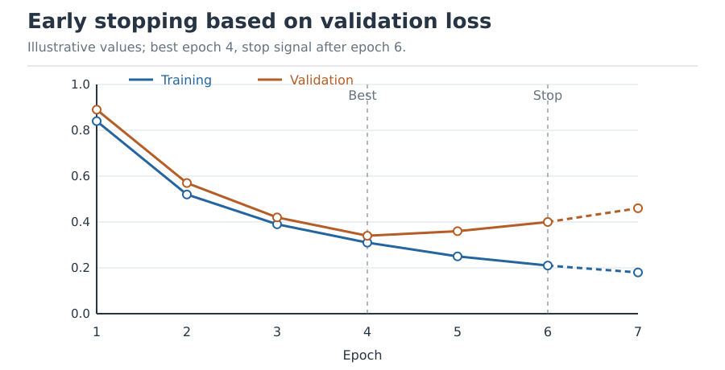

# M14-L5 – Regularisation, dropout and early stopping {#L5}

**Course area:** M14 – Neural networks and introduction to deep learning

**Level:** Bachelor · Core/elective

**Prerequisites:** M9, M10, [M14-L4](M14-L4.md).

**Learning objective:** Diagnose overfitting and distinguish three regularisation mechanisms.

## Why training loss is not enough {#S1}

A quality control system learns from historical measurements, including random disturbances. A highly flexible network may also fit the random components. What matters, however, is performance on new workpieces. Data from later production batches are therefore separated before training as validation and test data if this reflects subsequent deployment. The validation set is used for model selection; the test set remains untouched until the final evaluation. A decreasing training curve does not prove improvement on unseen data.

An L2 penalty augments the mean training loss $L$, for example by $\lambda\|w\|_2^2/2$ with $\lambda\ge0$. Here $w$ comprises the weights to be regularised; biases are excluded in this example. The additional derivative is $\lambda w$. With simple SGD the update becomes $w'=(1-\eta\lambda)w-\eta\nabla_w L$. For $w=3$, $\lambda=0.2$, the additional penalty is 0.9 and its gradient is 0.6. With adaptive optimisers, weight decay decoupled from the loss gradient (as in AdamW, for example) is not generally equivalent to this L2 penalty.

## Randomly dropping units {#S2}

Dropout changes activations during training. Let $p$ be the dropout probability with $0\le p<1$ and let $M$ be a Bernoulli random variable with $P(M=1)=1-p$. Inverted dropout is defined by $\tilde h=Mh/(1-p)$. For fixed $h$, we have $E(\tilde h\mid h)=h$ and $\operatorname{Var}(\tilde h\mid h)=h^2p/(1-p)$. For $h=6,p=0.25$, the possible values are 0 (25%) and 8 (75%); the mean remains 6 and the variance is 12. This does not guarantee that the expected value of the entire non-linear network remains unchanged. In the usual evaluation mode, dropout is disabled. The strength of the method must be selected using validation data; some architectures do not require dropout at all.

## Early stopping using a curve {#S3}




*Figure: Frühes Stoppen anhand des Validierungsverlusts.*

The illustration contains deliberately constructed loss values for seven epochs. An epoch corresponds to one complete pass through the training data; it is not the same as a single batch update. The training loss falls from 0.84 to 0.18. The validation loss falls to 0.34 at epoch 4 and then rises to 0.46. With a patience of two epochs without strict improvement and a minimum improvement of zero, the process stops after epoch 6. The stored weights from epoch 4 are restored. Epoch 7 merely illustrates a possible continuation. For very noisy curves, a patience of two may be too short.

```python
import numpy as np
v = [0.89, 0.57, 0.42, 0.34, 0.36, 0.40, 0.46]
best, stale, best_epoch = float('inf'), 0, None
for epoch, value in enumerate(v, 1):
    if value < best:
        best, stale, best_epoch = value, 0, epoch
    else:
        stale += 1
    if stale >= 2:
        break
assert (best_epoch, epoch) == (4, 6)
rng = np.random.default_rng(54)
a = 6*(rng.random(100_000) >= 0.25)/0.75
assert abs(a.mean()-6) < 0.08 and abs(a.var()-12) < 0.3
```

For a reproducible comparison, all candidates should use the same data split; with stochastic training, several initialisations are helpful. A large difference between training and validation error can also indicate distribution shift, data leakage during training or inappropriate preprocessing. Regularisation does not replace this investigation.

## Exercise and solution {#S4}

With dropout at $p=0.5$ and activation 4, the positive output is 8. Calculate the mean and variance. Solution: $0\cdot0.5+8\cdot0.5=4$; the variance is $0.5(0-4)^2+0.5(8-4)^2=16$. Why must the best epoch not be chosen using the final test set? Because it would then become part of model selection and would no longer provide an independent performance assessment.

## Sources and further reading {#S5}

- [Zhang et al.: Dive into Deep Learning, §5.6](https://d2l.ai/chapter_multilayer-perceptrons/dropout.html) – Dropout. **Verification:** pending.
- [Zhang et al.: Dive into Deep Learning, §5.5](https://d2l.ai/chapter_multilayer-perceptrons/generalization-deep.html) – generalisation, supplementary. **Verification:** pending.
