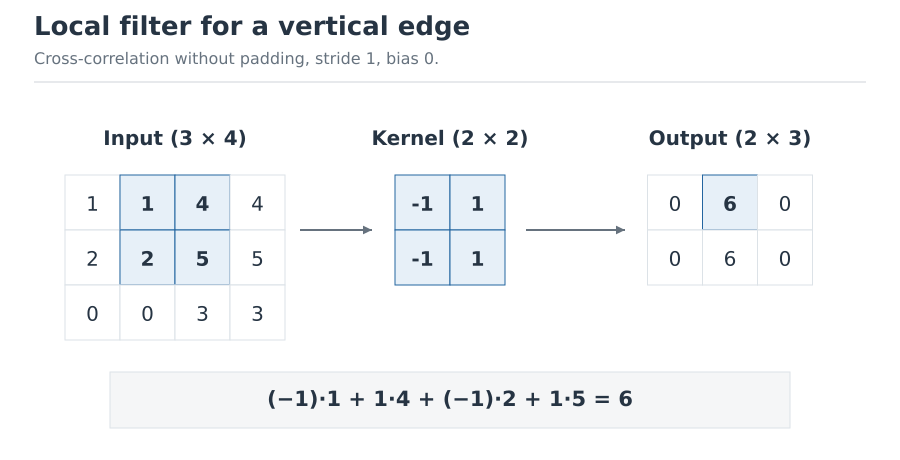

# M14-L6 – Overview of convolutional and sequence networks {#L6}

**Course area:** M14 – Neural networks and introduction to deep learning

**Level:** Bachelor · Core/elective

**Prerequisites:** M9, M10, [M14-L5](M14-L5.md).

**Learning objective:** Explain weight sharing in local filters and recurrent states and calculate small examples.

## Data structure as an architectural choice {#S1}

A fully connected network initially treats each position as a separate feature. In an image, an edge may occur in many locations; in a sequence of measurements, the same local dynamics may recur. An architecture can exploit this structure by using the same weights at different spatial or temporal positions. This reduces the parameter count compared with dense connectivity. However, the assumption that the same operation is appropriate at every position is itself a modelling assumption.

## Local filters in convolutional networks {#S2}




*Figure: Lokaler Filter für eine vertikale Kante.*

For a single-channel image $X$ and a kernel $K$ of size $k_h\times k_w$, many deep learning libraries use cross-correlation (under the name convolution):

$$Y_{i,j}=b+\sum_{u=0}^{k_h-1}\sum_{v=0}^{k_w-1}K_{u,v}X_{i+u,j+v}.$$

Without padding and with stride 1, an input $H\times W$ shrinks to $(H-k_h+1)\times(W-k_w+1)$. Let a 3×4 teaching image be $X=\begin{pmatrix}1&1&4&4\\2&2&5&5\\0&0&3&3\end{pmatrix}$ and the kernel $K=\begin{pmatrix}-1&1\\-1&1\end{pmatrix}$. With bias 0, we obtain $Y=\begin{pmatrix}0&6&0\\0&6&0\end{pmatrix}$. The kernel responds to the transition between the left and right halves of the image. The illustration shows the central window and its contribution. A trained convolutional layer can contain many different filters; with $C_{in}$ input and $C_{out}$ output channels, dense channel connectivity requires $C_{out}(C_{in}k_hk_w+1)$ parameters. Pooling summarises neighbourhoods but may lose spatial detail. Under appropriate boundary and stride conditions, convolution provides translation equivariance, not automatically complete position invariance.

## Recurrent processing of measurement sequences {#S3}

A simple recurrent network stores a hidden state $h_t$:

$$h_t=\phi(W_xx_t+W_hh_{t-1}+b),\qquad o_t=W_oh_t+c.$$

The matrices are shared across all time steps. In the scalar teaching model we deliberately use the identity rather than a non-linear activation: $h_t=0.5h_{t-1}+x_t$, $h_0=0$. For the sequence 2, 0, 1, the resulting states are 2, 1, 1.5. An impulse therefore persists briefly as a decaying contribution. When training a recurrent network, the chain rule is applied through the computation unrolled in time. Long paths can attenuate or amplify gradients; LSTM and GRU address this difficulty, among others. Attention-based networks offer another way to connect sequence positions; detailed architectures follow in the Master's advanced modules.

```python
import numpy as np
from numpy.lib.stride_tricks import sliding_window_view
x = np.array([[1,1,4,4], [2,2,5,5], [0,0,3,3]])
k = np.array([[-1,1], [-1,1]])
y = (sliding_window_view(x, k.shape)*k).sum(axis=(-2,-1))
assert np.array_equal(y, [[0,6,0],[0,6,0]])
h, states = 0., []
for value in [2,0,1]:
    h = 0.5*h + value
    states.append(h)
assert states == [2.,1.,1.5]
```

## Exercise and solution {#S4}

A convolutional layer with 3 input and 16 output channels uses 3×3 kernels with one bias per output channel. Solution: $16(3\cdot9+1)=448$ parameters. What is the output size for a 28×28 input without padding and with stride 1? 26×26 per output channel. How does the scalar recurrent state of 1.5 change with two additional zero inputs? It falls to 0.75 and then 0.375. The history does not disappear immediately but loses influence.

## Sources and further reading {#S5}

- [Zhang et al.: Dive into Deep Learning, §7.2](https://d2l.ai/chapter_convolutional-neural-networks/conv-layer.html) – cross-correlation. **Verification:** pending.
- [Zhang et al.: Dive into Deep Learning, §9.4](https://d2l.ai/chapter_recurrent-neural-networks/rnn.html) – recurrent state. **Verification:** pending.
