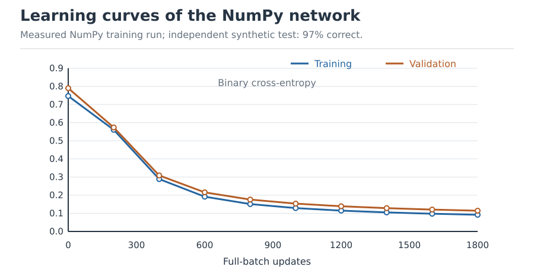

# M14-L7 – Implementing a small neural network {#L7}

**Course area:** M14 – Neural networks and introduction to deep learning

**Level:** Bachelor · Core/elective

**Prerequisites:** M9, M10, [M14-L6](M14-L6.md).

**Learning objective:** Train a network using NumPy, match gradients to parameter shapes and evaluate it on independent data.

## Learning task and data split {#S1}

In a synthetic sorting system, two scaled measurements between −1 and 1 are recorded. The label is 1 if both measurements have the same sign, otherwise 0. Simple linear classifiers cannot correctly separate these four quadrants. We use a fully connected network with two inputs, eight tanh units and one binary output. The data are generated independently from a uniform random model; they do not represent a real installation. The random generator is initialised once for reproducibility. The first 600 examples are used for training, the next 200 for validation and another 200 for the final test. Neither training nor selection of the best model variant is performed on the test data.

## Forward computation and loss {#S2}

In this lesson we store examples as rows and weights in the shape (input width, output width). With input matrix $X$, the computations are $H=\tanh(XW_1+b_1)$ and $Z=HW_2+b_2$. The sigmoid output is $P=\sigma(Z)$. Binary cross-entropy can be computed from the logit $z_i$ in a numerically stable way:

$$L=\frac1B\sum_{i=1}^B\bigl(\log(1+e^{z_i})-y_i z_i\bigr).$$

The derivative vector of the logits is $D=(P-Y)/B$. Because the loss is already averaged, the subsequent matrix product must not divide by $B$ again. It follows that $\nabla_{W_2}L=H^\top D$, $\nabla_{b_2}L=\sum_i D_i$, and for the first layer $E=(DW_2^\top)\odot(1-H^2)$, $\nabla_{W_1}L=X^\top E$, $\nabla_{b_1}L=\sum_i E_i$. All gradients are calculated using the same old weights. The update may take place only afterwards.

## A complete small training run {#S3}




*Figure: Lernkurven des selbst implementierten Netzes.*

The following code uses only NumPy. Full-batch gradients simplify checking; large networks usually use mini-batches and specialised libraries. The loss is calculated stably with `logaddexp`; the sigmoid function is also evaluated without potential exponential overflow. Training and validation losses are measured before the first update and after selected updates.

```python
import numpy as np
rng = np.random.default_rng(314)
x = rng.uniform(-1, 1, size=(1000, 2))
y = ((x[:, 0]*x[:, 1]) > 0).astype(float)[:, None]
xt, yt = x[:600], y[:600]
xv, yv = x[600:800], y[600:800]
xe, ye = x[800:], y[800:]
w1 = rng.normal(0, 0.6, (2, 8)); b1 = np.zeros(8)
w2 = rng.normal(0, 0.5, (8, 1)); b2 = np.zeros(1)

def forward(a):
    h = np.tanh(a @ w1 + b1)
    z = h @ w2 + b2
    p = np.exp(-np.logaddexp(0., -z))
    return h, z, p

def loss(a, target):
    z = forward(a)[1]
    return np.mean(np.logaddexp(0., z)-target*z)

history = [(0, loss(xt, yt), loss(xv, yv))]
for step in range(1, 1801):
    h, z, p = forward(xt)
    d = (p-yt)/len(yt)
    e = (d @ w2.T)*(1-h*h)
    dw2, db2 = h.T @ d, d.sum(axis=0)
    dw1, db1 = xt.T @ e, e.sum(axis=0)
    w1 -= 0.15*dw1; b1 -= 0.15*db1
    w2 -= 0.15*dw2; b2 -= 0.15*db2
    if step % 200 == 0:
        history.append((step, loss(xt, yt), loss(xv, yv)))
accuracy = np.mean((forward(xe)[2] >= 0.5) == ye)
print('Train/Valid:', history[0], history[-1])
print('Test accuracy:', accuracy)
assert history[-1][1] < history[0][1]
assert accuracy > 0.90
```

The curves in the illustration come from this run and use the same loss definition. The training loss decreases from 0.7468 to 0.0920 and the validation loss from 0.7900 to 0.1143. In the final test, 194 of 200 points are correctly classified (97%). The test accuracy applies only to independent points from the assumed distribution; it would not be guaranteed for differently distributed measurements or noisy labels. Points near the coordinate axes are especially sensitive to measurement noise. For real-world approval, error types, uncertainty, robustness and operating costs would also need to be investigated. The architecture has $8(2+1)+1(8+1)=33$ learnable parameters. Rather than requiring millions of parameters, this deliberately small task uses an appropriate non-linear model class.

## Exercise and solution {#S4}

What are the shapes of $D,E,\nabla_{W_1}L$ for 600 training examples? Solution: (600,1), (600,8) and (2,8). Why is $W_2$ not updated before calculating $E$? Otherwise the derivative of the first layer would no longer come from the same forward graph. As an additional experiment, the number of hidden units can be reduced to 1; compare only the training and validation curves. An independent, previously unused test set would be required for a subsequent new model selection.

## Sources and further reading {#S5}

- [Zhang et al.: Dive into Deep Learning, §5.1](https://d2l.ai/chapter_multilayer-perceptrons/mlp.html) – multilayer network. **Verification:** pending.
- [Zhang et al.: Dive into Deep Learning, §5.3](https://d2l.ai/chapter_multilayer-perceptrons/backprop.html) – backpropagation; Original NumPy code and synthetic data. **Verification:** pending.
- [PyTorch 2.15: BCEWithLogitsLoss](https://docs.pytorch.org/docs/2.15/generated/torch.nn.BCEWithLogitsLoss.html) – API reference accessed, supplementary reference; independent NumPy example. **Verification:** pending.
