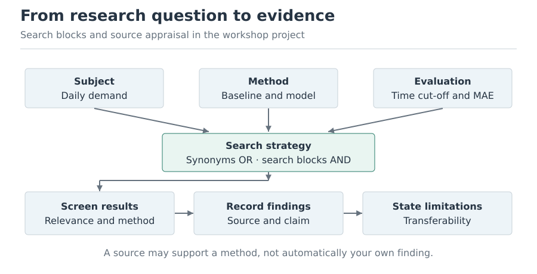

# M15-L1 – Research questions, literature searches and critical appraisal of sources {#L1}

**Course area:** M15 – Academic research and Bachelor’s project

**Level:** Bachelor · Core/practice

**Prerequisites:** M5, M6, M10.

**Learning objective:** Formulate a testable research question, document a search strategy and assess the scope of evidence provided by a source.

## From a practical problem to a research question {#S1}

A fictional university workshop wants to estimate, on the evening before each opening day, how many material sets will be issued the following day. A better forecast might reduce shortages and surpluses. However, the statement ‘AI improves planning’ cannot be tested: neither the comparison method nor the target, time frame or population is specified. The research question is therefore: does a predefined, reservation-based forecast reduce the mean absolute error of daily demand compared with a constant forecast when both are learnt from the same past opening days?

The target is the number of sets issued per opening day, and the information available is limited to the previous evening. The feature is a binary indicator of a high level of advance reservations. The investigation is limited to synthetic workshop data; an association between reservations and issues is not claimed to be causal. A forecasting study assesses predictions; an impact study would need to investigate an intervention and a suitable comparison design. Even if a model performs better, this does not establish an economic benefit.

## Targeted literature search {#S2}

*Figure: Von der Forschungsfrage zur Evidenz.*

The question is divided into search blocks: subject (demand forecasting, daily counts), method (baseline, prediction) and evaluation (time split, absolute error). Synonyms are joined with OR, and different blocks with AND. One might start with a library catalogue and an academic search engine, examine titles and abstracts and follow references. A search log records the date, database, exact search string, filters, number of results, inclusion and exclusion criteria and reasons for selection. The number of results changes; it must not be invented retrospectively. A full systematic review is not required here; such a review would additionally conduct selection and appraisal according to a suitable protocol.

For an article on forecasting retail sales, for example, check whether the target is continuous or discrete, what temporal split was used and whether the baseline was determined fairly. A good result in another market is a starting point, not proof for one's own context. Backward searching examines cited references; forward searching identifies later studies that cite the article. Both can reduce gaps in the initial keyword search.

## Evidence matrix and critical appraisal of sources {#S3}

| Assessment dimension | Question | Implication for the project |
|---|---|---|
| Subject relevance | Same target and forecast horizon? | Limit transferability |
| Study design | Future data excluded from training? | Check leakage risk |
| Uncertainty | Variation or intervals reported? | Do not generalise a single result |
| Provenance | Authors, version and publication venue identifiable? | Identify the source unambiguously |

API documentation explains how a method is implemented; a research article can establish its empirical properties under particular conditions. A blog can provide orientation but needs to be supplemented with appropriate specialist sources for central claims. Peer-reviewed publications can also have methodological weaknesses. In the literature log, distinguish source findings, one's own interpretation and remaining questions. Cite paraphrases; do not trace third-party illustrations or reproduce them without permission. All examples and diagrams for this educational project were created independently.

## Exercise and solution {#S4}

Turn ‘Reservations help’ into a falsifiable hypothesis. Solution: on the later test days, the MAE of the predefined group model is lower than the MAE of the constant baseline. The formulation must allow for failure as well. Which source establishes that less material is actually wasted in one's own workshop? None of the methodological sources; this would require a separate investigation of real outcomes.

## Sources and further reading {#S5}

- [DFG: Guideline 9 – Research design](https://www.wissenschaftliche-integritaet.de/de/ll-09-389662) – research design and state of research. **Verification:** pending.
- [The Turing Way: Getting Started Checklist](https://book.the-turing-way.org/project-design/pd-overview/pd-checklist/) – project planning, objectives, methodological and organisational prerequisites. **Verification:** pending.
