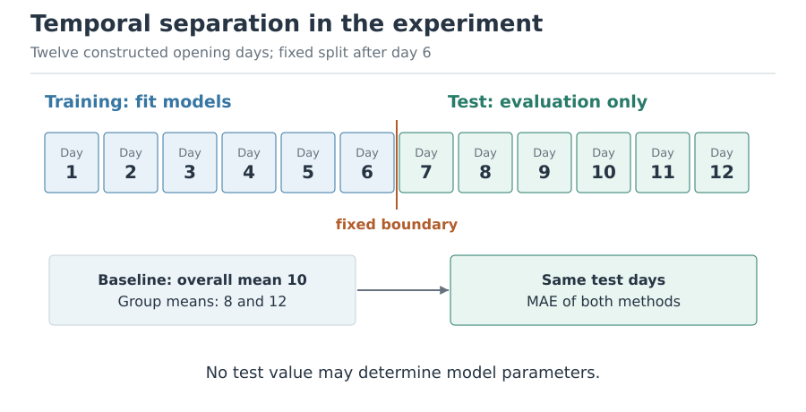

# M15-L2 – Data collection plan, baseline and experimental protocol {#L2}

**Course area:** M15 – Academic research and Bachelor’s project

**Level:** Bachelor · Core/practice

**Prerequisites:** M6, M7, M10, [M15-L1](M15-L1.md).

**Learning objective:** Define the variables to be collected and target measurement time, specify a fair reference and plan an experiment that can be checked in advance.

## Measurement plan and information cut-off {#S1}

The workshop study uses exactly one row per opening day. In the teaching dataset, the time variable `tag` (day) is a consecutive ordinal number, `hoch` (high) is set to 0 or 1 on the previous evening, and `menge` (quantity) is the actual number issued at the end of the day. A real study would also need to document when reservations are counted, what counts as an issue and how returns are handled. Closed days are outside the target population. An empty measurement field is not an observed zero. Data provenance and possible outages are recorded.

| Field | Type | Collection time |
|---|---|---|
| tag | positive integer | opening calendar |
| hoch | 0 or 1 | previous evening |
| menge | non-negative integer | end of day |

A threshold selected from test data violates the temporal information cut-off. The exercise assumes the binary indicator is already supplied as an input. It does not investigate the selection of an optimal threshold.

## Baseline and test boundary {#S2}

*Figure: Zeitliche Trennung im Experiment.*

A reference model should be simple and actually available. Here the constant forecast is the arithmetic mean of the training quantities (not the median, which is optimal for absolute error; both are 10 in the teaching case). The comparison model computes its own training mean for each feature group. If a group is absent from training, it uses the overall mean as a predefined fallback rule. The first six days form the training set, the following six the test set. These small sample sizes serve a teaching purpose; they are insufficient to demonstrate stable predictive performance for a real operation. A larger study would use temporally separate validation between the training and test periods, for example through rolling evaluation windows.

## Experimental protocol {#S3}

The protocol is written and versioned before evaluation. In this constructed exercise the rules are given; it is not an actually registered study. The primary metric is mean absolute error in sets per day:

$$\operatorname{MAE}=\frac{1}{n}\sum_{i=1}^n |y_i-\hat y_i|.$$

The test rules remain the same for both methods: the same days, the same target variable, no further fitting during the test period and no changes based on its results. The improvement in sets/day is $\Delta=\operatorname{MAE}_{B}-\operatorname{MAE}_{G}$. Positive values favour the group model. Signed errors are additionally stored as $y_i-\hat y_i$ to detect systematic underprediction. A predefined minimum benefit in a real project could be derived from material and shortage costs; an arbitrary threshold is not presented here as economically justified.

| Checkpoint | Evidence |
|---|---|
| Data collection | field definitions, outage log |
| Split | training/test boundary in configuration |
| Methods | fixed model rules and fallback rule |
| Evaluation | MAE, individual errors, unchanged test set |

Changing the method after the test may be useful, but must be documented as exploratory and evaluated on new independent data. The separation matters more than an impressive result.

## Exercise and solution {#S4}

A student computes the mean of all twelve days and uses it as the constant baseline. What is wrong? Solution: she uses six future target values that were unavailable at the respective forecast times. The reference is therefore unfair. With training quantities 7, 9, 8, 11, 13, 12, the mean permitted in advance is 60/6 = 10 sets.

## Sources and further reading {#S5}

- [DFG: Guideline 9 – Research design](https://www.wissenschaftliche-integritaet.de/de/ll-09-389662) – research design and state of research. **Verification:** pending.
- [The Turing Way: Getting Started Checklist](https://book.the-turing-way.org/project-design/pd-overview/pd-checklist/) – project planning, objectives, methodological and organisational prerequisites. **Verification:** pending.
- [scikit-learn: Common pitfalls and recommended practices, §12.2](https://scikit-learn.org/stable/common_pitfalls.html?highlight=kfold) – data leakage and data separation. **Verification:** pending.
- [scikit-learn: DummyClassifier](https://scikit-learn.org/stable/modules/generated/sklearn.dummy.DummyClassifier.html) – feature-independent reference models for classification; analogy to the regression case. **Verification:** pending.
