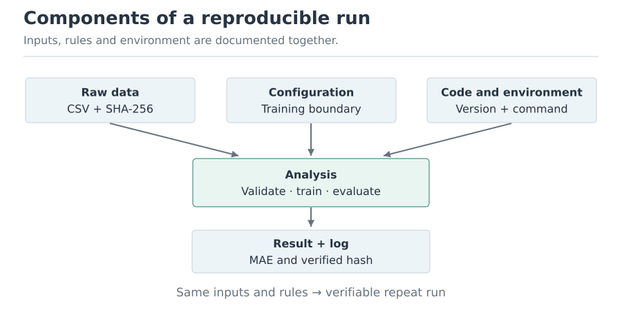

# M15-L3 – Building a reproducible analysis project {#L3}

**Course area:** M15 – Academic research and Bachelor’s project

**Level:** Bachelor · Core/practice

**Prerequisites:** M3, M7, [M15-L2](M15-L2.md).

**Learning objective:** Separate data, code, configuration and results, and repeat a deterministic teaching run with validation.

## From individual files to a verifiable workflow {#S1}




*Figure: Bausteine eines reproduzierbaren Laufs.*

An analysis project is reproducible if its results can be recreated from described inputs and processing steps. In this context, this does not mean that independent data collection produces the same values. In the workshop project, raw data, scripts, configuration and derived results are kept separate. A data dictionary describes types, units and temporal references. A README describes the launch command, expected output, required environment and limitations. Version control provides a traceable record of which version produced the analysis. Data with restricted access must not accidentally enter a public repository.

A small directory structure might look like this (the original German filenames are retained):

```text
werkstatt/
  README.md
  data/tage.csv
  data/datenwoerterbuch.md
  config.json
  src/analyse.py
  tests/
  results/
```

Raw data are not manually overwritten in a spreadsheet. Corrections are made as versioned transformations with reasons. A hash identifies the exact bytes of a file; it does not by itself prove the accuracy or provenance of its contents. Larger projects also document dependencies, operating systems, model versions and sources of randomness. A seed alone does not guarantee bitwise identical results across platforms.

## Minimal executable analysis workflow {#S2}

The following complete example uses only the Python standard library. It deliberately uses twelve constructed rows, not real workshop data. The data are embedded as an ASCII CSV string so that the example runs without path configuration. In the project documentation, the same rows can be stored in a separate CSV. The configuration contains the fixed boundary of six days. Outputs can be saved as JSON and compared with an expected result. The German field names from L2 are retained.

```python
import csv, io, hashlib, json
from statistics import mean
raw = "tag,hoch,menge\n1,0,7\n2,0,9\n3,0,8\n4,1,11\n5,1,13\n6,1,12\n7,0,9\n8,1,12\n9,0,8\n10,1,14\n11,1,11\n12,1,15\n"
rows = [tuple(map(int, r)) for r in list(csv.reader(io.StringIO(raw)))[1:]]
assert [r[0] for r in rows] == list(range(1, 13))
assert all(g in (0, 1) and y >= 0 for _, g, y in rows)
cut = 6
train, test = rows[:cut], rows[cut:]
baseline = mean(y for _, _, y in train)
group = {}
for g in (0, 1):
    vals = [y for _, k, y in train if k == g]
    group[g] = mean(vals) if vals else baseline
errors_b = [abs(y-baseline) for _, _, y in test]
errors_g = [abs(y-group[g]) for _, g, y in test]
assert baseline == 10 and group == {0: 8, 1: 12}
assert sum(errors_b) == 15 and sum(errors_g) == 7
result = {"sha256": hashlib.sha256(raw.encode()).hexdigest(),
          "cut": cut, "baseline_mae": mean(errors_b),
          "group_mae": mean(errors_g)}
print(json.dumps(result, sort_keys=True))
```

This run estimates both models using only the first six rows. It expects MAE values of 2.5 and approximately 1.167. The assertions are regression tests for this fixed teaching file; with new data, different values may be correct. More general tests would also cover unseen groups, missing values, incorrect time order and duplicate day identifiers.

## Reproduction and limitations {#S3}

A second person receives exactly the same input bytes, configuration and analysis code, runs the analysis in a documented Python 3 environment and compares the hash and result. Different hashes initially indicate different inputs. If the hash and configuration are the same but the result differs, the code version, libraries and numerical settings are examples of things to investigate. For floating-point numbers, a technically justified tolerance comparison is often more appropriate than exact equality of decimal text. In the small example, the calculation is independent of random selection and external APIs.

## Exercise and solution {#S4}

On paper, add a test for a duplicate day identifier. Solution: the number of unique identifiers must equal the number of rows, for example `len({r[0] for r in rows}) == len(rows)`. Why is a hash of the result file alone insufficient? It reveals that a file has changed but explains neither the inputs nor the analysis steps. A reproducible run needs the entire mapping.

## Sources and further reading {#S5}

- [DFG: Guideline 12 – Documentation](https://www.wissenschaftliche-integritaet.de/de/ll-12-389682) – traceable documentation. **Verification:** pending.
- [The Turing Way: Research Data Management](https://book.the-turing-way.org/reproducible-research/rdm/) – data management and reuse. **Verification:** pending.
- [The Turing Way: Reproducible Environments](https://book.the-turing-way.org/reproducible-research/renv/) – recording the computing environment. **Verification:** pending.
