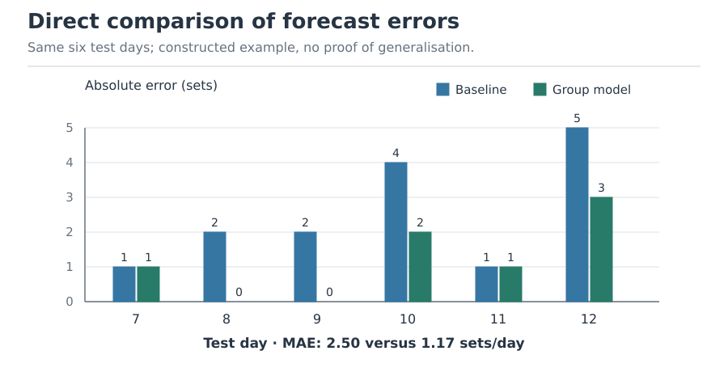

# M15-L4 – Evaluation and clear presentation of results {#L4}

**Course area:** M15 – Academic research and Bachelor’s project

**Level:** Bachelor · Core/practice

**Prerequisites:** M5, M6, M10, [M15-L3](M15-L3.md).

**Learning objective:** Calculate paired forecast errors, describe uncertainty and limitations, and design a transparent presentation.

## Comparison on the same test days {#S1}

Both methods were fitted on the first six days. The constant baseline predicts 10 sets, whereas the group model predicts 8 when advance reservations are low and 12 when they are high. The six later days are now used exclusively for evaluation. The actual values were constructed for the teaching example.

| Day | Actual | Baseline | Group model | Absolute error B | Absolute error G |
|---:|---:|---:|---:|---:|---:|
| 7 | 9 | 10 | 8 | 1 | 1 |
| 8 | 12 | 10 | 12 | 2 | 0 |
| 9 | 8 | 10 | 8 | 2 | 0 |
| 10 | 14 | 10 | 12 | 4 | 2 |
| 11 | 11 | 10 | 12 | 1 | 1 |
| 12 | 15 | 10 | 12 | 5 | 3 |

$$\operatorname{MAE}_B=\frac{15}{6}=2.5,\qquad \operatorname{MAE}_G=\frac{7}{6}\approx1.167.$$

The difference is $\Delta=8/6\approx1.333$ sets per day. The relative decrease is $\Delta/\operatorname{MAE}_B=8/15\approx53.3\,\%$ (meaningful only for a positive baseline MAE). This is not equivalent to a 53.3% cost saving. Both models were tested on exactly the same days; the error differences are therefore paired, not two independent samples.

## What the numbers can tell us {#S2}

The daily differences in absolute errors are 0, 2, 2, 2, 0, 2. The group model is better on four days and equally good on two. Six artificially selected days do not establish a statistically supported generalisation to a workshop. In real observations, adjacent days can be dependent, for example because of the start of term or weekly patterns. An ordinary bootstrap of independent rows or a t-interval based on six dependent daily values would then be unreliable. A later, sufficiently large test window with a documented temporal sampling plan is required; block methods may account for dependence under suitable assumptions. Spurious precision in p-values from a constructed teaching dataset should be avoided.

## From a table to a results chart {#S3}

*Figure: Prognosefehler im direkten Vergleich.*

The diagram shows the two absolute errors for each day on a common axis starting at zero. Grouping preserves the paired structure. Another possible chart would show actual and forecast values over time; systematic underprediction would be particularly visible there. For the group model, the mean signed error is $(1+0+0+2-1+3)/6=5/6$ sets; positive values here indicate underprediction on average. For the baseline it is $( -1+2-2+4+1+5)/6=9/6$ sets.

In the text, identify the data, metric, model comparison and limitations. The factual statement is: on six constructed test days, the MAE of the specified group model was lower than that of the reference. Whether a real workshop would benefit remains open. Every results chart must make clear which measurements, units and samples it shows. A truncated bar-chart axis would visually distort the differences.

## Exercise and solution {#S4}

On day 11, the error of both models is 1. Are their forecasts therefore identical? Solution: no, the baseline predicts 10 and the group model 12 when the actual value is 11. The absolute errors are equal, but their signs are opposite. If shortages are expensive and surpluses cheap, an asymmetric loss measure may be more appropriate; it must be specified before the test.

## Sources and further reading {#S5}

- [DFG: Guideline 12 – Documentation](https://www.wissenschaftliche-integritaet.de/de/ll-12-389682) – traceable documentation. **Verification:** pending.
- [scikit-learn: Common pitfalls and recommended practices, §12.2](https://scikit-learn.org/stable/common_pitfalls.html?highlight=kfold) – data leakage and data separation. **Verification:** pending.
