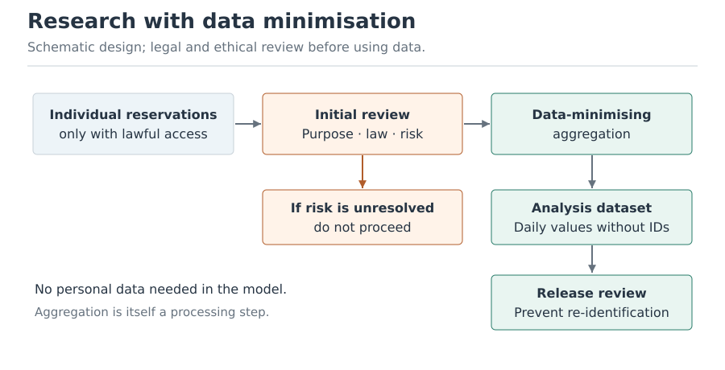

# M15-L5 – Data protection, consent and research ethics {#L5}

**Course area:** M15 – Academic research and Bachelor’s project

**Level:** Bachelor · Core/practice

**Prerequisites:** M7, [M15-L1](M15-L1.md), [M15-L2](M15-L2.md).

**Learning objective:** Distinguish data protection and ethical reviews, and justify a design based on data minimisation.

## What data are actually necessary? {#S1}

The synthetic daily counts in this teaching study contain no information about real people. In a real workshop, reservation systems could contain names, timestamps, identification numbers and specific material lists. Even without names, a combination of attributes can make individuals identifiable. The first question is therefore whether the research task needs individual reservations at all. For daily quantity forecasts, the proposed case requires only a sufficiently aggregated count or indicator that has already been produced lawfully. Producing aggregates from personal data is itself processing and requires a lawful framework.

## Legal basis, information and consent {#S2}

The GDPR applies to the processing of personal data within its scope. Before collection, the purposes, necessary fields, responsibilities and a valid legal basis must be determined. Consent is one possible basis under Article 6, not the only one. Where relied upon, it must, among other requirements, be freely given, informed, specific and unambiguous; withdrawal must be possible. In relationships of dependency, the voluntary nature of consent requires particular scrutiny. Information under Article 13 or 14 depends in part on whether data are obtained from the data subject or another source. Special categories of data additionally require an exception under Article 9. Research alone does not provide blanket permission; the relevant legal requirements and safeguards under Article 89 must be examined.

Pseudonymisation replaces direct identifiers with codes and keeps the additional information separately protected. Data that can be re-identified remain personal data. Genuine anonymisation requires an assessment of realistic possibilities for identification. A hash of an easily guessed identification number is insufficient. Data minimisation, limited retention periods, access permissions and security must be built into the design from the start. The specific legal position and local review requirements must be clarified with the university and, where appropriate, data protection officers and relevant ethics bodies. This lesson does not provide legal advice for individual cases.

## Safeguards and ethical assessment {#S3}

*Figure: Datensparsame Forschung.*

The original workflow diagram separates the necessary data access from the analysis dataset. Before a real project begins, the workshop checks whether aggregation is permissible; only the required daily features are then transferred into an access-restricted analysis dataset. No identifier enters the model. The review before release of results checks again whether rare combinations allow individuals to be inferred. If the purpose, legal basis or risk has not been sufficiently clarified, data are not collected or results are not published, as applicable.

Ethics is more than formal legality: a forecast error may cause shortages that affect certain groups more often. A research plan documents potential harms, evaluates alternatives and identifies those responsible for decisions. The total quantity investigated here does not justify individual assessment, ranking or access decisions. Data not needed for forecasting are not collected as a precaution for other purposes. Open research does not mean making all raw data freely available; where appropriate, code, synthetic examples and aggregated results can be shared without disclosing protected information.

## Exercise and solution {#S4}

A project group wants to store the names and degree programmes of everyone making a reservation in order to forecast the total number of material sets. What is an obvious alternative? Solution: a sufficiently aggregated daily count or the predefined indicator, provided it is produced lawfully and is suitable for the research question. Consent alone does not make unnecessary fields necessary. If the group poses a new research question involving personal data, a new legal and ethical review would be needed before collection.

## Sources and further reading {#S5}

- [Regulation (EU) 2016/679 – GDPR, Arts. 4–7, 9, 13–14, 25, 32, 89](https://eur-lex.europa.eu/legal-content/DE/ALL/?tid=111682012&uri=celex%3A32016R0679) – legal framework; alternative EUR-Lex view opened; no case-specific review. **Verification:** pending.
- [DFG: Guideline 10 – Legal and ethical frameworks](https://www.wissenschaftliche-integritaet.de/de/ll-10-389674) – legal and ethical responsibility. **Verification:** pending.
- [The Turing Way: Research Data Management](https://book.the-turing-way.org/reproducible-research/rdm/) – data management and reuse. **Verification:** pending.
