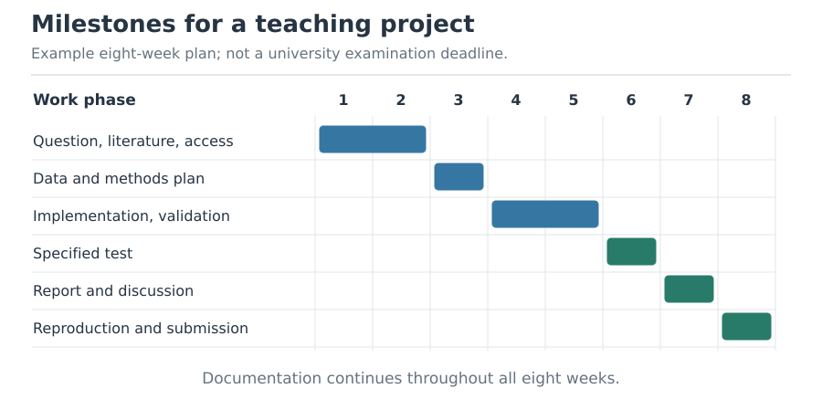

# M15-L6 – Project report, presentation and planning a Bachelor’s thesis {#L6}

**Course area:** M15 – Academic research and Bachelor’s project

**Level:** Bachelor · Core/practice

**Prerequisites:** [M15-L1](M15-L1.md) to [M15-L5](M15-L5.md).

**Learning objective:** Plan a clearly scoped project, structure a research report and present results with verifiable evidence.

## The report as a verifiable argument {#S1}

A good project report explains not only what was programmed, but why the chosen steps address the research question. The workshop example provides a small template. The introduction describes the need and question, the literature review justifies the comparison, and the methods section explains data provenance, time boundary, models and metric. The results section shows the six paired errors without making a new model selection. The discussion considers validity, uncertainty and alternatives. The conclusion answers the question within the scope of the data actually investigated. A reference list and appendices make evidence, data dictionary, code and run log easy to find.

| Section | Specific content in the teaching project |
|---|---|
| Introduction | daily demand, fixed forecast horizon |
| Literature review | models, comparison principle, limitations |
| Methods | synthetic data, sequence, fixed rules |
| Results | MAE 2.5 and 7/6 sets/day, individual errors |
| Discussion | no real sample; no evidence of cost savings or causality |

Results that contradict the hypothesis are also presented. Departures from the original plan must be documented with dates and reasons. Sources are identified consistently and others’ contributions acknowledged; this also applies to data and software. If AI tools are used, local university rules on disclosure and permitted use apply. The author remains responsible for verifiable statements; generated suggestions are not automatically reliable literature references.

## A realistic work plan {#S2}

*Figure: Meilensteinplan für ein Lernprojekt.*

The following freely chosen eight-week plan is an example, not a mandatory duration for a Bachelor’s thesis. Before registration, clarify examination regulations, supervision, prerequisites, deadlines, data protection and, where applicable, ethics approval. A proposal describes the question, existing literature, method, required data, risks and expected type of results. If access to data is at risk, the project needs a viable alternative question; switching to synthetic data changes the scope of the conclusions and must be explicitly agreed.

| Week | Activity | Evidence / decision |
|---|---|---|
| 1–2 | clarify question, literature and access | proposal, review decision |
| 3 | data definition and methods plan | data dictionary, protocol |
| 4–5 | implement and validate | tests, frozen method |
| 6 | specified test and evaluation | run log, results table |
| 7 | report and discussion | draft, literature check |
| 8 | reproduction, corrections, presentation | submission version and reserve |

The graphic illustrates the dependencies between phases. Data collection must not start before access is clarified; the final test must not begin until model selection is complete. Writing and documentation take place throughout the project. Small milestones reveal delays early, particularly missing data or unclear assessment criteria.

## Presentation and review {#S3}

For an example ten-minute talk, one minute is allocated to the problem, two to design and data, two to methods, two to results and two to limitations and outlook; one minute remains in reserve. The main chart shows the fair comparison of both models, not an unsupported benefit. Repeating the analysis program should confirm the reported values. Review also requires that the report be understandable without running the program and that the code produce the results without handwritten intermediate calculations.

## Exercise and solution {#S4}

Write a brief final conclusion. Example: on six constructed test days, the predefined reservation-based forecast achieves an MAE of 7/6 rather than 15/6 sets per day. The finding demonstrates the comparison method but allows no conclusion about a real workshop. Follow-up work would require lawfully collected, temporally separated data and a predefined benefit threshold. This completes the teaching project, but does not constitute passing an academic Bachelor’s examination.

## Sources and further reading {#S5}

- [DFG: Guideline 12 – Documentation](https://www.wissenschaftliche-integritaet.de/de/ll-12-389682) – traceable documentation. **Verification:** pending.
- [The Turing Way: Getting Started Checklist](https://book.the-turing-way.org/project-design/pd-overview/pd-checklist/) – project planning, objectives, methodological and organisational prerequisites. **Verification:** pending.
- [DFG: Guideline 14 – Authorship](https://www.wissenschaftliche-integritaet.de/de/ll-14-389686) – responsibility and scholarly contribution. **Verification:** pending.
