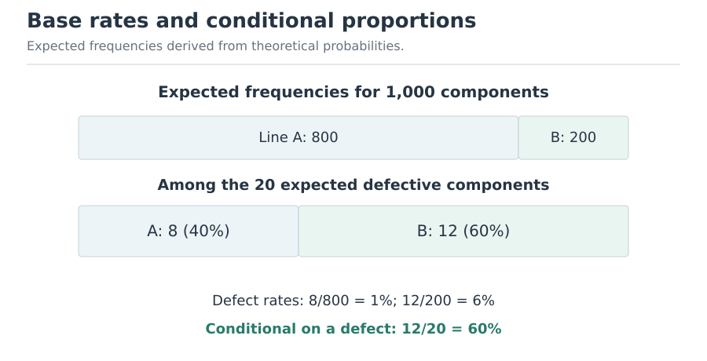

# M16-L1 – Probability theory: diagnostic test and revision {#L1}

**Course area:** M16 – Bridge to the Master’s programme

**Level:** Transition · Supplementary/bridging requirements

**Prerequisites:** M4, M2.

**Learning objective:** Determine conditional probabilities, moments and the uncertainty of a mean without a formula sheet.

## Diagnostic test: three different probability statements {#S1}

Complete the tasks in 20 minutes without software. Record the assumptions behind each result. A diagnostic test is not a university entrance examination. It identifies which foundations for the upcoming Master’s lessons are already in place.

A. Production line A supplies 80% of the components and has a defect probability of 0.01; line B supplies 20% with a defect probability of 0.06. A randomly selected component is defective. What is the probability that it came from B?

B. The number $X$ of alerts in an observation window is 0, 1 or 2 with probabilities 0.2, 0.5 and 0.3. Determine the expected value and variance.

C. 100 independent, identically distributed measurements each have expected value 12 and standard deviation 4. How variable is their mean? When is a normal approximation plausible?

## Solutions and common misconceptions {#S2}

*Figure: Basisraten und bedingte Anteile.*

In A, let $F$ denote a defect. Events A and B partition the sample space. By the product rule and the law of total probability,

$$P(F)=0.8\cdot0.01+0.2\cdot0.06=0.02.$$

$$P(B\mid F)=\frac{0.2\cdot0.06}{0.02}=0.6.$$

The smaller line therefore accounts for more than half of the defective components. It does not supply more than half of total production. The graphic distinguishes joint events from conditional proportions.

In B, $E[X]=0\cdot0.2+1\cdot0.5+2\cdot0.3=1.1$. With $E[X^2]=1.7$, this gives $\operatorname{Var}(X)=1.7-1.21=0.49$. The standard deviation is 0.7 alerts; variance has squared units.

In C, $E[\bar X]=12$ and $\operatorname{Var}(\bar X)=16/100=0.16$, so $\operatorname{SD}(\bar X)=0.4$. The central limit theorem for iid observations with finite positive variance justifies a normal approximation asymptotically. One hundred observations do not guarantee a good finite-sample approximation for highly skewed distributions or rare events; dependence changes the variance formula.

## Transfer to modelling {#S3}

A shared cause of defects leads to correlated measurements. In general, $\operatorname{Var}(\bar X)=n^{-2}\sum_{i=1}^n\sum_{j=1}^n\operatorname{Cov}(X_i,X_j)$. With equal variance $\sigma^2$ and the same admissible pairwise correlation $\rho$, this becomes $\sigma^2[1+(n-1)\rho]/n$. For $\rho=0.1$ in the example above, the variance is 1.744 rather than 0.16. More measurements are no substitute for controlling shared causes. This reasoning is needed in time series, hierarchical models and sampling.

## Assessment and revision {#S4}

Award one point per task for the calculation method and one for the result together with its assumptions. If you make mistakes in A, revise [M4-L1](M4-L1.md) and [M4-L6](M4-L6.md); for B, [M4-L2](M4-L2.md) and [M4-L4](M4-L4.md); for C, [M4-L7](M4-L7.md). Check your understanding with a new example: for equally sized lines with defect rates 0.02 and 0.08, $P(B\mid F)=0.8$. Without justification, a correct guess does not demonstrate mastery of the method.

## Sources and further reading {#S5}

- [OpenStax: Principles of Data Science, 3.4 Probability Theory](https://openstax.org/books/principles-data-science/pages/3-4-probability-theory) · conditional probability and Bayes
- [Durham University: Mathematical Finance Prerequisites, Ch. 1](https://maths.dur.ac.uk/users/clare.wallace/MF/Prerequisites/some-probability-revision.html) · moments and central limit theorem
